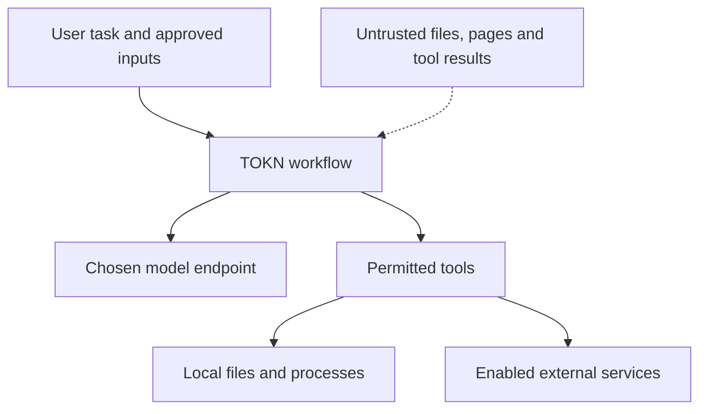

# Threat model for users

TOKN connects a model to tools that can read files, edit code and run commands.
The important question is not only **which model?**, but also **what can the
whole workflow read, send and change?**

This is a functional boundary map, not an implementation diagram.
Models and external tools can return untrusted content.

## Assets to protect

- Your code, prompts, documents and runtime records.
- Provider credentials, licences and other private configuration.
- Files and processes accessible to the account running tools.
- Your model budget and the integrity of results you rely on.
- The authenticity of the executable you install or update.

## Boundaries and practical controls

| Boundary | Risk | Practical control |
|---|---|---|
| Inputs to model | Sensitive text can be transmitted or retained by a provider | Use approved inputs and endpoints; review provider terms |
| Untrusted content to agent | Prompt injection can steer requests or tool use | Treat content as data, restrict tools and inspect approvals; do not assume perfect detection |
| Agent to host tools | Allowed actions can affect files, processes or networks | Use least privilege and a suitable sandbox when isolation is required |
| TOKN to MCP or plugins | External code or services can receive data and act with their own permissions | Inspect and trust integrations deliberately; disable unneeded connections |
| Worker or peer to reviewer | A reported success may be wrong or incomplete | Require tests and evidence; an authenticated message is not a correct answer |
| Download channel to machine | A corrupted or substituted binary could execute as you | Verify checksum and release signature before running it |

Workspace trust, tool restrictions and domain safeguards help constrain
execution; they are not an OS security boundary or a guarantee against
prompt injection. Default tool execution is not a general-purpose sandbox.
Even a permitted action can be inappropriate for your data or task.

## Offline does not mean isolated

A local model keeps inference at its configured endpoint. It does not by
itself disable browsers, search, MCP, subprocess networking or startup checks.
Stage dependencies, review [network settings](telemetry-and-network.md) and
use host-level controls where enforced isolation is required.

Keep logs, checkpoints and runtime state out of public repositories. Review
and sanitize records before sharing them; do not assume a log contains only
the final answer.

## Trial licensing is not a security control

Licensing controls feature entitlement, not what data is approved to leave
your machine or whether a model's recommendation is safe. Domain outputs
remain decision support. Human responsibility and appropriate review still
apply.

## Residual risk

No model-driven workflow can be assumed correct solely because a command
finished, a council agreed or an audit record was intact. Signatures depend
on the trusted publisher key; a compromised host or publisher can undermine
that trust. Permissions constrain allowed actions but do not validate their
meaning. Choose controls appropriate to the consequences of an error.

See [private reporting](../../SECURITY.md), [key verification](key-management.md)
and [the update process](update-process.md).
