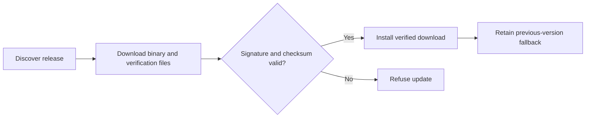

# Update process

`tokn update` downloads the matching platform binary from the public release
channel, verifies it and replaces the installed executable.
It requires network access and permission to update that file.



```text
Release -> download -> verify -> install
                         |
                         +-> verification failure: do not install
```

## Before updating

```sh
tokn version
tokn update --check
```

`--check` contacts the release channel but does not install a binary.
Review the release notes and any platform limitations.
To install:

```sh
tokn update
```

## What verification establishes

Official downloads include:

- The binary for your OS and architecture.
- `SHA256SUMS`, with its expected checksum.
- `SHA256SUMS.sig`, the release signature over that manifest.

The checksum detects bytes that do not match the manifest. The signature
authenticates the manifest against the release key trusted by the official
binary. A checksum alone is not an authenticity check.
Source/development builds can have different verification configuration;
do not treat a checksum-only notice as full verification.

**Do not bypass a failure.** A missing manifest, mismatched checksum or invalid
signature means stop and investigate. `--force` requests reinstallation;
it does not authorise an unverifiable download.

For a first installation or manual recovery, follow the complete
[checksum and signature instructions](../../README.md#2-verify-what-you-downloaded).
They do not require access to the private source repository.

## Recovery

```sh
tokn update --list
tokn update --rollback
```

`--list` shows the current version and retained fallback.
Rollback uses the immediately previous binary if available; it is not an
archive of every version. A failed download is not a reason to delete the
working installation or disable verification.

You can request a particular release with `tokn update --version <tag>`.
Keep the version and checksum when recording what you installed.
New shipments use new version tags; do not rely on a tag alone as a content
hash or assume GitHub has made a particular release immutable.

## Common failures

| Problem | Next step |
|---|---|
| No network or provider/proxy restriction | Keep the installed version and retry on an approved connection |
| Signature or checksum failure | Stop; report the tag, platform and error privately if tampering is suspected |
| No matching asset | Check the supported-platform list; do not substitute another architecture |
| Cannot replace the executable | Check file permissions and running processes; do not elevate blindly |
| No rollback target | Use a separately verified download rather than assuming a backup exists |

Verification establishes artifact integrity and authenticity relative to the
trusted key—not correctness, safety for every task or professional approval.
See [key verification](key-management.md) and [supply-chain evidence](supply-chain.md).
