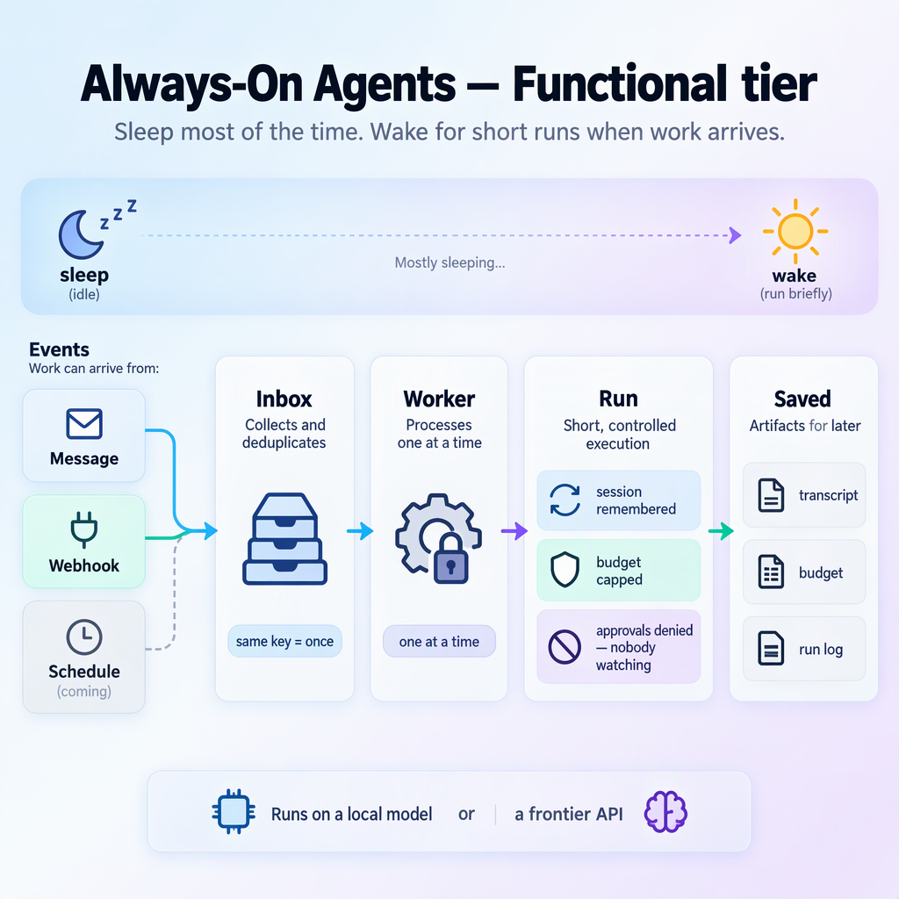
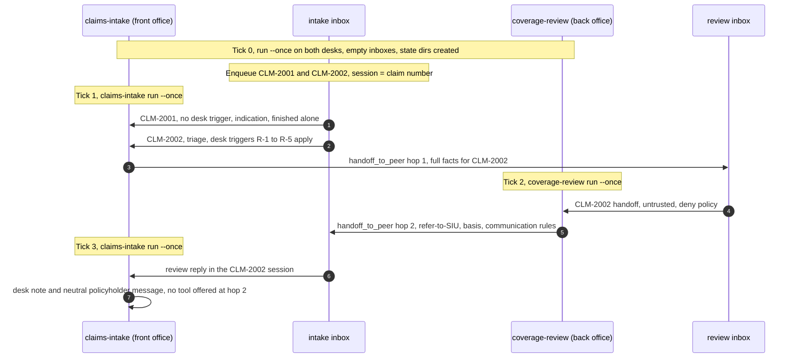
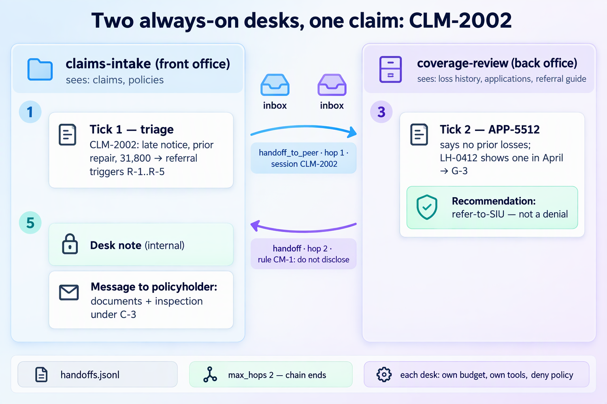

# Always-on agents: two desks, one claim, a handoff

Two TOKN always-on agents, each from its own instance with its own workspace,
state directory, budget and tool allowlist, work one insurance claim together.
The front office triages the claim and talks to the policyholder. The back
office sees the records the front office must not see, and recommends what to
do next. They pass the claim back and forth with `handoff_to_peer`. Everything
is synthetic.



*Events land in an inbox; one worker wakes, runs briefly with the session remembered, the budget capped and approvals denied, saves what happened, and sleeps again.*

> **Decision support only.** The agents write coverage *indications* and a
> recommendation for a human. They never decide a claim, a denial, a payment or
> misrepresentation. A licensed adjuster and a special investigations unit (SIU)
> decide. The policies, claims, people and history are invented.

**New to always-on?** Start with
[always-on-claims-intake](../always-on-claims-intake/README.md): one agent, one
inbox, sessions, unattended denials and budgets. This example assumes those
ideas and adds the one new thing, the `handoff:` block.

## Why two agents and not one

The same case could be run by one agent with every file in its workspace. That
would be simpler, and wrong for this desk, for four reasons:

- **Least privilege.** Intake never holds the confidential loss history or the
  application comparison. Review never holds the policyholder's conversation.
  Each agent's `tools` list and workspace reflect what its job needs.
- **Different budgets.** Intake triage is cheap: its runs used about 32,000 to
  70,000 tokens. Review's judgment is expensive: its referral run used about 206,000
  tokens on the same model. One shared budget would either starve review or
  let intake overspend. Each desk gets its own `per_run_tokens`.
- **Independent schedules.** Intake is for the front door and runs often. Review
  runs when there is work to do. Each has its own scheduler entry (step 9).
- **An audit trail.** Every handoff is recorded in the sender's
  `handoffs.jsonl`, with the session, the hop number and the size of the
  message. The chain is bounded: `max_hops: 2` means intake to review to intake,
  then the chain stops.

## What you will build



The claims are:

| Claim | Session | What happens | Why |
|---|---|---|---|
| CLM-2001 | `CLM-2001` | Intake triages and finishes alone, no referral | No desk trigger applies: 1-day notice, sudden hose failure, 6,200 estimate |
| CLM-2002 | `CLM-2002` | Intake refers. Review finds an application answer that conflicts with the shared loss history and recommends `refer-to-SIU`. Intake writes the desk note and a neutral policyholder message | Five desk triggers, a 31,800 estimate, and a prior similar loss that review can read and intake cannot |

The files each desk can read:

| Folder | Read by | What it is |
|---|---|---|
| `intake/` | claims-intake only (its workspace) | `AGENTS.md`, `desk-guide.md` (the five referral triggers), `claims/`, `policies/` |
| `review/` | coverage-review only (its workspace) | `AGENTS.md`, `guidelines/referral-guide.md`, `history/` (loss history and applications), `policies/` |

Intake cannot open `review/`, and review cannot open `intake/`: each agent's
repository root is its own desk folder, and TOKN's file tools refuse a path
that escapes it. The only way facts move between them is the handoff message.



*From this example's live run: intake refers CLM-2002 (hop 1); review, which alone holds the loss history, finds the application contradicted and hands back refer-to-SIU with communication rule CM-1 (hop 2); intake writes the internal desk note and a neutral message to the policyholder.*

## 1. Prerequisites

Check these first. `run.ps1` and `run.sh` check all of them at once and list
every missing item, so you do not fix them one at a time.

| Dependency | Why this example needs it | Windows | macOS | Linux |
|---|---|---|---|---|
| **tokn v0.3.100 or later** | Runs `tokn always-on`. Handoff is new in this version | Download `tokn_windows_amd64.exe` from [the releases page](https://github.com/bhakthan/tokn-dist/releases/latest), rename it `tokn.exe`, put it on `PATH` (or set `TOKN_BIN`) | Download `tokn_darwin_arm64` (Apple Silicon) or `tokn_darwin_amd64` (Intel) from [the releases page](https://github.com/bhakthan/tokn-dist/releases/latest), then `chmod +x` it and move it to `/usr/local/bin/tokn` | Download `tokn_linux_amd64` (or `tokn_linux_arm64`) from [the releases page](https://github.com/bhakthan/tokn-dist/releases/latest), `chmod +x` it, and move it to `/usr/local/bin/tokn` |
| **Python 3.10+** (for `check.py` only; standard library) | Grades the run | `winget install Python.Python.3.12` | `brew install python` | `sudo apt install python3` |
| **git** | Each desk folder is its own git repository, so the run can prove nothing was written into it | `winget install Git.Git` | `xcode-select --install` | `sudo apt install git` |
| **Azure CLI** (Azure path) | Signs you in with `az login`, so no key is stored anywhere | `winget install Microsoft.AzureCLI` | `brew install azure-cli` | `curl -sL https://aka.ms/InstallAzureCLIDeb \| sudo bash` |
| **An Azure OpenAI deployment** (Azure path) | The model. Any tool-calling chat deployment works. This example uses `gpt-6-astra` | Your Azure resource | Your Azure resource | Your Azure resource |
| **llama.cpp `llama-server`** (local path, not live-tested) | Serves a local model on loopback. See [the local variant](#local-variant-not-live-tested) | `winget install ggml.llamacpp` | `brew install llama.cpp` | Build it: [llama.cpp build guide](https://github.com/ggml-org/llama.cpp/blob/master/docs/build.md) |
| **PowerShell** (Windows) or **bash** with `curl` (macOS, Linux) | Runs `run.ps1` or `run.sh` | Windows PowerShell 5.1 is built in | Bash is built in | Bash is usually installed |

Use the Azure items or the llama.cpp item, not both. The live run used Azure.

Work from this folder for every command below:

```powershell
cd examples\always-on-claims-desks
```

## 2. Step 1: Configure Azure sign-in

Copy the template and keep it as a record of your values:

```powershell
Copy-Item .env.example .env
```

TOKN deliberately does **not** load the Azure endpoint or the
`AZURE_OPENAI_USE_DEFAULT_CREDENTIAL` switch from a repository `.env`. A repo
file must not be able to redirect your model traffic or change how it
authenticates. So export the values in your real shell:

```powershell
az login
$env:AZURE_OPENAI_ENDPOINT = "https://<your-resource>.openai.azure.com/openai/v1"
$env:AZURE_OPENAI_DEPLOYMENT = "gpt-6-astra"
$env:AZURE_OPENAI_USE_DEFAULT_CREDENTIAL = "true"
```

```bash
az login
export AZURE_OPENAI_ENDPOINT="https://<your-resource>.openai.azure.com/openai/v1"
export AZURE_OPENAI_DEPLOYMENT="gpt-6-astra"
export AZURE_OPENAI_USE_DEFAULT_CREDENTIAL="true"
```

- `AZURE_OPENAI_USE_DEFAULT_CREDENTIAL=true` makes TOKN use your `az login`
  identity instead of a key. The credential refreshes itself, which a
  long-running worker needs.
- `AZURE_OPENAI_DEPLOYMENT` must equal `model.model` in both configs.
- Nothing here is a secret. Do not paste a key into `.env`.

## 3. Step 2: The two desk configs

Each desk has its own config. Both are in `config/`, and the run scripts copy
each one to `<desk>/.nospace/always-on/<name>.yaml`, where TOKN looks for it.

`config/claims-intake.yaml`:

```yaml
name: claims-intake
mode: default
model:
  provider: azure-openai
  model: gpt-6-astra
  context_size: 128000
max_steps: 20
turn_timeout: 10m
tools: [read_file, list_directory, file_search, grep_search]
budget:
  per_run_tokens: 120000
  per_day_tokens: 800000
handoff:
  max_hops: 2
  max_per_run: 1
  peers:
    - name: coverage-review
      state_dir: "../state/coverage-review"
      description: "Coverage and SIU review desk: loss history, application answers, referral guidelines. Returns proceed / proceed-with-conditions / refer-to-SIU."
```

`config/coverage-review.yaml` differs in four places: `name`, `per_run_tokens: 240000`,
and the single peer, `claims-intake`, with `state_dir: "../state/claims-intake"`
and its own description.

What each field does:

- **`name`** must match the file name. It is also the agent name on every
  command, and the name a peer uses in `handoff.peers`.
- **`mode: default`** is the only mode always-on sessions support.
- **`model`**. `provider: azure-openai` and `model` (the deployment name) pick the
  endpoint, which comes from `AZURE_OPENAI_ENDPOINT` in your shell. `context_size`
  is the model window; `doctor` requires at least 8192.
- **`max_steps: 20`** caps model calls in one run. **`turn_timeout: 10m`** caps one
  model call.
- **`tools`** is the complete allowlist. Both desks list only the four read tools:
  `read_file`, `list_directory`, `file_search`, `grep_search`. Neither can write
  or run a shell command. Nothing else is offered to the model, and `handoff_to_peer`
  is not listed because TOKN adds it automatically when a peer exists and the hop
  limit has not been reached. Listing a tool does not approve it: unattended
  calls that need approval are denied either way.
- **`budget.per_run_tokens`** caps one run. The two desks differ on purpose.
  Intake runs used 31,720 to 70,251 tokens, so 120,000 leaves room. Review's
  referral run used 206,303 tokens, so review gets 240,000. A run never exceeds
  what is left of today's budget. It must not exceed `per_day_tokens`.
- **`budget.per_day_tokens: 800000`** caps each desk per local calendar day.
  When it is spent, events wait in the inbox until the day resets. The two desks
  have separate ledgers, so one desk cannot spend the other's allowance.
- **`handoff.max_hops: 2`** is the chain bound. Intake sends hop 1 to review; review's
  reply is hop 2 and reaches intake. At hop 2 the `handoff_to_peer` tool is no
  longer offered, so the chain ends.
- **`handoff.max_per_run: 1`** allows one handoff per run, and only once to each
  peer. That stops a model from fanning out a case.
- **`handoff.peers`** lists who this desk may hand work to. `name` is the peer's
  agent name. `state_dir` is the peer's `--state-dir`. A relative path resolves
  against **this desk's repository root**, so `../state/coverage-review` from
  `intake/` is `state/coverage-review` next to the desks. `description` is shown to
  the model in the tool description, so it knows what the peer is for.

Handoff is refused until the peer's state directory exists. Step 4 creates both.

## 4. Step 3: The two desks

Each desk folder is already in this example, with its fixtures copied from the
live harness. A desk must be a git repository, and it must ignore its generated
folders. `run.ps1` and `run.sh` do this for you. By hand:

```powershell
cd intake
git init
Set-Content -Path .gitignore -Value ".nospace/", ".tokn/"
cd ..\review
git init
Set-Content -Path .gitignore -Value ".nospace/", ".tokn/"
cd ..
```

The state directories are **not** inside either desk. They are `state\claims-intake`
and `state\coverage-review`, under this example folder. TOKN writes only its
generated `.nospace\` and `.tokn\` folders into a desk, and `check.py` verifies
that the fixture files are unchanged after every run.

## 5. Step 4: Start both desks once, then doctor both

Run tick 0 for both desks. Each inbox is empty, so no model is called. Each
`run --once` creates its state directory. Start review first, because intake's
doctor needs review's state directory to exist. The commands assume `tokn` is on
`PATH`; otherwise use the full path to the binary:

```powershell
tokn always-on run coverage-review --once --repo-root review --state-dir state\coverage-review --no-update-check --run-timeout 0
tokn always-on run claims-intake   --once --repo-root intake --state-dir state\claims-intake   --no-update-check --run-timeout 0
```

`--run-timeout 0` removes the 30-second global timeout, which a real drain
can exceed. `--repo-root` and `--state-dir` are explicit on every command, so no
command depends on your current directory.

Then preflight both desks:

```powershell
tokn always-on doctor claims-intake   --repo-root intake --state-dir state\claims-intake   --no-update-check
tokn always-on doctor coverage-review --repo-root review --state-dir state\coverage-review --no-update-check
```

`doctor` lists every problem at once. For each desk it checks the config, the
model endpoint, native tool calling, the context size, the state directory and,
with handoff configured, one finding per peer. The peer finding looks like this
in `doctor --json` (from the live run):

```json
{
  "check": "handoff peer coverage-review",
  "ok": true,
  "detail": "C:\\...\\state\\coverage-review"
}
```

If the peer's state directory is missing, the finding fails and says so. Start
the peer once with `run --once`, as above.

## 6. Step 5: Enqueue the two first notices

Both first notices go to the front office. Each session id is the claim number,
so the conversation for one claim continues across events. The dedupe key stops
a retried send from being processed twice.

```powershell
tokn always-on enqueue claims-intake --repo-root intake --state-dir state\claims-intake --no-update-check --session CLM-2001 --key fnol-CLM-2001 --body "@events\CLM-2001.md"
tokn always-on enqueue claims-intake --repo-root intake --state-dir state\claims-intake --no-update-check --session CLM-2002 --key fnol-CLM-2002 --body "@events\CLM-2002.md"
```

`--body @file` reads the file. `enqueue` returns at once; nothing runs yet. The
event body is the first notice's instruction: triage it, cite clause ids, give
an indication (not a decision), name the deductible, and say whether any desk
trigger applies.

## 7. Step 6: Tick 1, intake triages both claims

```powershell
tokn always-on run claims-intake --once --repo-root intake --state-dir state\claims-intake --no-update-check --run-timeout 0
```

Intake drains its inbox, then exits. What happens:

- **CLM-2001** is triaged and finished. No trigger applies, so intake writes its
  answer and no handoff is sent.
- **CLM-2002** is triaged, and at least one trigger applies (late notice, an
  earlier repair on the same line, loss within 60 days of inception, a 31,800
  estimate, and a growing stain). Intake calls `handoff_to_peer` for coverage-review
  with everything review needs, because review cannot read `intake\`. It tells the
  adjuster the claim is referred and pending.

Inspect what happened:

- `state\claims-intake\handoffs.jsonl`: one line, `"to": "coverage-review"`,
  `"session_id": "CLM-2002"`, `"hop": 1`.
- `state\claims-intake\sessions\CLM-2001.json` and `CLM-2002.json`: the conversation for each claim.
- `state\claims-intake\runs\<date>.jsonl`: one line per run, with `kind`,
  `disposition`, `tokens_used` and `status`.

## 8. Step 7: Tick 2, coverage-review decides

```powershell
tokn always-on run coverage-review --once --repo-root review --state-dir state\coverage-review --no-update-check --run-timeout 0
```

The handoff sits in review's inbox as kind `handoff`. TOKN frames it as a
colleague's request, not as operator instructions, and runs it under the deny
policy. Review reads the policy, the loss history, the application answers and
the referral guide. It replies with `handoff_to_peer` to intake, in the same
session. The reply has the recommendation, the basis (clause and history ids,
one per line), the documents it wants, and the communication rule for the
policyholder message (CM-1).

Inspect:

- `state\coverage-review\handoffs.jsonl`: `"from": "coverage-review"`,
  `"to": "claims-intake"`, `"hop": 2`.
- `state\coverage-review\runs\<date>.jsonl`: the handoff run and its token count.
  This run is the expensive one.

## 9. Step 8: Tick 3, intake writes the final answer

```powershell
tokn always-on run claims-intake --once --repo-root intake --state-dir state\claims-intake --no-update-check --run-timeout 0
```

Intake receives the reply as a handoff event in the **CLM-2002 session**, so it
continues the same conversation. It writes two sections: `## Desk note` for the
adjuster, and `## Message to policyholder` for the policyholder. The policyholder
message follows review's communication rules. It requests documents and an
inspection and says no decision has been made. It does not mention the SIU
referral, a misrepresentation concern or any history. Intake receives hop 2, so
the handoff tool is not offered, and the chain ends.

Inspect `state\claims-intake\sessions\CLM-2002.json`. It holds two runs: the
first notice, and the review reply that continues the same conversation.

## 10. Step 9: Schedule the desks for real

Nothing here runs by itself. You run `run --once` on a schedule. TOKN installs
no service: use Task Scheduler, systemd timers or launchd, one entry per desk.
Intake runs often (every 2 minutes here); review runs less often (every 10
minutes). Use the same flags as above, and keep the Azure variables in the
environment the scheduler uses.

**Windows (Task Scheduler).** Set the Azure variables for your user, so the
task inherits them, then register one task per desk:

```powershell
setx AZURE_OPENAI_ENDPOINT "https://<your-resource>.openai.azure.com/openai/v1"
setx AZURE_OPENAI_DEPLOYMENT "gpt-6-astra"
setx AZURE_OPENAI_USE_DEFAULT_CREDENTIAL "true"

$root = "C:\path\to\tokn-dist\examples\always-on-claims-desks"
$exe  = "C:\path\to\tokn.exe"
foreach ($d in @(@{ Name = "claims-intake"; Folder = "intake"; Every = 2 }, @{ Name = "coverage-review"; Folder = "review"; Every = 10 })) {
    $taskArgs = "always-on run $($d.Name) --once --run-timeout 0 --no-update-check --repo-root `"$root\$($d.Folder)`" --state-dir `"$root\state\$($d.Name)`""
    $action = New-ScheduledTaskAction -Execute $exe -Argument $taskArgs -WorkingDirectory "$root\$($d.Folder)"
    $trigger = New-ScheduledTaskTrigger -Once -At (Get-Date) -RepetitionInterval (New-TimeSpan -Minutes $d.Every) -RepetitionDuration (New-TimeSpan -Days 365)
    Register-ScheduledTask -TaskName "TOKN $($d.Name)" -Action $action -Trigger $trigger
}
```

`setx` writes the variables for future sessions; open a new terminal to see them.

**Linux (systemd user timers).** One service and one timer per desk. Put the
Azure variables in `~/.config/tokn-claims.env` as plain `NAME=value` lines, then:

```ini
# ~/.config/systemd/user/tokn-claims-intake.service
[Unit]
Description=TOKN claims-intake tick

[Service]
Type=oneshot
WorkingDirectory=/path/to/always-on-claims-desks/intake
EnvironmentFile=%h/.config/tokn-claims.env
ExecStart=/usr/local/bin/tokn always-on run claims-intake --once --run-timeout 0 --no-update-check --repo-root /path/to/always-on-claims-desks/intake --state-dir /path/to/always-on-claims-desks/state/claims-intake
```

```ini
# ~/.config/systemd/user/tokn-claims-intake.timer
[Timer]
OnBootSec=2min
OnUnitActiveSec=2min

[Install]
WantedBy=timers.target
```

Enable with `systemctl --user enable --now tokn-claims-intake.timer`. Make a
`tokn-claims-review` pair the same way with `coverage-review`, `review/`, and
`OnUnitActiveSec=10min`.

**macOS (launchd).** Use a LaunchAgent per desk with `ProgramArguments` set to
the same `tokn always-on run ... --once` command, `WorkingDirectory` set to the
desk folder, `EnvironmentVariables` holding the Azure variables, and
`StartInterval` set to `120` for intake and `600` for review. Load each with
`launchctl load`.

A tick that starts while the previous one is still running exits with
`another worker holds the lock`, and the next tick tries again. That is expected.

## 11. Step 10: Grade the run

```powershell
python check.py
```

`check.py` reads the two state directories, the two desk folders and
`check-manifest.json`. It makes no model calls and changes nothing. It runs
checks D2 to D15 from the live harness. D1, that every tick exits 0, is not
repeated here, because `run.ps1` and `run.sh` stop at the first failing tick.

## One-command path

`run.ps1` (Windows) and `run.sh` (macOS, Linux) do steps 1 to 10 in order:

```powershell
.\run.ps1
```

```bash
bash run.sh
```

The script runs the preflight first and lists every missing item, then sets up
both desks, runs tick 0, doctors both, enqueues the two notices, runs ticks 1 to
3, records status and runs `check.py`. It exits nonzero if a tick, a doctor or
the check fails. Both scripts make model calls.

**Re-running.** A second run stops with "state\ is left over from an earlier
run" until you clear it. Use `.\run.ps1 -Fresh` (or `bash run.sh --fresh`). That
deletes `state\` and the generated `.nospace\` and `.tokn\` folders, then runs
again. Nothing else is deleted, and the desk fixtures are never changed.

## What you should see

These numbers are from one live run on `gpt-6-astra` (Azure OpenAI). They will
differ on your run. The shape should not: every check passes, and the chain
stops at two hops.

**Checks.** The live harness passed 15 of 15, counting D1 (every tick exits 0).
`check.py` grades D2 to D15, so the table below has 14 rows, all PASS in that run:

| Check | Result | Detail |
|---|---|---|
| D2 CLM-2001 finished by intake alone (no referral) | PASS | intake handoffs for CLM-2001: 0 |
| D3 CLM-2002 referred to coverage-review exactly once (hop 1) | PASS | `[["coverage-review", "CLM-2002", 1]]` |
| D4 the referral carries the facts review cannot read | PASS | 2,269 chars |
| D5 review ran the handoff in session CLM-2002, untrusted kind, unattended | PASS | `handoff`, `completed` |
| D6 review used records only it can see (LH-0412 / APP-5512) | PASS | cited |
| D7 review recommends refer-to-SIU (G-3) and replies to intake (hop 2) | PASS | `[["claims-intake", "CLM-2002", 2]]` |
| D8 the reply continues intake's CLM-2002 session (2 runs) | PASS | runs = 2 |
| D9 intake writes the desk note and the policyholder message | PASS | desk note 2,768 chars, message 897 chars |
| D10 the policyholder message discloses no SIU referral or history (CM-1) | PASS | clean |
| D11 the chain stops at max_hops (no third handoff) | PASS | intake = 1, review = 1 |
| D12 both workspaces unchanged | PASS | unchanged |
| D13 no runtime state inside either repository | PASS | none |
| D14 each agent's own budget ledger is charged | PASS | intake 156,764 = runs; review 206,303 = runs |
| D15 no run halted (each desk's budget fits its job) | PASS | all completed |

**Runs (one row per run):**

| Desk | Session | Kind | Status | Steps | Tokens | Budget per run |
|---|---|---|---|---|---|---|
| claims-intake | CLM-2001 | user_message | completed | 4 | 54,793 | 120,000 |
| claims-intake | CLM-2002 | user_message | completed | 5 | 70,251 | 120,000 |
| coverage-review | CLM-2002 | handoff (hop 1) | completed | 4 | 206,303 | 240,000 |
| claims-intake | CLM-2002 | handoff (hop 2, the reply) | completed | 1 | 31,720 | 120,000 |

Intake's ledger is 156,764 tokens, which equals its three runs. Review's ledger
is 206,303. Review used 86% of its per-run cap, so it has little headroom.

**Excerpts.** The intake-to-review referral is internal. Its opening:

> Review claim CLM-2002, policy HO-DEMO-5, insured Household 12 (synthetic). FNOL reported 2026-11-09; approximate loss date 2026-10-12 ('around then'). Water damage downstairs living-room ceiling and upstairs bathroom floor. …

The review-to-intake reply carries the recommendation and the basis:

> Recommendation: refer-to-SIU
>
> APP-5512 — Signed 2026-09-20; Q7 answers No to property losses at this address in the preceding five years.
>
> LH-0412 — Records a 2026-04-03 water loss involving the upstairs bathroom supply line and ceiling below; repair completion was not verified. This does not prove the policyholder's stated repair did not occur.

Review's basis cites the clause and history ids, and it states that no coverage
denial, misrepresentation finding or condition breach was determined. The
policyholder message, which intake writes from review's communication rules,
says only this:

> We are continuing to review your water-damage claim, CLM-2002. No coverage decision has been made. Under the policy's cooperation condition C-3, please provide a dated timeline of when you first noticed the stain, …

It does not mention the SIU referral or the loss history. Check D10 grades that
with a regular expression, not by eye.

## Local variant (not live-tested)

You can point both desks at one local `llama-server` instead of Azure. This
variant is **not live-tested**, and `run.ps1` and `run.sh` do not support it: their
preflight checks Azure. To try it, change each config by hand: `model.provider`
becomes `gguf`, `model.base_url` becomes `http://127.0.0.1:8080/v1`, and
`model.context_size` must match the server's `-c` value (at least 8192). Then
run each `tokn always-on` command yourself, adding `--airgap` to `doctor` and
`run`, which refuses any non-loopback endpoint. Run one desk at a time, because
both share the server. The [local-llamacpp](../local-llamacpp/README.md) example
covers the model setup. Results will differ: a small model may not meet the
thresholds, which is itself a useful test.

## Troubleshooting

- **Preflight: `AZURE_OPENAI_DEPLOYMENT is 'x' but both configs use 'gpt-6-astra'`.**
  Set the variable to `gpt-6-astra`, or change `model.model` in both configs to
  your deployment name. Both must match.
- **A handoff is refused: `peer coverage-review has no state directory yet`.**
  Start that desk once: `tokn always-on run coverage-review --once ...` (step 4).
  The doctor finding `handoff peer ...` fails until it exists.
- **Intake's run ends with no handoff at hop 2.** That is correct. The reply is
  hop 2 and the chain stops there by design, so the tool is not offered. To
  allow a third hop, raise `max_hops`, but that is a loop, and this example
  deliberately does not.
- **`handoff limit for this run reached (max_per_run 1)`.** The model tried a
  second handoff in one run. The first one stands. This is the limit working.
- **A run stops on the budget.** Check `tokn always-on status <desk> --json`
  for `budget_remaining_today_tokens`. If one run hit `per_run_tokens`, raise that
  desk's `per_run_tokens`, not the other desk's. It must stay at or below
  `per_day_tokens`. If the day's budget is spent, events wait in the inbox until
  the next local day.
- **`another worker holds the lock (pid N, ...)`.** A tick overlapped the
  previous one for the same desk. The lock is per state directory and is not
  waited on, so the new tick exits. Lengthen the interval or wait. The events
  stay in the inbox.
- **An authentication error during a run.** Run `az login` again, and make sure
  `AZURE_OPENAI_USE_DEFAULT_CREDENTIAL=true` is in the environment the scheduler
  uses (step 9).
- **D12 reports a file changed right after a fresh clone.** `check.py` compares
  bytes with `check-manifest.json`. Line-ending conversion on checkout (for
  example `core.autocrlf` on Windows) changes the bytes. Check that the fixture
  files match the committed versions, and do not edit them.
- **`tokn version` reports 0.3.0 for a development build.** The run scripts
  require v0.3.100 or later, and a development build without the release version
  stamp fails that check. Use the release binary, or set `TOKN_BIN` to a build
  that reports its version.

## Clean up

Clear the run, then remove the generated folders:

```powershell
.\run.ps1 -Fresh
Remove-Item -Recurse -Force state, intake\.git, review\.git, intake\.nospace, review\.nospace, intake\.tokn, review\.tokn, intake\.gitignore, review\.gitignore -ErrorAction SilentlyContinue
```

```bash
rm -rf state intake/.git review/.git intake/.nospace review/.nospace intake/.tokn review/.tokn intake/.gitignore review/.gitignore
```

Also remove any scheduled tasks, timers or LaunchAgents you created in step 9.
TOKN installs no service, so nothing else is left behind.

## Files

| File | What it is |
|---|---|
| `intake/` | The front-office workspace (copied from the live harness fixtures) |
| `review/` | The back-office workspace (copied from the live harness fixtures) |
| `config/claims-intake.yaml` | Intake's config: 120,000 per run, one peer |
| `config/coverage-review.yaml` | Review's config: 240,000 per run, one peer |
| `events/CLM-2001.md`, `events/CLM-2002.md` | The two first notices, the event bodies |
| `run.ps1`, `run.sh` | Preflight, setup, tick 0, doctor, enqueue, ticks 1 to 3, status, check |
| `check.py` | Stdlib-only grader for checks D2 to D15. Also reads a `--raw` harness folder |
| `check-manifest.json` | SHA-256 of every fixture file, the baseline for D12 |
| `.env.example` | Placeholders for the Azure values. Do not commit `.env` |
| `.gitignore` | Keeps `state/`, the generated `.nospace/` and `.git/` folders, and `.env` out of git |
| `always-on-agents-functional.webp` | The concept image above |
| `always-on-handoff-applied.webp` | The two-desk handoff for CLM-2002 |

## Related

- [always-on-claims-intake](../always-on-claims-intake/README.md): the single-agent
  example this one builds on.
- [local-llamacpp](../local-llamacpp/README.md): the local model setup used by the
  local variant.
- `tokn always-on --help` and `tokn always-on run --help`: the command reference.
