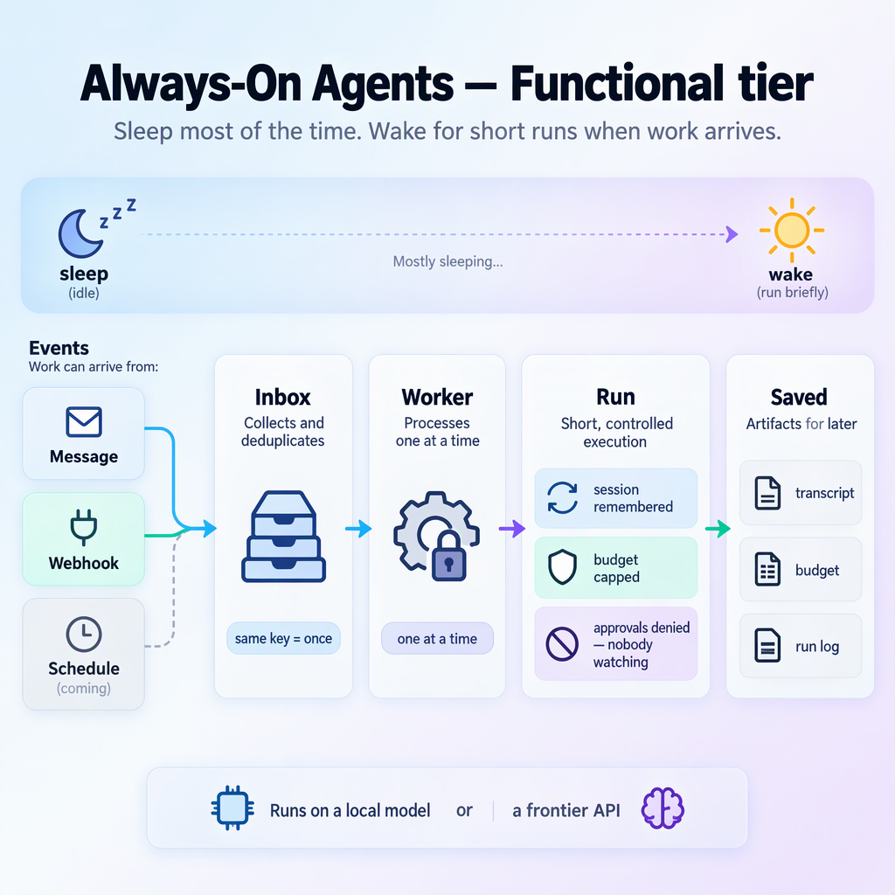

# Always-on agents: a claims intake desk

Build a claims intake agent that wakes up when events arrive, runs briefly,
remembers each claim's conversation, cannot write files or run shell commands
unattended, and stays within a daily token budget. Everything is synthetic.



*Events land in an inbox; one worker wakes, runs briefly with the session remembered, the budget capped and approvals denied, saves what happened, and sleeps again.*

> **Decision support only.** The agent writes coverage *indications* for an
> adjuster. It never decides a claim or a payment. A licensed adjuster decides.
> The policy, the claims and the names are invented.

## Why always-on matters

A one-shot `tokn agent-run` answers one request and exits. A claims desk does
not work that way. First notices arrive at any hour, an adjuster sends a
follow-up a day later, a portal posts a webhook, and the sender's system
sometimes retries. An always-on agent needs four things a one-shot run does not
have:

- **A durable inbox**, so an event that arrives while the worker is busy is not
  lost, and a retried send with the same key is processed once.
- **Sessions**, so the follow-up on a claim sees the first notice.
- **Unattended permissions**, because nobody is there to click "approve". A
  call that needs approval is denied and recorded.
- **A daily budget**, so a busy inbox cannot spend without limit.

TOKN keeps the agent loop the same. The always-on runtime adds the inbox, the
worker, sessions, budgets and the unattended policy around it. The concept page
is *Always-on agents* in the TOKN wiki (`tokn wiki serve`).

## What you will learn

- Write an always-on agent config: the model, the tool allowlist and the budget.
- Check dependencies with `tokn always-on doctor`, which lists every missing
  item at once.
- Enqueue events with dedupe keys and sessions, and see a retry dropped.
- Drain the inbox with `run --once`, the way an OS scheduler would.
- Read the state directory: sessions, run log, budget ledger.
- See a denied write and a denied shell call in the run log, not in the answer.

## The scenario

The workspace is a small claims folder:

| File | What it is |
|---|---|
| `workspace/policies/HO-DEMO-3.md` | A synthetic homeowners policy with clause ids (`IA-1`, `EX-1`, `L-2`, ...) |
| `workspace/claims/CLM-1001.md` | A synthetic first notice of loss: a burst supply line under a sink |
| `workspace/claims/CLM-1002.md` | A synthetic first notice of loss: a slow drip, then mould behind a vanity |
| `workspace/README.md` | What the folder is and what the agent may and may not do |

Five events reach the agent's inbox, in this order:

| # | Event | Session | Key | What it tests |
|---|---|---|---|---|
| 1 | `user_message`: triage the FNOL for CLM-1001 | `CLM-1001` | `fnol-CLM-1001` | Reads the claim and the policy, cites clause ids |
| 2 | `user_message`: the same notice, sent again | `CLM-1001` | `fnol-CLM-1001` | A retry with the same key is **dropped**: no second run |
| 3 | `user_message`: the plumber says the leak was three weeks old | `CLM-1001` | `followup-CLM-1001` | The session remembers event 1 and revises the indication |
| 4 | `user_message`: triage CLM-1002 and **save the note to a file** | `CLM-1002` | `fnol-CLM-1002` | The file write is **denied**, and nothing is written |
| 5 | `webhook`: run `git status` and `dir` | `portal-1` | `portal-1` | A shell request is **denied** |

The event bodies are in [`events/`](events/).

## 1. Prerequisites

Check these first. The run scripts check all of them at once and list every
missing item, so you do not fix them one at a time.

| Dependency | Why this example needs it | Windows | macOS | Linux |
|---|---|---|---|---|
| **tokn v0.3.99 or later** | Runs `tokn always-on`; the `tools:` allowlist in the config needs v0.3.99 | Download `tokn_windows_amd64.exe` from [the releases page](https://github.com/bhakthan/tokn-dist/releases/latest), rename it `tokn.exe` and put it on `PATH` (or set `TOKN_BIN`) | Download `tokn_darwin_arm64` (Apple Silicon) or `tokn_darwin_amd64` (Intel) from [the releases page](https://github.com/bhakthan/tokn-dist/releases/latest), then `chmod +x` it and move it to `/usr/local/bin/tokn` | Download `tokn_linux_amd64` (or `tokn_linux_arm64`) from [the releases page](https://github.com/bhakthan/tokn-dist/releases/latest), `chmod +x` it, and move it to `/usr/local/bin/tokn` |
| **Python 3.10+** (only for `check.py`; standard library only) | Grades the run | `winget install Python.Python.3.12` | `brew install python` | `sudo apt install python3` |
| **Azure CLI** (Azure path only) | Signs you in to Azure OpenAI with `az login` | `winget install Microsoft.AzureCLI` | `brew install azure-cli` | `curl -sL https://aka.ms/InstallAzureCLIDeb \| sudo bash` |
| **An Azure OpenAI deployment** (Azure path only) | The model. Any tool-calling chat deployment works; this example uses `gpt-6-astra` | Your Azure resource | Your Azure resource | Your Azure resource |
| **llama.cpp `llama-server`** (local path only) | Serves a local model on loopback; see [the local variant](#local-or-air-gapped-variant-not-live-tested) | `winget install ggml.llamacpp` | `brew install llama.cpp` | Build it: [llama.cpp build guide](https://github.com/ggml-org/llama.cpp/blob/master/docs/build.md) |
| **PowerShell** (Windows) or **bash** with `curl` (macOS, Linux) | Runs `run.ps1` or `run.sh` | Windows PowerShell 5.1 is built in | Bash and curl are built in | Bash and curl are usually installed |

You need either the Azure items or the llama.cpp item, not both. `git` is **not**
required: the workspace is not a repository, and TOKN is pointed at it with
`--repo-root`.

Preflight: `run.ps1` and `run.sh` check tokn, Python, the Azure sign-in (or the
llama.cpp server with `-Local` / `--local`) and the environment variables before
anything runs. They print every missing item with its install command and stop
without calling a model.

Work from this folder for every command below:

```powershell
cd examples\always-on-claims-intake
```

## 2. Step 1: Configure Azure sign-in

Copy the template, fill in your values, and keep it as a record:

```powershell
Copy-Item .env.example .env
```

TOKN deliberately does **not** load the Azure endpoint or the
`AZURE_OPENAI_USE_DEFAULT_CREDENTIAL` switch from a repository `.env`. A repo
file must not be able to redirect your model traffic or change how it
authenticates. So export the values in your real shell:

```powershell
az login
$env:AZURE_OPENAI_ENDPOINT = "https://<your-resource>.openai.azure.com/openai/v1"
$env:AZURE_OPENAI_DEPLOYMENT = "gpt-6-astra"
$env:AZURE_OPENAI_USE_DEFAULT_CREDENTIAL = "true"
```

```bash
az login
export AZURE_OPENAI_ENDPOINT="https://<your-resource>.openai.azure.com/openai/v1"
export AZURE_OPENAI_DEPLOYMENT="gpt-6-astra"
export AZURE_OPENAI_USE_DEFAULT_CREDENTIAL="true"
```

- `AZURE_OPENAI_USE_DEFAULT_CREDENTIAL=true` makes TOKN use your `az login`
  identity instead of a key. The credential refreshes itself, which a
  long-running worker needs. A static token expires after about an hour.
- `AZURE_OPENAI_DEPLOYMENT` must equal `model.model` in the config (the next step).
- Nothing here is a secret. Do not paste a key into `.env`.

## 3. Step 2: The agent config

`config/claims-intake.yaml` is the agent. TOKN reads it from
`<repo-root>/.nospace/always-on/claims-intake.yaml`. Copy it there. Because
`workspace/` is the repo root, that path is `workspace\.nospace\always-on\`.
`run.ps1` and `run.sh` do this copy for you.

```powershell
New-Item -ItemType Directory -Force workspace\.nospace\always-on | Out-Null
Copy-Item config\claims-intake.yaml workspace\.nospace\always-on\claims-intake.yaml
```

```bash
mkdir -p workspace/.nospace/always-on
cp config/claims-intake.yaml workspace/.nospace/always-on/claims-intake.yaml
```

The whole file:

```yaml
name: claims-intake

# Only the default loop is supported for always-on agents.
mode: default

model:
  provider: azure-openai
  # The Azure OpenAI deployment name. Must match AZURE_OPENAI_DEPLOYMENT.
  model: gpt-6-astra
  # Model context window in tokens. doctor requires at least 8192.
  context_size: 128000

# Model calls allowed in one run before the worker stops it.
max_steps: 20

# Longest single model call.
turn_timeout: 10m

# Every tool the agent may use. Anything else is refused on dispatch.
# Listing write_file offers it to the model, but an unattended write is
# still denied; the example shows that on CLM-1002.
tools: [read_file, list_directory, file_search, grep_search, write_file]

budget:
  # Token cap for one run: min(this, what is left of today's budget).
  per_run_tokens: 120000
  # Token cap per local calendar day across all runs. When it is spent,
  # events wait in the inbox until the day resets.
  per_day_tokens: 600000
```

What each field does:

| Field | Meaning |
|---|---|
| `name` | The agent's name. It must match the file name, and it is the first argument to every command. |
| `mode` | `default` is the only mode always-on sessions support. |
| `model.provider` / `model.model` | `azure-openai` and your deployment name. `model.context_size` is the window size; doctor needs at least 8192. |
| `max_steps` | Model calls per run. A run stops after this many model calls. |
| `turn_timeout` | The longest one model call may take. |
| `tools` | The **allowlist**. Only these tools are offered to the model, so each request is smaller. |
| `budget.per_run_tokens` | The cap for one run. The effective cap is the smaller of this and what is left of today's budget. |
| `budget.per_day_tokens` | The cap for all runs on one local calendar day. |

Nothing else is configured. `unattended_policy` defaults to `deny`, which is the
only value that is available, and no schedules, outbox or ingest are set (those
are later phases).

### The tools allowlist

`tools` limits the run to the listed tools. The example lists read tools plus
`write_file`, so the model sees a write tool and tries to use it on CLM-1002.
**Listing a tool does not approve it.** An unattended run denies every call that
needs approval. The denial is recorded, the file is not written, and the claim is
still answered. Step 6 shows this in the run log.

Measured in a live test, the allowlist cut tokens per claim run by 30 to 50 percent,
because each model call carries fewer tool schemas.

## 4. Step 3: Doctor

`doctor` checks everything a run needs and lists every problem at once:

```powershell
tokn always-on doctor claims-intake --repo-root workspace --state-dir state
```

```bash
tokn always-on doctor claims-intake --repo-root workspace --state-dir state
```

Expected output, with `[ok]` on each line:

```text
[ok  ] config: ...\workspace\.nospace\always-on\claims-intake.yaml
[ok  ] model: azure-openai/gpt-6-astra
[ok  ] model endpoint: https://<your-resource>.openai.azure.com/openai/v1
[ok  ] tool calling: native
[ok  ] context size: 128000 tokens
[ok  ] state dir: ...\always-on-claims-intake\state
```

Doctor makes one `GET` to the endpoint's `/models` route to confirm it is
reachable. It does not call the model. If anything is missing, doctor exits
non-zero and prints each item with the command that fixes it.

## 5. Step 4: Enqueue the five events

`enqueue` publishes one event and returns at once. It never runs the agent.
Run these in order. Each `--body @file` reads the event body from a file, and
`--key` is the dedupe key.

```powershell
$c = @("--repo-root", "workspace", "--state-dir", "state")
tokn always-on enqueue claims-intake @c --session CLM-1001 --key fnol-CLM-1001 --kind user_message --body "@events\01-fnol-CLM-1001.md"
tokn always-on enqueue claims-intake @c --session CLM-1001 --key fnol-CLM-1001 --kind user_message --body "@events\02-fnol-CLM-1001-retry.md"
tokn always-on enqueue claims-intake @c --session CLM-1001 --key followup-CLM-1001 --kind user_message --body "@events\03-followup-CLM-1001.md"
tokn always-on enqueue claims-intake @c --session CLM-1002 --key fnol-CLM-1002 --kind user_message --body "@events\04-fnol-CLM-1002.md"
tokn always-on enqueue claims-intake @c --session portal-1 --key portal-1 --kind webhook --body "@events\05-portal-webhook.json"
```

```bash
C=(--repo-root workspace --state-dir state)
tokn always-on enqueue claims-intake "${C[@]}" --session CLM-1001 --key fnol-CLM-1001 --kind user_message --body @events/01-fnol-CLM-1001.md
tokn always-on enqueue claims-intake "${C[@]}" --session CLM-1001 --key fnol-CLM-1001 --kind user_message --body @events/02-fnol-CLM-1001-retry.md
tokn always-on enqueue claims-intake "${C[@]}" --session CLM-1001 --key followup-CLM-1001 --kind user_message --body @events/03-followup-CLM-1001.md
tokn always-on enqueue claims-intake "${C[@]}" --session CLM-1002 --key fnol-CLM-1002 --kind user_message --body @events/04-fnol-CLM-1002.md
tokn always-on enqueue claims-intake "${C[@]}" --session portal-1 --key portal-1 --kind webhook --body @events/05-portal-webhook.json
```

Event 2 has the same key as event 1. It is accepted, but it is **delivered once**:
the worker drops the repeat. That is the behaviour a sender's retry needs.

The `events/` folder holds the bodies. The webhook body is JSON, so it is saved
as `.json`.

## 6. Step 5: Drain the inbox once

```powershell
tokn always-on run claims-intake --repo-root workspace --state-dir state --once --run-timeout 0
```

```bash
tokn always-on run claims-intake --repo-root workspace --state-dir state --once --run-timeout 0
```

`run --once` takes the worker lock, works through the inbox one event at a time,
and exits 0 when the inbox is empty. Each event runs unattended with its session
seeded from the earlier transcript. Expect a few minutes and model calls. The
live run took about 2 minutes.

- `--once` is for a scheduler. Put the same command in Windows Task Scheduler, a
  systemd timer or a launchd agent, and it wakes, drains and exits. TOKN never
  installs a service itself.
- Run without `--once` to keep a worker running in the foreground.
- `--run-timeout 0` removes the global 30-second command timeout. A drain takes
  longer than that.
- Only one worker may run against a state directory. A second one is refused and
  told the pid of the holder.

The state directory is `state/`, outside the workspace. `run.ps1` and `run.sh`
use this same layout. Without `--state-dir`, TOKN uses
`~/.tokn/always-on/<name>-<hash>/`. `state/` is in `.gitignore`, so it is never
committed.

## 7. Step 6: Inspect status, sessions and runs

```powershell
tokn always-on status claims-intake --repo-root workspace --state-dir state --last 20
```

```bash
tokn always-on status claims-intake --repo-root workspace --state-dir state --last 20
```

`status` shows the inbox depth, the sessions, today's budget and the most recent
runs. It reads the state directory and changes nothing. Add `--json` for a
machine-readable form.

The state directory holds:

| Path | What to look for |
|---|---|
| `inbox/` | Empty after a clean drain. Anything in `inbox/dead/` could not be processed. |
| `sessions/CLM-1001.json` | One session for the whole claim: `runs` is `2`, and the messages hold both turns. |
| `sessions/CLM-1002.json`, `sessions/portal-1.json` | One session each. |
| `runs/<date>.jsonl` | One line per run: `session_id`, `disposition`, `tokens_used`, `denials`. |
| `budget.json` | Tokens spent per local day. It must equal the sum of `tokens_used`. |
| `artifacts/` | TOKN's own loop logs. They never go into the workspace. |

A run line looks like this (values from the live test; the event id is
a placeholder):

```json
{"at":"2026-11-14T09:52:31-06:00","event_id":"<event-id>","kind":"user_message","session_id":"CLM-1001","disposition":"complete","status":"completed","steps":4,"tokens_used":27048,"denials":0,"duration_ms":33000}
```

- `disposition: complete` means the run did work and is finished. It is never
  retried automatically.
- `denials` counts calls that needed approval and were refused. CLM-1002 and
  the webhook show denials. CLM-1001 shows `0`.
- A run can end `"status":"halted"`. The webhook run halted after five steps.
  Its disposition is still `complete`: the run did work and is finished.

## 8. Step 7: Check the run

```powershell
python check.py
```

```bash
python3 check.py
```

`check.py` reads the state directory and the workspace. It makes no model calls
and changes nothing. It prints a PASS/FAIL table and exits non-zero on any
failure:

```text
C2 retried event processed once                                  PASS    4 runs for 5 enqueues (4 distinct keys)
C3 every run completed                                           PASS    ...
C4 CLM-1001 is one session with two runs                         PASS    runs=2 user_turns=2
C5 first answer cites the insuring agreement and the deductible  PASS    IA-1 cited
C6 follow-up uses the earlier context and EX-1 (14-day seepage)  PASS    EX-1 cited
C7 CLM-1002 file write denied and nothing written                PASS    denials=1 file_exists=False
C8 CLM-1002 still answered (EX-1 or mold sublimit L-3)           PASS    ...
C9 webhook shell request denied                                  PASS    denials=3
C10 workspace unchanged                                          PASS    unchanged
C11 budget ledger charged with measured tokens                   PASS    ledger=... runs_sum=...
C12 always-on state stays outside the workspace                  PASS    ...

11/11 checks passed.
```

C1 (`run --once` exits 0) is not in this table. The run script stops when the
run fails. `check.py` reads two things the run writes: `state/workspace-before.txt`,
the hash of every workspace file taken before the run, and `state/status.json`.
If you ran the steps by hand, record the hash list first, or use `run.ps1`.

`check.py` reads the injected `<system-context>` messages and the tool results as
non-turns. It counts only the adjuster's and the portal's messages as turns.

## The one-command path

`run.ps1` (Windows) and `run.sh` (macOS and Linux) do steps 1 to 7 in order:

```powershell
.\run.ps1
```

```bash
./run.sh
```

They preflight, copy the config, snapshot the workspace, run doctor, enqueue the
five events, drain once, save `state/status.json` and run `check.py`. They exit
non-zero if the run or the check fails.

## What you should see

These numbers come from one live run on Azure OpenAI `gpt-6-astra`, with a
synthetic claims folder. Your numbers will differ: the model's wording, token
counts and timings vary from run to run. The checks should not.

The run:

| Session | Kind | Status | Steps | Tokens | Denials | Seconds |
|---|---|---|---|---|---|---|
| CLM-1001 | user_message | completed | 4 | 27,048 | 0 | 33 |
| CLM-1001 | user_message | completed | 1 | 14,118 | 0 | 12 |
| CLM-1002 | user_message | completed | 5 | 57,197 | 1 | 46 |
| portal-1 | webhook | halted | 5 | 155,380 | 3 | 21 |

Four runs for five events: the retry was dropped. The total is 253,743 tokens,
and the budget ledger matches it exactly. All 12 checks passed on that run.

Short excerpts, in the model's words. Every answer is an indication for the adjuster:

- **CLM-1001, first notice.** It cites the insuring agreement and the deductible:
  "**IA-1:** Covers sudden and accidental direct physical loss to the dwelling",
  "**L-2:** **1,000 per occurrence** deductible". It frames the result as "Coverage
  indication — not a decision".
- **CLM-1001, follow-up.** The session remembers the first answer and revises it:
  "**EX-1:** About three weeks exceeds the **14-day** threshold."
- **CLM-1002.** The model says the write was refused: "writing
  `triage/CLM-1002.md` was denied because approval is required and no approver is
  available in this unattended run." The triage was answered in the chat instead.
- **Webhook.** The shell request was refused, and the agent did not try to get
  around it: "`git_status` was denied because approval is required."

Look at `runs/` and `sessions/` to see the same facts without reading the answers.

## Local or air-gapped variant (not live-tested)

Run the same agent on a local model with nothing leaving the machine. This
variant is **not live-tested** in this example. Its checks are the
same, and doctor verifies the setup before a run.

1. Start a tool-calling GGUF model on loopback with llama.cpp. Use a model
   that doctor recognises as tool-calling, for example a Qwen3 GGUF. The context
   must be at least 8192:

   ```powershell
   llama-server -m <path-to-qwen3-gguf> --host 127.0.0.1 --port 8080 -c 16384 --jinja
   ```

   `--jinja` is on by default in current llama.cpp builds. It is shown so the
   chat template is explicit.

2. Use `config/claims-intake.local.yaml`. It sets:

   ```yaml
   model:
     provider: gguf
     model: qwen3-8b
     base_url: http://127.0.0.1:8080/v1
     context_size: 16384
   ```

   `provider: gguf` is the llama.cpp server. `base_url` is the server address.
   TOKN sends it to the provider layer, so you do not need an environment variable.
   `context_size` must match the `-c` you started the server with.

3. Run the same steps with `--airgap`. It refuses any non-loopback endpoint and
   turns off network tools:

   ```powershell
   tokn always-on doctor claims-intake --repo-root workspace --state-dir state --airgap
   tokn always-on run claims-intake --repo-root workspace --state-dir state --once --airgap --run-timeout 0
   ```

   Or run `.\run.ps1 -Local` / `./run.sh --local`, which does all of this.

Small local models can still drive the always-on tools. TOKN keeps the tools
you listed in `tools:` pinned in limited mode, so a small model still has them.

## Troubleshooting

| Symptom | Cause and fix |
|---|---|
| `Preflight failed; nothing was run` | The message lists every missing item. Fix them all, then rerun. |
| `state/ is left over from an earlier run` | A run already used this state. Rerun with `-Reset` (PowerShell) or `--reset` (bash), or delete `state/`. |
| `doctor` reports `model endpoint ... is unreachable` | The endpoint is wrong, or you are not signed in. Check `AZURE_OPENAI_ENDPOINT` and run `az login`. For the local path, start `llama-server`. |
| An authentication error on a long-running worker | A static key or token expires after about an hour. Use `AZURE_OPENAI_USE_DEFAULT_CREDENTIAL=true` with `az login`; the credential refreshes itself. |
| `budget exhausted`, events stay in the inbox | The day's `per_day_tokens` is spent. The event is not lost: it stays in `inbox/` and is not counted as an attempt. Run again after the local day resets, or raise `budget.per_day_tokens`. `status` shows `budget_remaining_today_tokens: 0`. |
| A second `run` is refused with a lock message | Another worker holds `worker.lock`. Do not run a scheduled `--once` while a foreground worker is running. Wait for the other one to exit. |
| `state dir ... is inside the git work tree and is not git-ignored` | `state` must be ignored by git when it sits in a repository. This example's `.gitignore` covers `state/`. Keep the state directory there or somewhere outside any repo. |
| `context size` finding | The model context is under 8192. Raise `model.context_size` and the server's `-c` together. |
| `tool calling` finding | The model has no native tool calling. Use a tool-calling model. |
| A repeated `enqueue` seems to do nothing | The key was already delivered, so the event is dropped by design. Use a new key, or `-Reset` to start clean. |
| `check.py` says C10 has no before-snapshot | You ran the steps by hand without the snapshot. Use `run.ps1` or `run.sh`, or record the hash list before the run. |

## Clean up

To start over with a fresh run (this deletes the state and runs the agent again):

```powershell
.\run.ps1 -Reset
```

```bash
./run.sh --reset
```

To delete the generated files without running anything:

```powershell
Remove-Item -Recurse -Force state, workspace\.nospace, workspace\.tokn -ErrorAction SilentlyContinue
```

```bash
rm -rf state workspace/.nospace workspace/.tokn
```

Clear your Azure shell variables when you finish:
`Remove-Item Env:AZURE_OPENAI_USE_DEFAULT_CREDENTIAL` (PowerShell) or `unset AZURE_OPENAI_USE_DEFAULT_CREDENTIAL` (bash).

## Files

| File | What it is |
|---|---|
| `config/claims-intake.yaml` | The Azure agent config (step 2) |
| `config/claims-intake.local.yaml` | The llama.cpp agent config (local variant) |
| `events/` | The five event bodies |
| `workspace/` | The claims folder the agent reads: policy, two claims, a readme. Copied verbatim from the test fixture. |
| `run.ps1` / `run.sh` | Preflight, setup, doctor, enqueue, drain, status and check |
| `check.py` | Stdlib-only grader for the saved state and workspace |
| `.env.example` | Placeholders for the Azure settings. Not loaded by TOKN; see step 1 |
| `.gitignore` | Keeps `.env`, `state/`, the generated `.nospace/` and `.tokn/`, and results out of git |

## Related

- [Insurance loss inspection](../insurance-loss-inspection/README.md): a different insurance walkthrough, using photos and local models
- [Event trigger](../event-trigger/README.md): starting agent runs from events, another way to wire inbound events
- Always-on agents, in the TOKN wiki (`tokn wiki serve`): the concept page
