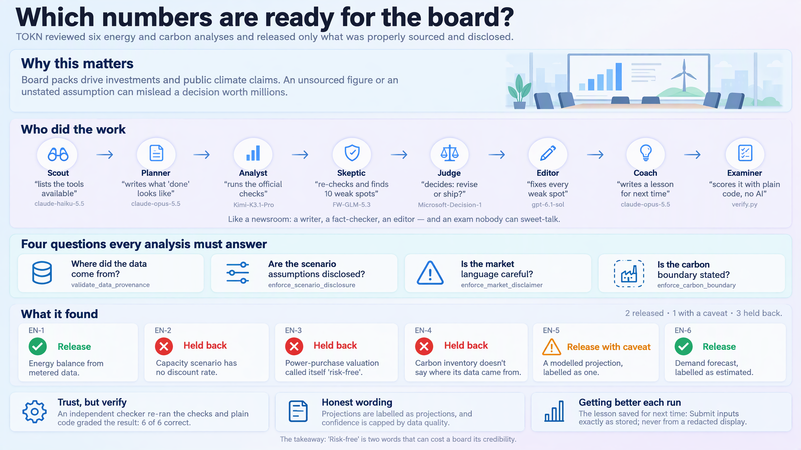

# Release gate for a quarterly energy & carbon board pack

*Domain mode `energy` · five models and a decision model, one brief, graded by a deterministic checker. Verdict: **PASS**.*


*The run at a glance: why it matters, who did the work, what each item was checked for, and what it found. Click to open the full 4K image.*

## The problem

Run six analyst-prepared energy and carbon analyses exactly as submitted and decide which can be released to the board, with what caveats.

Inputs (synthetic, in [`inputs/`](inputs/)): [`analysis_requests.json`](inputs/analysis_requests.json), [`release_policy.json`](inputs/release_policy.json).

### What a careless run gets wrong

Each item hides a trap. The models never saw this list; the grader did.

| Item | Trap | Correct status |
|---|---|---|
| `EN-3` | Looks complete — disclaimer acknowledged, discount rate 7%, tenor and volume given — but the assumptions string contains 'risk-free', a blocked market term, so the market-disclaimer gate refuses it. | `blocked` |
| `EN-2` | Boundary item: discount_rate is present but exactly 0.0, which the scenario-disclosure gate treats as missing; horizon and assumptions are fine. | `blocked` |
| `EN-4` | The GHG scope and market-based accounting method are both declared, so the carbon-boundary gate passes, but there is no provenance or data_layer field — the provenance gate (which also matches en_carbon_inventory) refuses it. | `blocked` |
| `EN-5` | Passes every gate, but the tool returns provenance 'modeled' at confidence 0.45, so it ships only as a caveated projection. | `release_with_caveat` |
| `EN-6` | The tool output carries no provenance field (a non-blocking warning fires), but the payload declares 'estimated', so it is a plain release. | `release` |

## The relay, step by step

| # | Stage | Model | Time | Tools called (domain tools in bold) | Wrote |
|---|---|---|---|---|---|
| 0 | Discover | claude-haiku-5-5 | 29.7s | `read_file`×5, `list_directory`×1, `write_file`×1 | [`CAPABILITIES.md`](run/CAPABILITIES.md) |
| 1 | Plan | claude-opus-5-5 | 78.1s | `read_file`×6, `grep_search`×4, `list_directory`×1, `write_file`×1 | [`PLAN.md`](run/PLAN.md) |
| 2 | Execute | Kimi-K3.1-Pro | 617.6s | **`en_energy_balance`**×1, **`en_capacity_expansion`**×1, **`en_ppa_valuate`**×1, **`en_carbon_inventory`**×1, **`en_scenario_model`**×1, **`en_demand_forecast`**×1 | [`RESULT.md`](run/RESULT.md) |
| 3 | Critique | FW-GLM-5.3 | 569.0s | **`en_ppa_valuate`**×2, **`en_energy_balance`**×1, **`en_capacity_expansion`**×1, **`en_carbon_inventory`**×1, **`en_scenario_model`**×1, **`en_demand_forecast`**×1 | [`CRITIQUE.md`](run/CRITIQUE.md) |
| 4 | Decide | Microsoft-Decision-1 | 0.9s | — | [`decision.json`](run/decision.json) |
| 5 | Revise | gpt-6.1-sol | 261.1s | **`en_energy_balance`**×1, **`en_capacity_expansion`**×1, **`en_ppa_valuate`**×1, **`en_carbon_inventory`**×1, **`en_scenario_model`**×1, **`en_demand_forecast`**×1 | [`result.json`](run/result.json) |
| 6 | Reflect | claude-opus-5-5 | 67.1s | `read_file`×7, `list_directory`×1, `write_file`×1 | [`REFLECTION.md`](run/REFLECTION.md) |

> **Disclosure:** the execute stage exited with code 1 (a TOKN guard stopped the agent, such as the token-budget breaker). Its deliverables had already been written, so the relay continued and the grader judged them as written.

### 1. Discover — claude-haiku-5.5

Before anyone plans, TOKN describes itself. The discover stage reads `tokn introspect` and the tools actually registered for this mode, so the plan is built on what exists, not on what a model assumes exists.

From [`CAPABILITIES.md`](run/CAPABILITIES.md):

```text
# CAPABILITIES — Scout stage, energy relay (Q3 2026 board pack)

Scope: capability map only. No item (EN-1 to EN-6) has been assessed or submitted.

Evidence base: `BRIEF.md`; `inputs/analysis_requests.json`; `inputs/release_policy.json`;
`tokn-self/introspect-slice.json`; `tokn-self/DOMAIN-README.md`; my own tool list.
Tool-list check: the 22 `en_` tools named in the README (balance/planning 4, demand 4,
market 4, carbon 4, economics 3, scenario 3) all appear in my tool list. Names agree.

## Domain tools that apply

| Tool (exact name) | Item(s) | Input fields the payload carries (from `inputs/analysis_requests.json`) |
|---|---|---|
| `en_energy_balance` | EN-1 | carriers, period, provenance (metered), meter_id (AMI-HQ-0042), region. Required fields are all present. |
| `en_capacity_expansion` | EN-2 | horizon_years (20), discount_rate (0.0), assumptions. Optional fields candidates, carbon_price and demand_growth are absent. Candidates are only named inside the assumptions text. No provenance field is supplied. |
| `en_ppa_valuate` | EN-3 | contract_type (virtual/cfd), tenor_years (12), strike_price (41.5), discount_rate (0.07), assumptions, disclaimer_acknowledged (true). Required fields are all present. volume_mwh (180000) is present as well. |
```

### 2. Plan — claude-opus-5.5

The planner turns the brief into acceptance criteria and names the tool call that decides each item.

From [`PLAN.md`](run/PLAN.md):

```text
# PLAN — Q3 2026 energy & carbon board pack release gate (energy relay, Planner stage)

Sources read: `BRIEF.md`, `inputs/analysis_requests.json`, `inputs/release_policy.json`,
`CAPABILITIES.md`, `tokn-self/DOMAIN-README.md`, `tokn-self/introspect-slice.json`.

> **Correction to CAPABILITIES.md (Gap 2), checked directly in the files on disk:** the "ri[REDACTED]free" text is
> a display artefact of the Scout's viewer. `grep` of the raw files shows:
> - `inputs/analysis_requests.json` line 40 (EN-3 `assumptions`): `"Cash flows discounted at the risk-free rate plus a 350 bp project spread; ..."`
> - `tokn-self/DOMAIN-README.md` line 58: blocked certainty terms include `"guaranteed return", "risk-free", "will definitely", etc.`
>
> So the EN-3 payload **does** contain a README-listed blocked term (`risk-free`). This is a prediction about the gate, not a finding. The Executor must still submit the payload and record what the tool actually returns.

## Objective
Submit each of the six analysis payloads (EN-1…EN-6) to its named `en_` tool exactly once and unchanged, then give each item exactly one status (`release`, `release_with_caveat`, `blocked`) by the mechanical rules below, with evidence quoted from the tool output.

## Steps
```

### 3. Execute — Kimi-K3.1-Pro

The executor runs the domain tools and records every item with the tool output that justifies it. Its first answer is kept unchanged as [`result.v1.json`](run/result.v1.json); the excerpt below is the final write-up, after the critique and revision.

From [`RESULT.md`](run/RESULT.md):

```text
# Q3 2026 energy & carbon board pack — final release assessment

## Evidence and method

Full revision was applied after reading the brief, both inputs, plan, previous deliverables, critique, and typed decision. Every payload was independently re-submitted unchanged once in the reviser stage. Python raw-file JSON loading and character-codepoint inspection resolved EN-3's viewer redaction to `risk-free`. No blocked payload was corrected to obtain completion.

The observed refusals and provenance layers support the statuses below. Release denotes eligibility under the release rules, not the existence of underlying analytical figures. Complete reviser responses and machine-checkable payloads are preserved in `result.json`.

## Item outcomes

| Item | Tool | Status | Basis |
|---|---|---|---|
| EN-1 | `en_energy_balance` | **release** | Completed; metered payload with meter ID |
| EN-2 | `en_capacity_expansion` | **blocked** | Observed scenario-disclosure refusal |
| EN-3 | `en_ppa_valuate` | **blocked** | Observed market blocked-term refusal |
| EN-4 | `en_carbon_inventory` | **blocked** | Observed data-provenance refusal |
| EN-5 | `en_scenario_model` | **release_with_caveat** | Completed modeled projection |
```

### 4. Critique — FW-GLM-5.3

A different model family re-runs the tools and files 10 finding(s). It is told to find faults, not to agree.

From [`CRITIQUE.md`](run/CRITIQUE.md):

```text
# CRITIQUE — Q3 2026 energy & carbon board pack release gate (Critic stage, energy relay)

Evidence base: `BRIEF.md`, `inputs/analysis_requests.json`, `inputs/release_policy.json`, `PLAN.md`, `CAPABILITIES.md`, `tokn-self/DOMAIN-README.md`, `tokn-self/introspect-slice.json`, `result.json`, `RESULT.md`, plus independent re-runs of all six domain tools and two further tool runs (`en_ppa_valuate` with the file's true payload text; `en_carbon_report` as a cross-check).

## Method

I re-ran every tool whose output decides a status, with each payload copied from `inputs/analysis_requests.json`:

| Item | Tool | Re-run result |
|---|---|---|
| EN-1 | `en_energy_balance` | completes; `balance_computed`, provenance=metered, period=2026-Q3, region=site-north, unit=MWh, no confidence — identical to the recorded response |
| EN-2 | `en_capacity_expansion` | REFUSED: "[ENERGY] energy: scenario missing discount rate — projections are meaningless without a stated discount rate" — identical to the recorded reason |
| EN-3 | `en_ppa_valuate` | see C1 — the recorded response does not correspond to the payload in `inputs/` |
| EN-4 | `en_carbon_inventory` | REFUSED: "[ENERGY] energy: data provenance layer required — declare whether data is metered, estimated, modeled, or assumed" — identical to the recorded reason |
| EN-5 | `en_scenario_model` | completes; `scenario_modeled`, provenance=modeled, confidence=0.45 — identical to the recorded response |
| EN-6 | `en_demand_forecast` | completes; `forecast_generated`, carrier=electricity, sector=commercial, unit=MWh — identical to the recorded response |
```

### 5. Decide — Microsoft-Decision-1

A decision model answers small, typed questions about the critique. It returns a probability, not prose, and the probability routes the next stage.

| Question | P(yes) |
|---|---|
| Do the critique findings show at least one item whose status is wrong or unsupported, so the result must be revised before it is used? | 0.269 |
| Does any analysis that a domain gate refused (EN-2, EN-3 or EN-4) still receive release or release_with_caveat, or get re-run with an edited payload to make it pass? | 0.622 |
| Is the EN-5 scenario result presented as a measured or certain outcome rather than a modeled projection with its confidence stated? | 0.008 |

Routing: **full-revision**.

### 6. Revise — gpt-6.1-sol

The reviser must answer every finding, not only the ones it agrees with: 10 fixed.

| Finding | Severity | Issue (abridged) | Response |
|---|---|---|---|
| C1 | blocking | The EN-3 payload was not submitted as given, and every status-bearing field recorded for it is contradicted by the tool's actual behavior on the real payload. Raw-text search of the repository shows `inputs/analysis_requ… | **fixed**: Independent exact-input en_ppa_valuate rerun refused with the preserved blocked-term message. EN-3 now records R1, call_completed=false, gate_fired=true, quoted… |
| C2 | major | Consequence of C1 in the deliverable text: `result.json` (lines 30, 33, 91) and `RESULT.md` (line 54) write the blocked term and the submitted assumptions as `ri[REDACTED]free`. That string is a viewer redaction artefact… | **fixed**: Raw-file JSON loading and character-codepoint inspection verified risk-free, resolving the viewer artefact. Exact assumptions now appear in payload_submitted an… |
| C3 | major | PLAN acceptance criterion 1 requires a top-level `board_pack` field set to "Q3 2026 energy & carbon board pack". A repository-wide search for `board_pack` finds it only in PLAN.md line 143 and `inputs/analysis_requests.j… | **fixed**: Verified board_pack was missing; added the exact input value. |
| C4 | major | PLAN acceptance criterion 2 requires each of the six items to carry a `payload_submitted` field "identical to the input payload; must diff-equal inputs/analysis_requests.json". A search for `payload_submitted` matches on… | **fixed**: Verified all payload_submitted fields were missing; added all six exact input objects. Re-ran every item once unchanged in this stage; read-only equality valida… |
| C5 | major | PLAN acceptance criterion 3 requires a `summary` object with counts per status "taken by counting the `items` array. No other derived numbers." `result.json` has no `summary` key (a search for "summary" returns no match … | **fixed**: Verified summary was missing; added per-status counts and validate them by Counter over revised items, not as analytical figures. |

All findings: [`CRITIQUE.md`](run/CRITIQUE.md). All responses: [`result.json`](run/result.json).

### 7. Reflect — claude-opus-5.5

TOKN reflects on TOKN a second time. Opus reads the full trace, names which tools mattered, and proposes a `/teach` rule so the next run starts smarter.

From [`REFLECTION.md`](run/REFLECTION.md):

```text
## Proposed /teach rule

`/teach Before any en_ tool call, load the payload from inputs/ with a raw-byte JSON read (never from displayed or redacted text), submit it unchanged, and record its sha256 next to the raw response; if displayed text contains "[REDACTED]", stop and resolve it from the raw bytes first.`
```

## The answer

| Item | First answer (Kimi) | Final (after critique) | Expected |
|---|---|---|---|
| `EN-1` | `release` | `release` ✅ | `release` |
| `EN-2` | `blocked` | `blocked` ✅ | `blocked` |
| `EN-3` | `blocked` | `blocked` ✅ | `blocked` |
| `EN-4` | `blocked` | `blocked` ✅ | `blocked` |
| `EN-5` | `release_with_caveat` | `release_with_caveat` ✅ | `release_with_caveat` |
| `EN-6` | `release` | `release` ✅ | `release` |

Accuracy: first answer 1.0, final 1.0.

## How it was graded

No model grades itself. [`verify.py`](../../verify.py) checks the files and the run log:

| Check | Result | Detail |
|---|---|---|
| artifacts_present | ✅ | all 10 present |
| result_json_valid | ✅ | final result.json parses with an items list |
| status_vocabulary | ✅ | all statuses in vocabulary |
| all_items_assessed | ✅ | 6 items |
| ground_truth | ✅ | final 1.0 (v1 1.0) |
| must_mention | ✅ | all present |
| forbidden_phrases | ✅ | none found |
| critique_has_findings | ✅ | 10 findings |
| every_finding_answered | ✅ | 10 responses |
| decision_answered | ✅ | 3/3 typed answers |
| execute_used_domain_tools | ✅ | used ['en_capacity_expansion', 'en_carbon_inventory', 'en_demand_forecast', 'en_energy_balance', 'en_ppa_valuate', 'en_scenario_model'] of expected ['en_capacity_expansion', 'en_carbon_inventory', 'en_demand_forecast', 'en_energy_balance', 'en_ppa_valuate', 'en_scenario_model'] |
| critic_reran_tools | ✅ | critic used ['en_capacity_expansion', 'en_carbon_inventory', 'en_demand_forecast', 'en_energy_balance', 'en_ppa_valuate', 'en_scenario_model'] |
| reflection_grounded | ✅ | names traced tools ['en_capacity_expansion', 'en_carbon_inventory', 'en_ppa_valuate', 'en_scenario_model']; has /teach rule: True |

## Reflect on it yourself

- Which trap would you have missed? Find the tool output in [`RESULT.md`](run/RESULT.md) that catches it.
- Did the first answer already get every item right? If so, what did the critique add? If not, which finding fixed it?
- Read the `/teach` rule above. Is it specific enough to change how the next run uses the domain tools?

## Run it yourself

```powershell
python run.py --domains energy --out C:\tmp\relay-energy
```

Set up `.env` and the prerequisites first; see the [relay README](../../README.md).

For a single-model version of this run that costs far less, see [energy-board-pack](../../../energy-board-pack/README.md).
