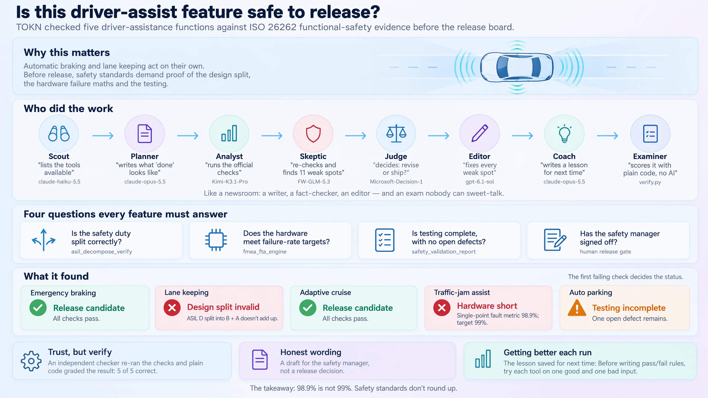

# Functional-safety release gate for five ADAS functions

*Domain mode `mobility` · five models and a decision model, one brief, graded by a deterministic checker. Verdict: **PASS**.*


*The run at a glance: why it matters, who did the work, what each item was checked for, and what it found. Click to open the full 4K image.*

## The problem

Gate five ADAS functions on ASIL decomposition validity, FMEDA hardware metrics and V&V completion before the release board.

Inputs (synthetic, in [`inputs/`](inputs/)): [`asil_decomposition.json`](inputs/asil_decomposition.json), [`fmeda_metrics.json`](inputs/fmeda_metrics.json), [`vv_evidence.json`](inputs/vv_evidence.json).

### What a careless run gets wrong

Each item hides a trap. The models never saw this list; the grader did.

| Item | Trap | Correct status |
|---|---|---|
| `FN-LKA` | Has the best metrics in the batch (PMHF 3.1 FIT, SPFM 99.7%, 99.1% requirement coverage, no open defects) but decomposes ASIL D into B + A, which sums to 3 < 4; asil_decompose_verify returns an error. | `decomposition_invalid` |
| `FN-ACC` | Sits exactly on three thresholds: C -> B + A sums to exactly 3 (valid), SPFM 99.0% equals the target (pass), and requirement coverage 95.0% equals the V&V threshold (accepted). A careless run calls it marginal or failing. | `release_candidate` |
| `FN-TJA` | SPFM 98.9% is 0.1 points below the 99% target; everything else passes, so rounding or eyeballing gives release_candidate. | `hw_metrics_fail` |
| `FN-APA` | Strong hardware metrics and 98% coverage, but one open defect makes safety_validation_report refuse V&V completion. | `vv_incomplete` |

## The relay, step by step

| # | Stage | Model | Time | Tools called (domain tools in bold) | Wrote |
|---|---|---|---|---|---|
| 0 | Discover | claude-haiku-5.5 | 30.6s | `read_file`×6, `list_directory`×1, `write_file`×1 | [`CAPABILITIES.md`](run/CAPABILITIES.md) |
| 1 | Plan | claude-opus-5.5 | 105.8s | `read_file`×7, `list_directory`×1, `write_file`×1, `git_status`×1, `file_search`×1 | [`PLAN.md`](run/PLAN.md) |
| 2 | Execute | Kimi-K3.1-Pro | 534.3s | **`safety_validation_report`**×6, **`asil_decompose_verify`**×5, **`fmea_fta_engine`**×5, `read_file`×8, `run_command`×4, `list_directory`×2 | [`RESULT.md`](run/RESULT.md) |
| 3 | Critique | FW-GLM-5.3 | 721.0s | **`asil_decompose_verify`**×5, **`fmea_fta_engine`**×5, **`safety_validation_report`**×5, `read_file`×12, `grep_search`×7, `list_directory`×4 | [`CRITIQUE.md`](run/CRITIQUE.md) |
| 4 | Decide | Microsoft-Decision-1 | 1.2s | — | [`decision.json`](run/decision.json) |
| 5 | Revise | gpt-6.1-sol | 349.4s | **`asil_decompose_verify`**×10, **`fmea_fta_engine`**×10, **`safety_validation_report`**×5, `read_file`×24, `git_status`×2, `run_command`×2 | [`result.json`](run/result.json) |
| 6 | Reflect | claude-opus-5.5 | 88.6s | `read_file`×9, `list_directory`×1, `grep_search`×1, `write_file`×1, `edit_file`×1 | [`REFLECTION.md`](run/REFLECTION.md) |

### 1. Discover — claude-haiku-5.5

Before anyone plans, TOKN describes itself. The discover stage reads `tokn introspect` and the tools actually registered for this mode, so the plan is built on what exists, not on what a model assumes exists.

From [`CAPABILITIES.md`](run/CAPABILITIES.md):

```text
# CAPABILITIES.md — Scout report, mobility functional-safety release gate

Scope: items FN-AEB, FN-LKA, FN-ACC, FN-TJA, FN-APA. This file records what tools and rules exist. It does not assess any item.

Sources read: `BRIEF.md`; `inputs/asil_decomposition.json`, `inputs/fmeda_metrics.json`, `inputs/vv_evidence.json`; `tokn-self/introspect-slice.json`; `tokn-self/DOMAIN-README.md`; my live tool list.

Consistency check: the README says "22 LLM tools". My live mobility tool list has 22 tools, so the count matches. The README gives no tool names, so the category split (4/4/5/2/2/1/2/2) could not be verified.

## Domain tools that apply

| tool (exact name) | item(s) / input file it applies to | input fields needed and present in `inputs/` |
|---|---|---|
| `asil_decompose_verify` | all five items; `inputs/asil_decomposition.json` | `safety_req`, `architecture`, `independence_claims` (non-empty), `decomposed_requirements`, `parent_asil`, `child_asils`. All present in every record. |
| `fmea_fta_engine` | all five items; `inputs/fmeda_metrics.json` | Brief rule 3 supplies `architecture`, `failure_rates`, `asil_req`, `pmhf_fit`, `spfm_pct`, `lfm_pct`. Present. `lifetime_h` is NOT present (see Gaps). `failure_modes` is NOT present (see Gaps). |
| `safety_validation_report` | all five items; `inputs/vv_evidence.json` | `all_evidence`, `safety_case`, `vv_report_path`, `requirements_covered_pct`, `defects_open`. All present. Not `requirements` or `defects` arrays. |

Not applicable to this brief (listed so the answer does not use them by mistake): `hara_automate` (no HARA input), `safety_case_build` (brief does not ask for a GSN case), `tara_engine`, `sotif_odd_coverage`, `sensor_coverage_analyze`, `hd_map_validate`, `fusion_evaluate`, `digital_twin_validate`, `carla_scenario_execute`, `openscenario_catalog_build`, `v2x_*`, `v2i_infrastructure_simulate`, `ev_charging_plan`, `battery_electrochemical_model`, `utm_simulate`, `evtol_safety_assess`, `regulatory_compliance_track`, `sumo_traffic_generate`. None has inputs in `inputs/`.

## Gates and rules that will constrain the answer
```

### 2. Plan — claude-opus-5.5

The planner turns the brief into acceptance criteria and names the tool call that decides each item.

From [`PLAN.md`](run/PLAN.md):

```text
# PLAN.md — Functional-safety release gate for FN-AEB, FN-LKA, FN-ACC, FN-TJA, FN-APA

Planner stage. This plan has NOT been executed. Every input value below is copied verbatim from `inputs/`. Every threshold comes either from `BRIEF.md` or from a value that a tool returns at execution time. No number is taken from memory of ISO 26262.

Sources read by the Planner: `BRIEF.md`, `CAPABILITIES.md`, `inputs/asil_decomposition.json`, `inputs/fmeda_metrics.json`, `inputs/vv_evidence.json`, `tokn-self/DOMAIN-README.md`, `tokn-self/introspect-slice.json`.

## Objective

For each of the five ADAS functions (FN-AEB, FN-LKA, FN-ACC, FN-TJA, FN-APA), run `asil_decompose_verify`, then `fmea_fta_engine`, then `safety_validation_report` on the records in `inputs/`. Assign exactly one status per function (`release_candidate`, `decomposition_invalid`, `hw_metrics_fail`, `vv_incomplete`) using the first-failing-check rule. Record the results in `result.json` and `RESULT.md` as a DRAFT for safety-manager review.

## Steps

### General execution rules (apply to every step)

- **G1. Field mapping.** Pass the tool's documented input fields, with values copied **verbatim** from the matching input record. Do not normalise, re-letter, round or annotate any value. For example, `child_asils` stays `["B","C"]`, not `["B(D)","C(D)"]`. The `function` key is not a tool field. Do not pass it. Use it only to label the result. This is how the Planner reads the brief's "exactly as given": the values are exact and the fields are the tool's own.
- **G2. Run all three checks for every item.** Call all three tools for all five items, even after an earlier check has failed, so the evidence record is complete. Results from later checks are recorded as `informational` and never change the status (Brief rule 1).
- **G3. Capture the raw output.** Save each tool's full raw output (or full error text) under `evidence.<tool>.<function>` in `result.json`. Any number in `RESULT.md` must trace to one of these outputs or to `inputs/` (Brief rule 5).
- **G4. No retries that change inputs.** If a call errors, you may retry it once with identical input, to rule out a transient error. If it errors again, record the error. Do not change any input to make a call pass.
- **G5. No other tools.** Do not use `hara_automate`, `safety_case_build`, `tara_engine` or any other tool that `CAPABILITIES.md` lists as not applicable.
```

### 3. Execute — Kimi-K3.1-Pro

The executor runs the domain tools and records every item with the tool output that justifies it. Its first answer is kept unchanged as [`result.v1.json`](run/result.v1.json); the excerpt below is the final write-up, after the critique and revision.

From [`RESULT.md`](run/RESULT.md):

```text
# DRAFT functional-safety gate report — mobility

**DRAFT — pending safety-manager review. Not a release authorization or proof of safety.**

## Evidence and method

Independent reruns of the applicable domain tools reproduced every original item status. The deciding order is decomposition, hardware metrics, then V&V completion; the first failure sets the item status. Later checks remain informational.

Full corrected live responses or full errors are preserved in `result.json` at `items[].raw_evidence.<tool>.<function>`. Input evidence lists, safety requirements, safety-case goals and element failure rates are recorded in each item's `input_trace`, with complete source records retained in `inputs/`.

All hardware calls returned programme targets **PMHF ≤10 FIT, SPFM ≥99%, LFM ≥90%**. The ASIL-D AEB/LKA/TJA calls supply the applied targets; ACC/APA returned identical programme targets. V&V requires coverage **≥95%** and **0 open defects**. Equality passes under the brief.

## Item outcomes

| Item | Status | Deciding rule | PMHF FIT | SPFM % | LFM % | Coverage % | Open defects |
|---|---|---|---:|---:|---:|---:|---:|
| FN-AEB | `release_candidate` | R1 | 6.2 | 99.4 | 92.1 | 97.4 | 0 |
| FN-LKA | `decomposition_invalid` | D1a | 3.1 | 99.7 | 96.0 | 99.1 | 0 |
| FN-ACC | `release_candidate` | R1 | 8.0 | 99.0 | 90.4 | 95.0 | 0 |
```

### 4. Critique — FW-GLM-5.3

A different model family re-runs the tools and files 10 finding(s). It is told to find faults, not to agree.

From [`CRITIQUE.md`](run/CRITIQUE.md):

```text
# CRITIQUE.md — Critic stage, mobility functional-safety release gate

**Critic scope:** read `BRIEF.md`, `inputs/`, `PLAN.md`, `result.json`, `RESULT.md`; re-run every tool whose output decides a status; check reported numbers, statuses, gates, coverage of inputs, and calibrated language. `result.json` and `RESULT.md` were not modified.

**Re-run evidence.** I re-ran all three domain tools for all five items, passing each function's record verbatim from `inputs/` (15 calls). Every number in `result.json` and `RESULT.md` reproduced exactly: FN-AEB decomposition_valid=true with child_rank_sum=5, independence_claims_count=4, SE-A14153669129; FN-ACC child_rank_sum=3 vs parent_rank=3; FN-TJA hardware_metrics_pass=false on "SPFM 98.9% below 99%"; FN-LKA error "child ASILs [B A] (sum 3) do not cover parent D (4) per ISO 26262-9 §5"; FN-APA error "1 open defects remain — all safety-critical defects must be resolved before V&V completion". All five statuses follow PLAN.md's D→H→V→R rules and BRIEF.md's first-failing-check rule, and the ASIL-D programme targets (PMHF ≤10, SPFM ≥99, LFM ≥90) were correctly applied to all five items per Brief rule 3, with the ASIL-C and ASIL-B ISO-target differences disclosed. Language is calibrated throughout. No item, value, or status is wrong. The findings below are all about the record's form and completeness.

## Findings

- **C1 — overall (major): `deciding_rule` missing for every item.** PLAN.md acceptance criterion 1 requires `deciding_rule` in each item entry. No item has one. The rule is named in prose only for the three failures (D1a, H3, V1); the two `release_candidate` items never state that R1 (D2+H5+V3) is the basis for the only positive status in the set. **Fix:** add `deciding_rule` to all five items (R1, D1a, R1, H3, V1) and name R1 in the two positive rationales.
- **C2 — overall (major): no raw tool outputs preserved.** PLAN.md G3 and criterion 3 require the raw output or full error text of all 15 calls under `evidence.<tool>.<function>`. Each call is instead condensed into one key-value string inside the item, and no raw-output record exists anywhere in the repository (searching the safety_evidence_id values and error strings returns only `result.json` and `RESULT.md`). I re-ran all 15 calls and every value reproduced, so the numbers are honest — but PLAN.md criterion 7's traceability chain ("trace to a recorded tool output") terminates in paraphrase, not raw output. The executor discloses the shape conflict in `limitations` and attributes it to the requested top-level JSON shape; I could not verify that attribution because the executor's stage instructions are not in the repository. **Fix:** preserve the raw outputs (an `evidence` object or a companion file), and surface the shape conflict to the relay owner rather than resolving it silently.
- **C3 — FN-APA (major): retry claim has no recorded evidence.** `result.json` claims "the permitted retry with verbatim identical input returned this same error". No record of a second call exists anywhere, and PLAN.md G4's retry is exactly the kind of call G3 requires capturing. I reproduced the error on one call, so the status (V1) is unaffected, but an unevidenced procedural claim inside a safety-gate record contradicts Brief rule 5. **Fix:** record the raw output of both attempts, or drop the retry claim and rest V1 on the single recorded error.
- **C4 — FN-AEB, FN-TJA (minor): `matched_scheme` labels contradict the returned children.** For FN-AEB the tool returned `matched_scheme` "C(D)+A(D)" alongside children [B(rank 2), C(rank 3)]; for FN-TJA "C(D)+A(D)" alongside [C(rank 3), B(rank 2)]. The label names the canonical §5.4.10 scheme matched by rank sum, not the split actually present. Both deliverables quote it verbatim and note it was "not independently rewritten to match the input labels", but neither flags that the label and the children disagree. **Fix:** add a flag/discrepancy that the label does not describe the returned split, and that the actual splits are non-canonical n-way splits accepted by rank sum.
- **C5 — overall (minor): no `discrepancies` key.** PLAN.md criterion 4 requires one, covering README-vs-tool targets, per-ASIL vs ASIL-D targets, tool pass/fail vs the H2 comparison, and notation-related errors. Most content exists, relocated into `limitations` (strict `<10 FIT` vs the tool's `<= programme target`; ASIL-C/B ISO targets vs the applied ASIL-D programme targets). Tool-vs-H2 agreed for all five items and no notation errors occurred, so those entries would be nil — but the deliverable is incomplete against the plan's own completeness definition. **Fix:** add the array (it may reference the limitations entries) or state explicitly that `limitations` serves as the discrepancies record.
- **C6 — overall (minor): `applied_targets` and `summary` keys absent.** PLAN.md criteria 2 and 6 require them. The values are recoverable (targets in the PMHF gate detail and item evidence; 2/1/1/1 implied by the verdict) but not stated in the specified form. **Fix:** add `applied_targets` {pmhf 10 FIT, spfm 99, lfm 90, from the fmea_fta_engine programme targets returned identically by all five calls} and `summary` {release_candidate 2, decomposition_invalid 1, hw_metrics_fail 1, vv_incomplete 1}.
- **C7 — overall (minor): `informational_after_failure`, `draft`, `flags` keys absent.** PLAN.md criterion 1 requires them per item. The information is present in prose (parenthesised "informational after failure"; "DRAFT release candidate pending safety-manager review"; the FN-APA open-goals, ASIL-D-target and FN-ACC 95.0 boundary flags), so nothing is lost, but the machine-checkable form is missing. **Fix:** add the three keys per item, or note the prose substitutes.
- **C8 — FN-AEB/LKA/ACC/TJA (minor): evidence lists and failure rates dropped from the record.** The four non-APA `all_evidence` lists appear only as counts while FN-APA's is quoted in full; `safety_case.top_goal`, the safety-requirement ids/texts, the per-element `failure_rates`, and the tool's `failure_rates_total_fit` (345/275/220/390/170 FIT) appear nowhere. The rates were passed to the tool, so they were not ignored in the calls — but the hardware and V&V evidence cannot be traced from the deliverable alone. **Fix:** record each item's evidence list, safety_req id, and failure rates (or the returned totals).
```

### 5. Decide — Microsoft-Decision-1

A decision model answers small, typed questions about the critique. It returns a probability, not prose, and the probability routes the next stage.

| Question | P(yes) |
|---|---|
| Do the critique findings show at least one item whose status is wrong or unsupported, so the result must be revised before it is used? | 0.037 |
| Does any function whose ASIL decomposition asil_decompose_verify rejected still receive release_candidate? | 0.002 |
| Does the result report FN-TJA's SPFM of 98.9% as meeting the 99% SPFM target? | 0.001 |

Routing: **light-revision**.

### 6. Revise — gpt-6.1-sol

The reviser must answer every finding, not only the ones it agrees with: 10 fixed.

| Finding | Severity | Issue (abridged) | Response |
|---|---|---|---|
| C1 | major | PLAN.md acceptance criterion 1 requires every item entry in result.json to carry a `deciding_rule` field (e.g. D1a, H3, V1, R1). No item has one. The deciding rule is named in prose only for the three failures (FN-LKA 'D… | **fixed**: Added deciding_rule to all items and named R1 with D2/H5/V3 in positive rationales; verified against readable PLAN.md rules and live gates. |
| C2 | major | PLAN.md G3 and acceptance criterion 3 require the raw output or full error text of all 15 tool calls (3 tools x 5 items) to be preserved under `evidence.<tool>.<function>`. result.json stores one condensed key-value stri… | **fixed**: Preserved full corrected live responses/errors in each item's raw_evidence keyed by tool and function. Kept original top-level shape as instructed and surfaced … |
| C3 | major | result.json's FN-APA evidence string claims 'the permitted retry with verbatim identical input returned this same error'. No record of a second call exists anywhere in the repository, and PLAN.md G4's permitted retry is … | **fixed**: Removed unsupported historical retry claim. Fresh APA V&V call independently reproduced the recorded one-open-defect error; V1 does not need any retry claim. |
| C4 | minor | For FN-AEB the tool returned `matched_scheme` 'C(D)+A(D)' alongside `children` [B(rank 2), C(rank 3)], and for FN-TJA 'C(D)+A(D)' alongside [C(rank 3), B(rank 2)] — i.e. the scheme label does not describe the split actua… | **fixed**: Fresh AEB/TJA decomposition calls reproduce C(D)+A(D) label with B+C/C+B children. Added explicit mismatch flags and rank-sum acceptance limitation, without cla… |
| C5 | minor | PLAN.md acceptance criterion 4 requires a `discrepancies` list in result.json covering README-vs-tool targets, per-ASIL vs ASIL-D target differences, tool pass/fail vs the H2 comparison, and notation-related tool errors.… | **fixed**: Explicitly designated limitations as the discrepancies record. Read README directly; fresh hardware calls confirm programme and per-ASIL differences. H2 compari… |

All findings: [`CRITIQUE.md`](run/CRITIQUE.md). All responses: [`result.json`](run/result.json).

### 7. Reflect — claude-opus-5.5

TOKN reflects on TOKN a second time. The reflector reads the full trace, names which tools mattered, and proposes a `/teach` rule so the next run starts smarter.

From [`REFLECTION.md`](run/REFLECTION.md):

```text
## Proposed /teach rule

In mobility release-gate briefs, write each domain tool's raw JSON response or error to `evidence/<tool>/<function>.json` right after each call, including retries, and in `result.json` cite those files instead of paraphrasing tool output or claiming calls that were not saved.
```

## The answer

| Item | First answer (Kimi-K3.1-Pro) | Final (after critique) | Expected |
|---|---|---|---|
| `FN-ACC` | `release_candidate` | `release_candidate` ✅ | `release_candidate` |
| `FN-AEB` | `release_candidate` | `release_candidate` ✅ | `release_candidate` |
| `FN-APA` | `vv_incomplete` | `vv_incomplete` ✅ | `vv_incomplete` |
| `FN-LKA` | `decomposition_invalid` | `decomposition_invalid` ✅ | `decomposition_invalid` |
| `FN-TJA` | `hw_metrics_fail` | `hw_metrics_fail` ✅ | `hw_metrics_fail` |

Accuracy: first answer 1.0, final 1.0.

## How it was graded

No model grades itself. [`verify.py`](../../verify.py) checks the files and the run log:

| Check | Result | Detail |
|---|---|---|
| artifacts_present | ✅ | all 10 present |
| result_json_valid | ✅ | final result.json parses with an items list |
| status_vocabulary | ✅ | all statuses in vocabulary |
| all_items_assessed | ✅ | 5 items |
| ground_truth | ✅ | final 1.0 (v1 1.0) |
| must_mention | ✅ | all present |
| forbidden_phrases | ✅ | none found |
| critique_has_findings | ✅ | 10 findings |
| every_finding_answered | ✅ | 10 responses |
| decision_answered | ✅ | 3/3 typed answers |
| execute_used_domain_tools | ✅ | used ['asil_decompose_verify', 'fmea_fta_engine', 'safety_validation_report'] of expected ['asil_decompose_verify', 'fmea_fta_engine', 'safety_validation_report'] |
| critic_reran_tools | ✅ | critic used ['asil_decompose_verify', 'fmea_fta_engine', 'safety_validation_report'] |
| reflection_grounded | ✅ | names traced tools ['asil_decompose_verify', 'fmea_fta_engine', 'safety_validation_report']; has /teach rule: True |

## Reflect on it yourself

- Which trap would you have missed? Find the tool output in [`RESULT.md`](run/RESULT.md) that catches it.
- Did the first answer already get every item right? If so, what did the critique add? If not, which finding fixed it?
- Read the `/teach` rule above. Is it specific enough to change how the next run uses the domain tools?

## Run it yourself

```powershell
python run.py --domains mobility --out C:\tmp\relay-mobility
```

Set up `.env` and the prerequisites first; see the [relay README](../../README.md).

For a single-model version of this run that costs far less, see [adas-safety-gate](../../../adas-safety-gate/README.md).
