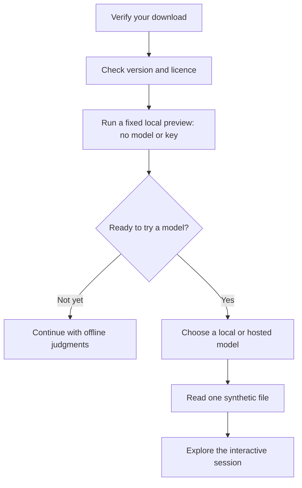

# First ten minutes with TOKN

**Get one useful result before configuring a model.** Check your install, try a
local preview, then optionally ask an agent to read a tiny file.
Everything here is available on **Community**; do not activate a trial for it.

The no-model preview works on older builds; the current CLI examples below
require **v0.3.116 or newer**. Results below are expectations, not a recorded
model transcript. Downloading, verifying a release or preparing a model may
take longer than ten minutes.



In plain text:

```text
Install -> local preview -> optional model -> first task -> explore
              |
              +-> offline judgments (no model needed)
```

## Before you start

| You need | For |
|---|---|
| A verified TOKN binary on `PATH` | Every step; follow the [download and verification guide](../../README.md#1-download) first |
| PowerShell on Windows, or Bash on macOS/Linux | The commands below |
| A writable temporary folder | The optional file-reading task |
| A configured model | Only steps 3–5; hosted use needs your credentials, local use needs a prepared runtime and model |

No Python, Docker, source-code checkout or paid licence is needed for this
walkthrough. Optional model installation has its own prerequisites in
[SETUP.md](../../SETUP.md).

**Network and files.** TOKN can register an anonymous install and check for
updates at startup. Disable both for these exercises:

**PowerShell**
```powershell
$env:TOKN_NO_REGISTER = "1"
$env:TOKN_NO_UPDATE_CHECK = "1"
```

**Bash**
```bash
export TOKN_NO_REGISTER=1
export TOKN_NO_UPDATE_CHECK=1
```

These settings do not block model or tool traffic. A hosted model receives your
prompt and the file content the agent reads. Use only synthetic or approved
data. Agent sessions can also create local logs and state; use the scratch
folder below rather than a real project.

## 1. Check the install and licence

Run in either shell:

```sh
tokn version
tokn license status
```

Look for the installed version, OS/architecture and `variant: public` in
`tokn version`. The public build excludes the embedded wiki, not the built-in
lessons. Use `tokn --help-all` for the commands and advanced flags in your build.
`tokn update` installs a newer release and requires network access.

Community is sufficient. An existing paid licence also works; you do not need
to change it. An expired-trial notice followed by Community is not a failure.
For licensed workflows later, first read
[platform support](../../README.md#platform-support), especially on Apple Silicon.

## 2. Get a result with no model or key

```sh
tokn community list
tokn community demo --domain geospatial
```

**Success looks like:** one `ACCEPTED` case and one `BLOCKED` case.
The second case deliberately uses a map projection unsuitable for area
measurement. Blocking it is the intended result, not an installation error.

The preview uses fixed synthetic inputs. It does not inspect your files,
enable a licensed domain or certify a real project. Also available:

```sh
tokn community demo --domain powergrid
tokn community demo --domain batterypass
```

**Staying offline?** Continue with the complete
[governed-judgment exercise](../../GETTING_STARTED.md#3-governed-judgments-offline-no-key):
it supplies the input files and shows a `continue` and a `revise` result.
Neither means a model has proved the underlying work correct.
You can stop here without configuring a provider.

## 3. Optional: choose your model

Pick **one** path. Keep these variables in the same terminal for the remaining
steps. Replace every uppercase placeholder before running.

**Hosted example: Anthropic**

```powershell
$env:NOSPACE_MODEL_PROVIDER = "anthropic"
$env:NOSPACE_MODEL_NAME = "YOUR_MODEL_ID"
# Supply the key from a trusted secret store or existing secure session.
```

```bash
export NOSPACE_MODEL_PROVIDER='anthropic'
export NOSPACE_MODEL_NAME='YOUR_MODEL_ID'
read -rs -p 'Anthropic API key: ' ANTHROPIC_API_KEY; echo
export ANTHROPIC_API_KEY
```

Use an API model ID available to your account, not a subscription's display
name. Hosted calls may incur charges. Never commit your key.

**Local alternative: an already-running Ollama with a model downloaded**

```sh
ollama --version
ollama list
```

Choose a model from that list that supports tool use:

```powershell
$env:NOSPACE_MODEL_PROVIDER = "ollama"
$env:NOSPACE_MODEL_NAME = "YOUR_INSTALLED_MODEL"
```

```bash
export NOSPACE_MODEL_PROVIDER="ollama"
export NOSPACE_MODEL_NAME="YOUR_INSTALLED_MODEL"
```

If Ollama or a suitable model is missing, use the
[setup guide](../../SETUP.md#local--ollama-no-key) before continuing. For
llama.cpp, Azure OpenAI and other providers, use the corresponding setup path.
Then check credential readiness:

```sh
tokn auth status
```

This reports configuration; it is not proof that the next model call will
succeed. `tokn doctor --provider anthropic` (or `ollama`) checks static
provider configuration; it does not prove that a live credential or endpoint
works.

### Current CLI (v0.3.116+)

With both stdin and stdout connected to a terminal, bare `tokn` opens the
interactive REPL. For a single request, `tokn -p "Summarize NOTES.md"` runs
once and exits.

To pass a file as input without starting a REPL:

```powershell
Get-Content -Raw NOTES.md | tokn agent-run -p "Summarize the supplied data"
```

```bash
tokn agent-run -p "Summarize the supplied data" < NOTES.md
```

Continue the last unfinished checkpoint in the current repository with
`tokn agent-run -c`. It fails when no unfinished checkpoint exists; it is not
a way to reopen a completed transcript. To browse past sessions instead:

```sh
tokn list-sessions
tokn load-session SESSION_ID
```

`load-session` displays a past session; it does not restart it. For advanced
options, use `tokn --help-all` or `tokn agent-run --help-all`. Do not combine
piped stdin with `-c`.

## 4. Ask the agent to read one file

Create a new temporary directory and a synthetic note, then run a bounded task.
The directory path is printed so you can inspect it afterwards.

**PowerShell**
```powershell
$WORK = Join-Path ([IO.Path]::GetTempPath()) ("tokn-first-run-" + [guid]::NewGuid().ToString("N"))
New-Item -ItemType Directory -Path $WORK | Out-Null
Set-Location $WORK
Set-Content -Encoding ascii NOTES.md "# Notes`n`nTODO: say hello."
Write-Output $WORK
tokn agent-run --repo-root "$WORK" --headless --mcp-disabled --max-steps 4 --prompt "Read NOTES.md and summarise the TODO. Do not edit files or run shell commands."
```

**Bash**
```bash
WORK="$(mktemp -d "${TMPDIR:-/tmp}/tokn-first-run.XXXXXX")"
cd "$WORK"
printf '# Notes\n\nTODO: say hello.\n' > NOTES.md
printf '%s\n' "$WORK"
tokn agent-run --repo-root "$WORK" --headless --mcp-disabled --max-steps 4 --prompt "Read NOTES.md and summarise the TODO. Do not edit files or run shell commands."
```

**Success looks like:** a summary mentioning "say hello", with `NOTES.md`
unchanged. Wording depends on the model.
`--headless` denies actions that need approval; do not add `--no-confirm`.
`--mcp-disabled` avoids connecting configured MCP servers for this exercise.
Neither suppresses TOKN's own local logs and session artifacts.
The prompt is your request, not the agent's only instruction or a sandbox.

## 5. Look around the interactive session

In the same terminal and scratch folder:

```sh
tokn agent-repl --repo-root "$WORK" --mcp-disabled
```

Type these **inside TOKN**, not in your operating-system shell:

```text
/help
/learn community
/learn system-one
/exit
```

Use `/help` to discover commands and `/learn` for explanations.
Further chat uses the selected model. Review any permission request before
approving it. When finished, inspect the printed scratch directory and remove
only that directory if you no longer need its files or logs.

## Choose your next ten minutes

| Want to try… | Go to |
|---|---|
| More checks without a model | [Getting started](../../GETTING_STARTED.md) |
| A local classifier or regressor | [Tabular prediction](../../TABULAR.md) |
| Review and undo an agent's work | [Session review](../session-review/README.md) · [checkpoints](../checkpoints/README.md) |
| Understand TOKNish in plain terms | [A checkable receipt for agent work](../../README.md#toknish--a-checkable-receipt-for-agent-work) |
| An agent that wakes for incoming work | [Always-on intake](../always-on-claims-intake/README.md) |
| Two agents handing a case back and forth | [Two collaborating desks](../always-on-claims-desks/README.md) |
| Field-specific tools and checks | [Domain overview](../../CAPABILITIES.md#domain-harnesses); full modes require entitlement |

Each linked guide has its own dependencies and data boundaries. Adding more
features is optional; the local preview is already a complete first success.

## Troubleshooting

| Symptom | What to do |
|---|---|
| `tokn` is not found | Add its directory to `PATH`, then reopen the terminal |
| The public commands are missing | Check `tokn version`, update and consult that build's `--help-all` |
| The trial expired | Community still runs this walkthrough; do not start another trial |
| Provider/key/model error | Replace placeholders, keep variables in the current terminal and use `tokn doctor --provider <id>` |
| Ollama is unavailable or the model cannot use tools | Start the prepared runtime and choose a suitable installed model; see [SETUP.md](../../SETUP.md) |
| The agent is denied or reaches its step limit | Read the reported reason; do not bypass the exercise's read-only controls just to obtain a success |
| You see `.tokn` or `.nospace` in scratch | These can be runtime state; keep them out of source control |
