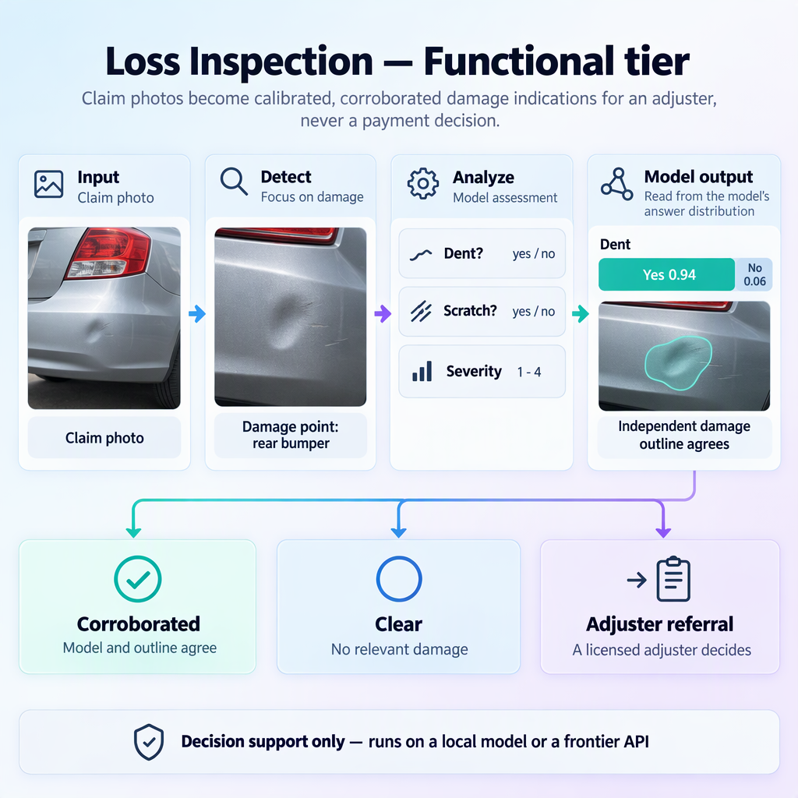

# Insurance loss inspection with three local models

Run one insurance claim end to end on your own machine. Three local models
work together: a **coding model** drives the TOKN agent in insurance mode, a
**vision model** answers photo damage checks, and a **decision model** triages
the claim from a summary. Every model is served by llama.cpp on loopback, and
nothing leaves this machine after the downloads finish.



*The functional flow of `tokn loss-inspect`: photos and damage points go in, a
vision model answers each check, and every record ends as corroborated, clear or
an adjuster referral.*

> **Decision support only.** TOKN never decides a claim. A licensed adjuster
> decides every referral. This example teaches how to read the output and what
> it takes for a record to be decided automatically. It does not automate a
> decision.

## What you will learn

- Read a Loss Inspection report: damage points, damage checks, probabilities,
  and why a record becomes an adjuster referral.
- Tell apart the three outcomes: `corroborated`, `clear` and `adjuster_referral`.
- Run a vision model that answers checks from its token probabilities, with no
  generated text.
- Ask a decision model typed questions about a summary, and keep its answers
  advisory.
- Let a coding model drive TOKN in insurance mode, and keep the human-only
  actions out of its reach.

## The claim (synthetic)

Claim **`CLM-DEMO-0001`** is fictional. A claimant submitted three photos after
a parking-lot incident:

| Photo | Damage points we inspect | What the photo shows |
|---|---|---|
| `suv-front.jpg` | windshield, hood, front bumper | a shattered windshield and a dented hood; the front bumper looks intact |
| `side-mirror.jpg` | left mirror | shattered mirror glass |
| `van-side.jpg` | van rear side, van front bumper, van windshield | a van crushed on its rear side; a cracked windshield |

The photos are openly licensed stand-ins from Wikimedia Commons. They show
other vehicles, and the scenario is invented around them. `fetch-photos`
downloads them at run time. They are not committed, and `ATTRIBUTION.md` lists
their licences.

Seven damage points, each checked for six yes/no damage types (`dent`,
`scratch`, `crack`, `broken`, `paint_damage`, `rust`) plus one severity score:
7 × 7 = **49 inspection records**.

## The three models

| Role | Model (Hugging Face GGUF) | Port | TOKN command | May decide? |
|---|---|---|---|---|
| Coding model | a Qwen coder GGUF you choose (`CODER_HF_MODEL`) | 8083 | `tokn agent-run --mode insurance` | No. It drafts a worklist and cannot resolve referrals. |
| Vision model (VLM) | `ggml-org/Qwen2.5-VL-3B-Instruct-GGUF` | 8081 | `tokn loss-inspect run` | No. It gives probabilities per check. |
| Decision model | `ggml-org/Clef-Flash-GGUF` | 8082 | `tokn system-one evaluate` | No. It gives advisory typed answers. |

### How the artifacts connect

```
  photos.json + points.json
          │
          ▼
  [VISION  :8081] tokn loss-inspect run ───────────► out/report.json
                                                       │            │
                                                       ▼            ▼
  [DECISION:8082] make-triage-request.py              [CODER :8083] tokn agent-run --mode insurance
          │  tokn system-one evaluate                      │  calls ins_loss_inspect, drafts worklist
          ▼                                                ▼
  out/triage-response.json                         out/worklist.md
                                                       │
                                                       ▼
                                  A licensed adjuster reviews each referral.
                                  Only a human resolves a referral.
```

Each step reads and writes files. That is why the steps can run one at a time
(see [Running the models](#running-the-models-together-or-one-at-a-time)).

## 1. Prerequisites

| Dependency | Why | Install |
|---|---|---|
| `tokn` **v0.3.96 or later** | Runs `loss-inspect`, `system-one` and `agent-run` | Download from the [latest release](https://github.com/bhakthan/tokn-dist/releases/latest) and put it on your `PATH` |
| llama.cpp (`llama-server`, or `llama`) | Serves the three models over HTTP | See section 2 |
| curl | Health checks in the scripts | Included on Windows 10 1803+ and macOS; `sudo apt install curl` on Debian/Ubuntu |
| Python 3.10+ | Builds the triage request and runs `check.py` | `winget install Python.Python.3.12` (Windows), `brew install python` (macOS), `sudo apt install python3` (Linux) |
| PowerShell 7 (Windows) or bash (macOS/Linux) | Runs the example scripts | PowerShell 7: `winget install Microsoft.PowerShell` |
| Internet, once | Downloads the model weights and the three photos | Not needed after that |

**Hardware notes**

- The vision model is a 3B model; the decision model is a separate GGUF; the
  coding model is the largest of the three if you pick a bigger one. Check each
  Hugging Face page for its file sizes before you start.
- Three models at the same time need a lot of memory. Run them **one at a time**
  if your machine is small (see [Running the models](#running-the-models-together-or-one-at-a-time)).
- CPU-only inference works. It is slower.

## 2. Install llama.cpp

**Windows**

```powershell
winget install ggml.llamacpp
```

**macOS (Apple Silicon or Intel)**

```bash
brew install llama.cpp
```

**Linux**

Build from source (see [the llama.cpp build guide](https://github.com/ggml-org/llama.cpp/blob/master/docs/build.md)):

```bash
git clone https://github.com/ggml-org/llama.cpp
cd llama.cpp
cmake -B build
cmake --build build --config Release -j
```

Then check the binary:

```bash
llama-server --version
```

> **Flags vary by llama.cpp version.** The commands below use `llama serve`,
> which is the form this example was written against. If your build only has
> `llama-server`, the same arguments work with that name. Run
> `llama serve --help` (or `llama-server --help`) to confirm. Newer releases
> may default to port 9931, so **always pass `--port`**. Use an instruct
> (non-thinking) vision model.

## 3. Configure this example

```bash
cp .env.example .env
```

Edit `.env`. Set `TOKN_MODEL` and `CODER_HF_MODEL` (the coding model you chose).
The rest of `.env` is loopback addresses that can stay as they are.

**Set the model settings in your shell, not in `.env`.** TOKN refuses routing
and destination keys from a repository `.env`, and the scripts skip them on
purpose. Use the block for your shell.

PowerShell:

```powershell
$env:TOKN_INSPECT_SCORER = "logprob"
$env:TOKN_INSPECT_ALLOW_LOCAL = "1"
$env:TOKN_INSPECT_BASE_URL = "http://127.0.0.1:8081/v1"
$env:TOKN_INSPECT_MODEL = "<name in the vision server's /v1/models list>"

$env:SYSTEMONE_BACKEND = "compatible"
$env:SYSTEMONE_ALLOW_LOCAL = "1"
$env:SYSTEMONE_BASE_URL = "http://127.0.0.1:8082/v1"
$env:SYSTEMONE_MODEL = "clef-flash"
```

bash / zsh:

```bash
export TOKN_INSPECT_SCORER=logprob
export TOKN_INSPECT_ALLOW_LOCAL=1
export TOKN_INSPECT_BASE_URL=http://127.0.0.1:8081/v1
export TOKN_INSPECT_MODEL="<name in the vision server's /v1/models list>"

export SYSTEMONE_BACKEND=compatible
export SYSTEMONE_ALLOW_LOCAL=1
export SYSTEMONE_BASE_URL=http://127.0.0.1:8082/v1
export SYSTEMONE_MODEL=clef-flash
```

On macOS and Linux, make the scripts executable once:

```bash
chmod +x *.sh
```

`TOKN_INSPECT_MODEL` is the name your vision server reports. You can find it
after the server starts, with `curl http://127.0.0.1:8081/v1/models`.

---

## Part 1: fully worked

Follow these steps in order. Each one shows the command, what it does and what
you should see. Read the expected output before you move on.

### Step 1.1: start the vision model

Before you run this, predict: once the server is up, what name will
`/v1/models` report for the model? Will it be the Hugging Face repo name, or
something else?

```bash
llama serve -hf ggml-org/Qwen2.5-VL-3B-Instruct-GGUF --host 127.0.0.1 --port 8081
```

`--host 127.0.0.1` keeps the server on loopback. `--port 8081` is the port the
TOKN settings expect. llama.cpp downloads the model and its matching projector
(`mmproj`) on first use. Keep this terminal open.

Check it in a second terminal:

```bash
curl http://127.0.0.1:8081/health
curl http://127.0.0.1:8081/v1/models
```

You should see something like `{"status":"ok"}`, then a JSON list with one
model id. Copy that id into `TOKN_INSPECT_MODEL`.

> The vision model is the only model the inspection needs. You can stop it
> after step 1.5 if memory is tight.

### Step 1.2: fetch the photos

```powershell
./fetch-photos.ps1
```

```bash
./fetch-photos.sh
```

Each download is checked to be 1280 px wide. You should see something like:

```
[*] suv-front.jpg: 1280x852, licence CC BY 2.0, author <name from the Commons page>
[*] side-mirror.jpg: 1280x853, licence CC BY-SA 4.0, author <name from the Commons page>
[*] van-side.jpg: 1280x853, licence CC BY-SA 4.0, author <name from the Commons page>
```

The author names come from each file's metadata, so they may differ from this
placeholder text. The licences should match `ATTRIBUTION.md`.

### Step 1.3: read the inputs before you run anything

Open `photos.json`. It lists three photos with an id and a view each. Then open
`points.json`. Each entry is a **damage point**: a named box on one photo.

Before you run this, predict: how many damage points are in `points.json`? How
many inspection records will one run produce if each point has seven checks?

Answer: 7 points, 7 checks, so 49 records. Check your count against the table
above.

Notice that `front bumper` is a point on the SUV photo but has no damage in the
ground truth. That point exists to test the system, not to find damage.

### Step 1.4: run the inspection

```powershell
./run-inspection.ps1
```

```bash
./run-inspection.sh
```

The script runs four steps, and each one is a plain `tokn` call:

1. `tokn loss-inspect check-sets auto-physical-damage` lists the check set.
   Checks are the typed questions: six yes/no damage types and one severity
   score.
2. `tokn loss-inspect status --probe --smoke` asks the vision server a test
   question on a generated image. It confirms the server accepts images and
   returns token probabilities. No photo is sent.
3. `tokn loss-inspect run ... --air-gap` scores every point. `--air-gap` makes
   TOKN refuse any scorer that is not on this machine. `--outlines none` means
   no damage outlines are used. Read the note in step 1.5 about why that
   matters.
4. `tokn loss-inspect verify --report out/report.json` recomputes every record
   and checks the report digest.

The run exits with code **3** when any record is an adjuster referral. The
script treats 3 as success: the report is complete, and an adjuster must work
through the referrals. Exit code 0 means every record is corroborated or
clear, and code 1 is an error.

You should see something like the check-set listing, then a probe line for the
vision model, then a summary table. The last lines should be:

```
[*] Report complete. Adjuster referrals exist (exit 3). This is expected without calibration and outlines; see the README.
[*] Verified: out/report.json is internally consistent. Next: ./check.ps1
```

### Step 1.5: read the report

```powershell
./check.ps1
```

```bash
python3 check.py
```

`check.py` makes two kinds of statement. The structure check decides pass or
fail. The table is for reading. It shows, for each damage point, the three
checks with the highest probability of **yes**. A `*` marks a check the photo
actually shows.

You should see something like:

```
PASS: structure ok (7 points, 49 records, claim CLM-DEMO-0001).
Referrals: 49 of 49. Every referral needs an adjuster.

point              referrals  top three P(yes)                            ground truth
windshield                 7  crack* 0.xx, broken* 0.xx, ...               broken, crack
...
front bumper               7  dent 0.xx, ...                               no visible damage
```

The numbers are whatever your model produced. They are not the values shown
here.

**Why are all 49 records referrals?** The default run has no calibration file
and no damage outlines. Two rules send the record to an adjuster:

- **`uncalibrated`**: the model's raw probability has not been fitted against
  labelled examples, so it is not trusted for an automatic outcome.
- **`outline_missing`**: no damage outline was found for the check, so the
  visual evidence does not back up the answer.

Look at one record to see the reasons yourself:

```powershell
python -c "import json; r=json.load(open('out/report.json')); print(r['records'][0]['reasons'], r['records'][0]['label'], r['records'][0]['probability'])"
```

```bash
python3 -c "import json; r=json.load(open('out/report.json')); print(r['records'][0]['reasons'], r['records'][0]['label'], r['records'][0]['probability'])"
```

Before you run it, predict: will `reasons` include `uncalibrated`? What will
`label` be for the first record?

**Read the probabilities with care.** Without calibration, a 3B vision model
leans toward "yes". In an earlier test with this model, an undamaged bumper
scored P(dent) ≈ 0.76. That is the reason calibration exists. Do not read a
high probability as proof of damage.

#### Contrast: the three outcomes

These are the rules the system follows. Read the three columns side by side.

| | `corroborated` | `clear` | `adjuster_referral` |
|---|---|---|---|
| What the model said | a confident **yes** | a confident **no** | anything less certain, or disagreement |
| What the outline showed | an outline agrees, or the check needs none | no conflicting outline | missing, weak, or conflicting |
| Calibration needed? | yes | yes | not needed to refer; referral is the default |
| What happens next | recorded as found | recorded as no damage | a licensed adjuster reviews it |
| Seen in this demo | none (no calibration) | none (no calibration) | all 49 |

Now the same photo under two conditions. This is a **hypothetical** comparison,
not a run in this example. Adding calibration and outlines is the only change.

| Record for the hood | Default run (this demo) | With calibration and outlines (hypothetical) |
|---|---|---|
| `dent` label, probability | `yes`, raw 0.xx | `yes`, calibrated 0.xx |
| outline | none | found on the hood |
| status | `adjuster_referral` (`uncalibrated`, `outline_missing`) | `corroborated` only if the calibrated probability clears the guideline threshold and the outline agrees |

Metacognition check: before you read the hypothetical row, write down which of
the three columns you think a **front bumper** record would land in, and why.

#### Verify it yourself

`verify` already ran. To check again by hand:

```powershell
tokn loss-inspect verify --report out/report.json
```

```bash
tokn loss-inspect verify --report out/report.json
```

Verification proves the report is internally consistent. It does not prove the
report is authentic. Anyone with the file can rebuild it.

### Step 1.6: stop the vision model

Stop the vision server in its terminal (Ctrl+C). Its job is done. The report is
a file now, so the next steps do not need it.

---

## Part 2: partially worked

Triage uses the decision model. Clef-Flash answers **typed questions**, which
come in three types:

| Type | Answer | Example question |
|---|---|---|
| `noul` | a probability in [0, 1] | "should a field inspection be arranged?" |
| `choice` | one option, plus the probabilities of each | "which route: desk review, field inspection or specialist glass?" |
| `score` | an expected level, plus the probabilities of each level | "how urgent is this file, on a 0 to 3 scale?" |

`make-triage-request.py` builds the request from `out/report.json`. Its `state`
is a summary only: referral counts by priority, and the top check per point. It
has no photos, no file paths and no claim reference.

Start the decision model in a new terminal:

```bash
llama serve -hf ggml-org/Clef-Flash-GGUF --host 127.0.0.1 --port 8082 -b 2048 -ub 2048
```

The `-b 2048 -ub 2048` flags matter. A decision model reads the whole request
in one pass, and llama.cpp's default batch of 512 tokens is too small for this
summary (about 750 tokens). Without the flags the server returns HTTP 500 and
its log says `input ... is too large to process. increase the physical batch
size`.

Check it with `curl http://127.0.0.1:8082/health`.

Now the triage run is partly written for you. Fill in the blanks.

```bash
python3 make-triage-request.py                 # 1. build out/triage-request.json
tokn system-one status                         # 2. check the decision layer
tokn system-one evaluate --file ____________ | tee out/triage-response.json   # 3. ask
```

There are two decisions to make. First, the blank is the file that
`make-triage-request.py` wrote. Second, decide whether `evaluate` should take
`--air-gap`. Read the `--air-gap` help text in `tokn system-one --help` before
you decide, and compare it with the note in the triage script.

Then run the script that does all three steps and check your answers:

```powershell
./run-triage.ps1
```

```bash
./run-triage.sh
```

You should see something like a JSON object with three answers:
`field_inspection_recommended` with a probability, `route` with a chosen option,
and `urgency` with an expected level and the probabilities for each level.

Metacognition checks:

- Before you run the script, predict which `route` option the summary points to
  if every point has 7 referrals. Then predict the opposite case, with few
  referrals. Compare your predictions with the answer.
- The triage answers are advisory. Name one reason a triage answer could be
  wrong that the adjuster would catch by opening the photos.

### Side by side: what each model may decide

| Model | Looks at | Produces | Who acts on it |
|---|---|---|---|
| Vision | the photos and damage points | a probability per check, then a record | a licensed adjuster, for every referral |
| Decision | the summary only (no photos) | advisory typed answers | a licensed adjuster, as one input |
| Coding | `report.json`, through `ins_loss_inspect` | a worklist draft | the adjuster, who reviews it |

Stop the decision model when you are done.

---

## Part 3: problem-only

No commands are given for these. Use what you learned and the files in this
folder. Write your answers in `out/exercise-notes.md`, then check them against
the run.

**Problem A: the bumper that must not be cleared.**
A colleague says the front bumper should be marked `clear` so the file closes
faster. Using only the rules in this example, list the conditions a record must
meet to become `clear` instead of an adjuster referral. Look at the check set
guidelines `auto_no`, `require_outline_for_clear`, `require_calibration` and
`calibration_gate`. Say why "the model is confident there is no dent" is not
enough on its own.

**Problem B: how much labelled data?**
Calibration needs at least 200 labelled crops per check, with at least 50 of
each yes/no label. The check set has six yes/no checks. What is the smallest
number of labelled crops a complete calibration needs? Then explain why a
calibration fitted on the seven demo points would not be enough, even if you
had all their labels.

**Problem C: stricter, not looser.**
Guidelines may only tighten the check set's defaults. You want every record to
go to a referral during a training run, and to keep the automatic outcome in
shadow mode. Write a small `guidelines.json` that does this, run it with
`--guidelines`, and write the output to a new report file. Predict what
`shadow_status` will show for each record before you look.

**Problem D: a tool that must not act.**
The coding model can call `ins_loss_inspect`, but resolving a referral is a
human-only action. Find which tool would resolve a referral, which fields it
requires, and why a `possible_missed_damage` referral closed as `no_damage`
needs a written rationale. Explain why the task in `task.md` forbids the agent
from calling that tool.

---

## Running the models together or one at a time

**Option A: all three at once.** Set `CODER_HF_MODEL` and run:

```powershell
./start-models.ps1 -Start
```

```bash
./start-models.sh --start
```

These scripts check for llama.cpp, check that ports 8081 to 8083 are free, and
then start the servers with logs in `out/logs/`. They print the pids so you can
stop each one. Without `-Start`, they print the commands and do nothing else.

**Option B: one at a time (recommended on a small machine).** The steps only
share files, so you can run them in order:

1. Start the vision server. Run `./run-inspection.*`. Stop the vision server.
2. Start the decision server. Run `./run-triage.*`. Stop the decision server.
3. Start the coding server. Run `./run-agent.*`. Stop the coding server.

Each step reads the files the previous step wrote. The run never needs two
models at once.

## Part 4: the coding model drives TOKN

The last step runs the TOKN agent in insurance mode:

```powershell
./run-agent.ps1
```

```bash
./run-agent.sh
```

It runs this `tokn` call:

```
tokn agent-run --model-provider gguf --model-name <TOKN_MODEL> --mode insurance \
  --prompt-file task.md --repo-root . --max-steps 15 --run-timeout 0 \
  --output-format text --air-gap
```

Notes on each flag:

- `--model-provider gguf` and `GGUF_SERVER_URL` point TOKN at the coding server,
  the same way the [local-llamacpp](../local-llamacpp/README.md) example does.
- `--mode insurance` loads the insurance domain tools, including
  `ins_loss_inspect`.
- `--repo-root .` makes this example folder the agent's workspace, so every path
  in `task.md` starts with `out/`. Small models tend to add that prefix on their
  own, and spelling it out keeps their paths right.
- `--air-gap` disables specialist routing, web fetch and telemetry. The model
  is local, so this costs nothing.

The agent passes the report by **path** (`report_path: out/report.json`), not
by copying the JSON into the tool call. The report is about 50 KB. A small model
asked to copy it will corrupt it, and even a large model would waste tokens.
The tool reads the file itself, confined to the repository root.

You should see the agent call `ins_loss_inspect` once, then write
`out/worklist.md` with a table of open referrals. The table should be ordered
with `possible_missed_damage` first, because the tool returns referrals in that
order. In this demo no referral has a priority (there are no outlines, so
neither missed-damage nor leakage conflicts can arise), and that column is
empty.

**Read the worklist with care.** Small local models sometimes skip a step or
get the table wrong. Check the rows against `out/report.json`. The worklist is
a draft for an adjuster, not a decision.

**Small models and tool calling.** A small local coding model can be unreliable
at tool calling. Expect some runs to fail the first time. If that happens,
use a larger local coder model, or use a frontier provider for this step (see
the next section). Limited-capability mode turns on automatically for models of
8B or smaller, and the run prints a line that says so.

---

## Frontier alternative

The same flow works with hosted models. Only the three model roles change.

**Vision scorer (OpenAI, or Azure OpenAI).** The scorer needs a vision chat
model that accepts images and returns token logprobs. Reasoning models usually
do not return logprobs.

OpenAI, PowerShell:

```powershell
$env:TOKN_INSPECT_SCORER = "logprob"
$env:TOKN_INSPECT_BASE_URL = "https://api.openai.com/v1"
$env:TOKN_INSPECT_API_KEY = "<your-key>"
$env:TOKN_INSPECT_MODEL = "<vision chat model with logprobs>"
```

Azure OpenAI adds one header setting:

```powershell
$env:TOKN_INSPECT_BASE_URL = "https://<your-resource>.openai.azure.com/openai/v1"
$env:TOKN_INSPECT_API_KEY_HEADER = "api-key"
$env:TOKN_INSPECT_MODEL = "<deployment name>"
```

Two changes are needed for a hosted scorer. Remove `TOKN_INSPECT_ALLOW_LOCAL`,
because it is for loopback only. Remove `--air-gap` from the `run` call in
`run-inspection`, because `--air-gap` refuses any scorer that is not on this
machine. The example is then no longer fully local, so say so in your notes.

**Vision scorer (Gemini Decisions API).** Use the systemone scorer:

```powershell
$env:TOKN_INSPECT_SCORER = "systemone"
$env:SYSTEMONE_BACKEND = "gemini"
$env:GEMINI_API_KEY = "<your-key>"
```

The same `--air-gap` rule applies.

**Decision model.** Use another System One backend, set in the shell. The
`openai`, `azure`, `microsoft` and `gemini` backends are listed in
`tokn system-one --help`.

**Coding model.** Use any provider `tokn agent-run` supports. Anthropic models
expose no logprobs, so they cannot be the vision scorer. They can still be the
coding model. Check the `--model-provider` values in `tokn agent-run --help`.

## Limits of this example

- **Calibration is not included.** Fitting one needs at least 200 labelled
  crops per check, with at least 50 of each yes/no label. Without it, every
  record is a referral by design. That is the safe default.
- **Outlines are not included.** `--outlines none` means no outline evidence.
  Outlined checks are referred.
- **Photos are stand-ins.** They are not claim photos, and the damage in them
  was not measured for this demo.
- **The triage answers and the worklist are drafts.** A licensed adjuster reads
  the evidence and decides.
- **Your results will differ.** The numbers depend on the model, the llama.cpp
  version and the hardware. The structure of the output should not change.

## Troubleshooting

**`Missing: tokn binary` or `Old tokn`**

- Run `tokn version`. It must report 0.3.96 or later.
- Download the latest release, or set `TOKN_BIN` to its full path.

**`Port 8081 is already in use`**

- Another program holds the port. Stop it, or change the port and the matching
  shell setting.

**`TOKN_INSPECT_MODEL ... is not in the server's /v1/models list`**

- Copy the id exactly as `curl http://127.0.0.1:8081/v1/models` reports it.

**`The scorer is not ready` (from `status --probe --smoke`)**

- Confirm the vision server was started with `--mmproj` (an `-hf` ggml-org
  repo fetches it automatically). A server without projector support rejects
  images.
- Confirm the model is an instruct vision model, not a text-only model.

**`System One requires an external service and is unavailable in air-gap`**

- You passed `--air-gap` to `tokn system-one`. Remove it. The triage script does
  not use it.

**The agent did not write `out/worklist.md`**

- Read `out/agent-output.txt`. Small models sometimes skip a step. Run again, or
  use a larger coder model.

**The server crashes mid-run (GPU memory is full)**

- Restart the server with a smaller context (`-c 8192`) or a smaller quant, and
  run the models one at a time.

## Cleanup

```powershell
# Stop each llama.cpp server with Ctrl+C in its terminal, or Stop-Process -Id <pid>.
Remove-Item -Recurse -Force out, photos -ErrorAction SilentlyContinue
```

```bash
# Stop each llama.cpp server with Ctrl+C, or kill the pids in out/logs/pids.txt.
rm -rf out photos
```

Remove `.env` as well if you do not want to keep your settings. `out/` and
`photos/` are git-ignored, and so is `.env`.
