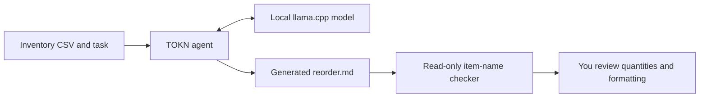

# Local llama.cpp example

Run TOKN against a GGUF model on your own machine. TOKN talks to a
[llama.cpp](https://github.com/ggml-org/llama.cpp) server through its
OpenAI-compatible API, using the `gguf` provider. Model inference can stay
local once the weights and server are staged. See section 11 for the
additional steps needed for an offline session.

This example includes a small, deterministic task: read a CSV inventory file
and write a markdown table of the items that need reordering. The input and
expected answer are deterministic; the agent's success is not guaranteed.
A checker compares the item names in its output with the expected names.

Illustrative model-versus-check boundary:



```text
Local model proposes file -> checker compares item names -> you inspect the rest
```

## What is in this folder

| File | Purpose |
|---|---|
| `task.md` | The task TOKN is asked to perform |
| `workspace/inventory.csv` | Input data for the task |
| `expected-reorder.md` | The expected item list |
| `check.py` / `check.ps1` | Read-only checker (stdlib only, no network) |
| `run-local.ps1` / `run-local.sh` | Preflight checks, then the run |
| `.env.example` | Settings template (placeholders only) |

## 1. Prerequisites

| Dependency | Why | Install |
|---|---|---|
| `tokn` binary | Runs the agent loop | Download from the [latest release](https://github.com/bhakthan/tokn-dist/releases/latest) and put it on your `PATH` |
| llama.cpp (`llama-server`) | Serves the model over HTTP | See the install commands in section 2 |
| A GGUF model | The local model TOKN talks to | Any GGUF from Hugging Face, for example `<hf-repo>:<quant>` |
| curl | Health checks in the scripts | Included on Windows 10 1803+ and macOS; `sudo apt install curl` on Debian/Ubuntu |
| Python 3 | Runs `check.py` (Linux/macOS script path) | Check `python3 --version`; macOS: `brew install python`; Debian/Ubuntu: `sudo apt-get install python3`. Windows can use `check.ps1` without Python. |

Check `tokn version`, `llama-server --version` and `curl --version` before
running. Linux source builds additionally need Git, CMake and a C++ toolchain;
use the upstream build guide for your distribution or choose a prebuilt
server. Use a model with tool-calling support, and review its licence.

**Hardware notes**

- Memory needs depend on the model, quantization, context and server build.
  Leave room beyond the weights themselves; this example does not establish
  a hardware minimum or guarantee a particular model's reliability.
- CPU-only inference works. It is just slower, so use `--run-timeout 0` (set
  in the scripts).

## 2. Install llama.cpp

Pick the command for your OS.

**Windows**

```powershell
winget install ggml.llamacpp
```

**macOS (Apple Silicon or Intel)**

```bash
brew install llama.cpp
```

**Linux**

Build from source (see [the llama.cpp build guide](https://github.com/ggml-org/llama.cpp/blob/master/docs/build.md)):

```bash
git clone https://github.com/ggml-org/llama.cpp
cd llama.cpp
cmake -B build
cmake --build build --config Release -j
```

Or download a prebuilt binary from the [llama.cpp releases page](https://github.com/ggml-org/llama.cpp/releases).

Confirm the binary is available:

```bash
llama-server --version
```

## 3. Start the llama.cpp server

Start the server on loopback only. Replace `<hf-repo>:<quant>` with the
tool-capable model you want. llama.cpp downloads it on first use; review the
source and licence first. `--jinja` enables chat-template support used for
tool calls.

```bash
llama-server -hf <hf-repo>:<quant> --host 127.0.0.1 --port 8080 -c 32768 --jinja
```

`-c 32768` sets the context size. If the server runs out of GPU memory, lower
this value (see Troubleshooting).

Keep this terminal open. The server must stay running while TOKN works.

## 4. Verify the server is healthy

In a second terminal:

```bash
curl http://127.0.0.1:8080/health
```

Expected output:

```json
{"status":"ok"}
```

To find the model id the server reports, run:

```bash
curl http://127.0.0.1:8080/v1/models
```

## 5. Install and configure this example

From `examples/local-llamacpp`, copy the reference template and set the model
ID reported by your local server:

```bash
cp .env.example .env
```

PowerShell:

```powershell
Copy-Item .env.example .env
```

Set `TOKN_MODEL` in `.env` to the model ID from the previous step:

```
TOKN_MODEL=your-local-model-id
```

The scripts read only `TOKN_MODEL` from `.env`. Set `GGUF_SERVER_URL` and
`TOKN_BIN` only in your trusted shell; the endpoint must use a loopback host.
An untrusted repository file cannot select a destination or executable. `.env`
is git-ignored.

## 6. Run the sample task

**Windows (PowerShell 7 or Windows PowerShell 5.1)**

```powershell
.\run-local.ps1
```

**macOS / Linux**

```bash
chmod +x run-local.sh
./run-local.sh
```

The script runs preflight checks first. It then runs:

```
tokn agent-run --model-provider gguf --model-name <TOKN_MODEL> \
  --prompt-file task.md --repo-root ./workspace \
  --max-steps 15 --run-timeout 0 --output-format text
```

The full agent output is saved to `run-output.txt`. When the run finishes, the
script calls the checker automatically.

You can also check the result on its own:

```bash
python3 check.py          # macOS / Linux
python check.py           # Windows
.\check.ps1               # PowerShell
```

The agent writes `workspace/reorder.md`; the checker only reads it. A match
prints `PASS: 3 items match.` The check compares unique item names only:
it does not verify quantities, row order, duplicate rows or the full table
format. Inspect those yourself before accepting the report.

### Preflight checks

Before anything runs, the scripts check each dependency and report every
problem together. For each one they print what is missing, why it is needed,
and the install command. They then exit with status 1. The checks cover:

- the `tokn` binary (on `PATH`, or set with `TOKN_BIN`)
- `TOKN_MODEL` is set to a real value, not the placeholder
- `curl` is available
- the llama.cpp server responds at `/health`
- with `--system-one` / `-SystemOne`: the `SYSTEMONE_*` shell variables are set
  and the decision server responds

## 7. Limited-capability mode

TOKN can select a reduced-capability setup for smaller local models.
This can make a focused file task more practical; it does not make an
unsupported model tool-capable or guarantee a correct result.

The run log and wrapper report when limited-capability mode is active.

**Override it**

| Setting | Effect |
|---|---|
| `NOSPACE_LIMITED_MODEL=1` | Force limited mode on. Use this when the model id has no size in it. |
| `NOSPACE_LIMITED_MODEL=0` | Force limited mode off. |
| `TOKN_MAX_OUTPUT_TOKENS=<n>` | Set a reply budget appropriate to your task and model |

Set these in `.env` or in your shell.

## 8. Optional: local decision model (System One)

System One is a decision layer that can run on a second local model. It needs
its own llama.cpp server on a different loopback port.

**Step 1: start a second server** (use a smaller model if you have limited
memory):

```bash
llama-server -hf <decision-hf-repo>:<quant> --host 127.0.0.1 --port 8081 -c 8192
```

**Step 2: set the variables in your shell, not in `.env`.** TOKN deliberately
does not load `SYSTEMONE_ALLOW_LOCAL` from a file.

PowerShell:

```powershell
$env:SYSTEMONE_BACKEND = "compatible"
$env:SYSTEMONE_ALLOW_LOCAL = "1"
$env:SYSTEMONE_BASE_URL = "http://127.0.0.1:8081/v1"
$env:SYSTEMONE_MODEL = "<decision-model-id>"
```

bash / zsh:

```bash
export SYSTEMONE_BACKEND=compatible
export SYSTEMONE_ALLOW_LOCAL=1
export SYSTEMONE_BASE_URL=http://127.0.0.1:8081/v1
export SYSTEMONE_MODEL="<decision-model-id>"
```

Only loopback hosts (`127.x`, `::1`, `localhost`) are accepted for local
decision servers. No API key is needed for an unauthenticated local server.
Use `SYSTEMONE_TIMEOUT_MS` if your local server needs a different timeout.

**Step 3: check the decision layer:**

```bash
tokn system-one status
```

**Step 4: run with the flag:**

```powershell
.\run-local.ps1 -SystemOne
```

```bash
./run-local.sh --system-one
```

The wrapper keeps normal interactive approvals for this optional path. Review
each requested action; decision-model output is not a sandbox.

Tip: running the agent model and the decision model on one GPU slows both. If
you can, put the decision model on a second GPU or on the CPU.

## 9. Tips for small models

- Keep tasks small and well scoped. Name the exact files and the expected
  output, as `task.md` does.
- Write step-by-step task files with a numbered list.
- Allow more steps (`--max-steps`) and leave the run timeout at `0`.
- Tell the model which commands exist on your machine. Small models may assume
  tools such as `python3` are available.
- If tool use or task completion is unreliable, try a more capable model
  that fits your hardware rather than assuming more retries prove correctness.
- Ask for a short, fixed reply format, such as "reply with one line: DONE".

## 10. Troubleshooting

**The server is not reachable (`Missing: llama.cpp server is not responding`)**

- Confirm the server is running in its own terminal.
- Check the port matches `GGUF_SERVER_URL` in `.env`.
- Run `curl http://127.0.0.1:8080/health` by hand. If it fails, look at the
  server's terminal output for the reason.

**Responses are slow**

- Expected on CPU or small GPUs. Leave `--run-timeout 0` in place.
- Use a smaller quantization (for example Q4 rather than Q8) if the model fits
  your hardware poorly.
- Avoid running System One on the same GPU as the agent model.

**The model writes long replies or repeats itself**

- Set a smaller reply budget if appropriate, for example
  `TOKN_MAX_OUTPUT_TOKENS=2048`.
- Make the task shorter and ask for one fixed output format.

**The connection is reset, or the server crashes mid-run (GPU memory is full)**

- Restart `llama-server`.
- Reduce the context size: `-c 32768` (or lower, e.g. `-c 16384`).
- Use a smaller model or a lower-bit quantization.
- Close other GPU-heavy programs.

**`check.py` reports missing or unexpected items**

- Open `workspace/reorder.md` and compare it with `expected-reorder.md`.
- Re-run the task. Smaller models sometimes skip a row, so the output may
  need another attempt.
- Use `python check.py --help` to confirm the checker's options.

## 11. Air-gapped use

Stage the TOKN binary, llama.cpp, model weights and any checker dependencies
before disconnecting. Run `llama-server` without `-hf`, using
`-m <path-to-model.gguf>` and a loopback listen address.

Set `TOKN_NO_REGISTER=1` and `TOKN_NO_UPDATE_CHECK=1` to disable TOKN's
startup registration and update checks. Review or disable other configured
integrations (`--mcp-disabled` disables outbound MCP discovery connections
when running TOKN directly). A loopback model URL alone is not a
zero-egress guarantee.

For staged GGUF/ONNX model preparation and checks, see
[Tabular prediction](../tabular-prediction/README.md).

The wrapper writes `run-output.txt`, the agent writes `workspace/reorder.md`,
and TOKN may create session logs or state. Offline does not mean read-only.

## 12. Cleanup

```bash
# Stop the llama.cpp servers: press Ctrl+C in each server terminal.

# Remove generated output (keeps the inputs)
rm -f run-output.txt workspace/reorder.md   # macOS / Linux
Remove-Item run-output.txt, workspace\reorder.md   # Windows PowerShell
```

Remove `.env` as well if you do not want to keep your settings.
