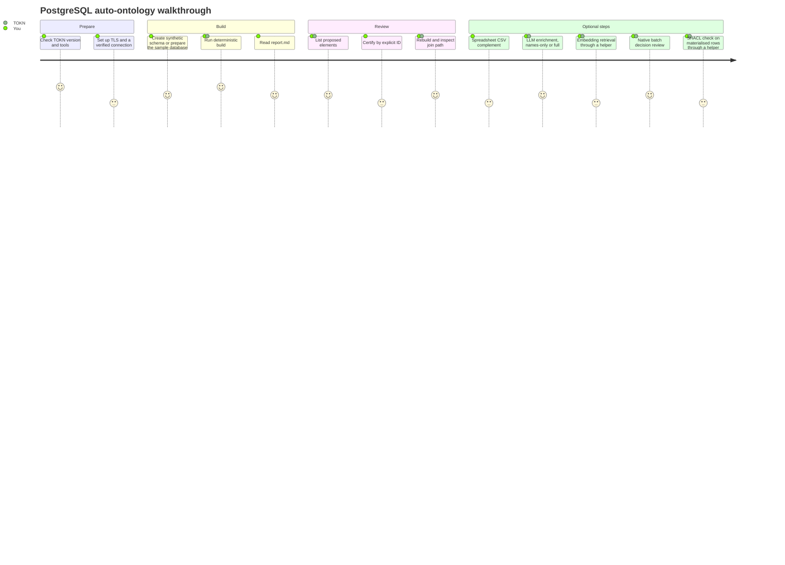
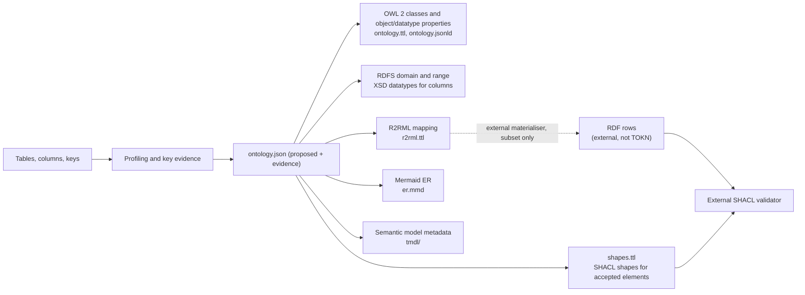

# PostgreSQL auto-ontology walkthrough

This walkthrough turns relational tables in PostgreSQL into a reviewable
ontology with TOKN. It covers:

- a small synthetic `customers` / `orders` schema you create yourself, and
- the public WideWorldImporters sample, from Microsoft's original
  `microsoft/sql-server-samples` repository, prepared as a PostgreSQL database
  you create yourself.

It also covers the optional steps: a CSV complement exported from a spreadsheet,
LLM enrichment (names-only and full), embedding-assisted retrieval through a
separate helper, a native batch decision review, and a SHACL check on a few
materialised RDF rows through an external helper.

Nothing here certifies an element automatically. TOKN writes ontology artifacts
only under the `--out` folder you choose, and helper outputs are the explicit
files you name.

**Three separate tracks.** This page is long; treat it as three exercises and stop
after the one you need:

| Track | Sections | Needs | Spend |
|---|---|---|---|
| Local schema exercise | Part 1 | TOKN, a local PostgreSQL container | None |
| Read-only walk of a database you prepared, local or cloud | Part 2, Part 5 | A database you own and a read-only role | Any managed server bills while it exists |
| Optional enrichment and review | Part 3, Part 4 | A model provider or deployment | Provider charges per call |

Splitting these into separate pages is on the roadmap. Use only synthetic or public
sample rows here. Names such as `customers` and `customer_priorities.csv` are
fictional fixtures, not evidence of a real customer or a real priority list.

## What you get

| Output | What it is | Authority |
|---|---|---|
| `ontology.json` | Canonical intermediate form, with evidence and confidence per element | Source of truth for the other outputs |
| `ontology.ttl` | OWL 2 Turtle: classes and properties | Describes the schema |
| `r2rml.ttl` | W3C R2RML mapping from tables to RDF | Describes how rows would map to RDF |
| `ontology.jsonld` | JSON-LD form of the ontology | Same content as Turtle |
| `er.mmd` | Mermaid ER diagram | Visual summary |
| `tmdl/` | Power BI / Fabric semantic-model definition | Metadata only |
| `report.md` | Coverage, validation, and the review queue | Read this first |
| `shapes.ttl` | SHACL shapes for accepted elements | Checks materialised RDF rows only when you run an external validator (see SHACL) |

Elements backed by declared evidence (for example declared foreign keys, and
some deterministic data properties) carry that status. Inferred relationships
and identity proposals stay **proposed** until you review them by explicit ID.

## What this is not

- **Not a correctness proof.** A proposed relationship can be wrong even when
  the data appears to support it. Review is a human decision, recorded with
  `tokn ontology certify`.
- **Not a model guessing relationships.** Object properties come from declared
  foreign keys, or from containment that the data verifies. A model can suggest
  labels and tie-breaks between candidates that already passed the data checks,
  but it cannot create a relationship.
- **Not a row materialiser.** The build describes the schema and writes
  `shapes.ttl`. It does not load table rows as RDF instances. Materialising rows
  and validating them with SHACL is a separate, external step (see
  [SHACL](#shacl-what-the-build-writes-and-what-the-external-check-covers)).
- **Not free.** Azure PostgreSQL, Azure OpenAI, and the decision API are billed
  by your provider. The deterministic build makes no model call.

## Prerequisites and preflight

Check these before you start. Missing items stop the walkthrough early, so
list them first.

| Dependency | Needed for | Check |
|---|---|---|
| TOKN **v0.3.101 or later** (the feature release used by this guide) | every step | `tokn version` prints a version and `variant: public` or `variant: full` |
| PostgreSQL server you control, reachable over TLS | the build and your prepared WideWorldImporters database | `psql --version` and a successful connection |
| `psql` | precheck and verification queries | `psql --version` |
| Azure CLI (`az`), only if you use Microsoft Entra tokens | PostgreSQL and model authentication | `az version` and `az login` |
| Python 3 with `helpers/requirements.txt`, only for the optional helpers | `export_reference_keys.py` (`psycopg[binary]`), `shacl_subset_check.py` (`rdflib`, `pyshacl`) | `python --version` |
| `git` | cloning Microsoft's original sample repository | `git --version` |
| Azure OpenAI deployment, only for enrichment or embeddings | optional steps | you have an endpoint and a deployment name |
| Decision API deployment, only for the review step | optional step | you have an endpoint and a deployment name |
| Approved CA bundle file | `sslmode=verify-full` | the file exists and your organisation approved it |

The deterministic build and the synthetic example need only TOKN and a
PostgreSQL connection. Everything else is optional.

**Telemetry and updates.** Disable registration and update checks for these
exercises:

```powershell
$env:TOKN_NO_REGISTER = "1"
$env:TOKN_NO_UPDATE_CHECK = "1"
```

```bash
export TOKN_NO_REGISTER=1
export TOKN_NO_UPDATE_CHECK=1
```

Run the commands from `examples\postgresql-auto-ontology` (PowerShell) or
`examples/postgresql-auto-ontology` (Bash).

**Side effects.** TOKN writes ontology artifacts only under the `--out` folder.
Each helper writes only the explicit `--out` or `--rdf-out` file you name, and
refuses to overwrite an existing file. Standard CLI logging may write outside
that folder; this guide does not pass any log option.

### Helper setup (once)

Create a Python environment outside the repository, then install the helper
requirements. The embeddings helper uses only the standard library, but the
other two helpers need the packages below.

```powershell
python -m venv "$env:USERPROFILE\venvs\tokn-helpers"
& "$env:USERPROFILE\venvs\tokn-helpers\Scripts\Activate.ps1"
python -m pip install -r helpers\requirements.txt
```

```bash
python3 -m venv ~/venvs/tokn-helpers
source ~/venvs/tokn-helpers/bin/activate
python -m pip install -r helpers/requirements.txt
```

`helpers/requirements.txt` lists `psycopg[binary]`, `rdflib`, and `pyshacl`.
Run this once, before the first helper step in Part 3.2 or Part 5.

## Journey



## How the artifacts relate



Static overview (one source per build; PostgreSQL and CSV outputs stay separate):

```text
PostgreSQL tables --+
                    +--> tokn ontology build --> ontology.ttl  (OWL 2 classes and properties)
CSV folder ---------+                        --> r2rml.ttl     (mapping; rows not run here)
                                             --> shapes.ttl    (SHACL, accepted elements)
                                             --> report.md, ontology.json

optional: enrichment or decision advice --> human review --> certify by explicit ID --> rebuild
external: materialised RDF rows + shapes.ttl --> external SHACL check (not TOKN)
```

Roles, in brief:

- **OWL 2** describes the vocabulary: which classes exist and which properties
  connect them.
- **RDFS** `domain` and `range` say what a property's subject and object should
  be. Columns map to XSD datatypes.
- **SHACL** validates RDF instances against declared shapes. It checks data,
  not the schema. An empty graph has nothing to check, so a "SHACL passed"
  result on schema-only output means nothing.
- **R2RML** says how table rows would map to RDF. It does not run by itself.

Reference specifications: [OWL 2](https://www.w3.org/TR/owl2-overview/),
[RDFS](https://www.w3.org/TR/rdf-schema/), [SHACL](https://www.w3.org/TR/shacl/),
[R2RML](https://www.w3.org/TR/r2rml/).

## Part 1: Worked example with a synthetic schema

This part uses a tiny schema with invented names. It exercises a declared
foreign key, one data-verified check, and a human review.

### Database hosting: Docker or Podman

Docker is not required by TOKN. PostgreSQL can run natively, in a managed
service, or in a container hosted by **Docker or Podman**. TOKN connects using
the PostgreSQL protocol; it does not launch or manage the container engine.

For containers, publish the database port and use that host/port, database
role, password and appropriate TLS settings in the connection variables.
The Azure token commands below apply only to Azure PostgreSQL with Entra
authentication, not to an ordinary local container. On Windows/macOS, Podman
also needs a running Linux machine.

**Verification boundary:** this walkthrough was live-tested against managed
PostgreSQL. Docker/Podman startup and dataset migration were not exercised here;
container hosting is an alternative deployment, not a separate tested TOKN
integration. Neither engine supplies a ready-made PostgreSQL version of the
Microsoft SQL Server sample.

**Cost and cleanup:** the scratch database and any managed server you create
bill while they exist. Drop the scratch database (`DROP DATABASE tokn_orders_demo`)
and clear `PGPASSWORD` when you finish. The Entra token expires on its own, but
do not store it in a file.

### 1.1 Create a scratch database

Use a database name that does not exist yet. Do not reuse an application
database.

```powershell
$env:PGHOST = "YOUR_SERVER.postgres.database.azure.com"
$env:PGPORT = "5432"
$env:PGUSER = "YOUR_POSTGRES_ROLE"
$env:PGSSLMODE = "verify-full"
$env:PGSSLROOTCERT = "YOUR_APPROVED_CA_BUNDLE.pem"
$token = az account get-access-token --resource https://ossrdbms-aad.database.windows.net --query accessToken --output tsv
$env:PGPASSWORD = $token
psql -d postgres -c "CREATE DATABASE tokn_orders_demo"
```

```bash
export PGHOST="YOUR_SERVER.postgres.database.azure.com"
export PGPORT="5432"
export PGUSER="YOUR_POSTGRES_ROLE"
export PGSSLMODE="verify-full"
export PGSSLROOTCERT="YOUR_APPROVED_CA_BUNDLE.pem"
export PGPASSWORD="$(az account get-access-token --resource https://ossrdbms-aad.database.windows.net --query accessToken --output tsv)"
psql -d postgres -c "CREATE DATABASE tokn_orders_demo"
```

`psql` and TOKN read the standard PostgreSQL environment variables (`PGHOST`,
`PGPORT`, `PGUSER`, `PGPASSWORD`, `PGSSLMODE`, `PGSSLROOTCERT`). Paths and
secrets therefore never have to be placed inside a connection string, and a
path with spaces needs no quoting inside one.

Connect to the new database (`psql -d tokn_orders_demo`) and run:

```sql
CREATE TABLE customers (
    customer_id   integer PRIMARY KEY,
    customer_name text NOT NULL UNIQUE,
    country_code  char(2)
);

CREATE TABLE orders (
    order_id     integer PRIMARY KEY,
    customer_id  integer NOT NULL REFERENCES customers (customer_id),
    order_date   date NOT NULL,
    total_amount numeric(10, 2) NOT NULL
);

INSERT INTO customers (customer_id, customer_name, country_code) VALUES
    (1, 'Example Traders', 'AA'),
    (2, 'Sample Logistics', 'BB'),
    (3, 'Demo Retail', 'CC');

INSERT INTO orders (order_id, customer_id, order_date, total_amount) VALUES
    (101, 1, '2026-01-05', 120.00),
    (102, 2, '2026-01-07', 45.50),
    (103, 1, '2026-02-11', 300.25),
    (104, 3, '2026-02-14', 18.00);
```

### 1.2 Build the ontology

Set `PG_DSN` to the database name only. The host, port, role, password, TLS
mode, and CA bundle come from the `PG*` variables set in 1.1, so no secret or
path is written into the connection string. TOKN reads `PG_DSN` from the process
environment; a `.env` file is not used.

```powershell
$env:PG_DSN = "dbname=tokn_orders_demo"
tokn ontology build --source postgres:env:PG_DSN --out .\out\orders-demo
```

```bash
export PG_DSN="dbname=tokn_orders_demo"
tokn ontology build --source postgres:env:PG_DSN --out ./out/orders-demo
```

Expected: the command reports classes, properties, and the number of proposed
items. The exact counts depend on the catalogue and profiling, so treat any
number you see as a result of your run, not a target.

### 1.3 Read what was inferred

- **What to look for.** `orders.customer_id` references `customers.customer_id`
  as a declared foreign key. Check how the build labels the two classes and
  the relationship in `report.md` and `ontology.ttl`. Use the labels the build
  actually emits for this sample; do not assume them.
- **Column types** map to XSD datatypes. Compare `ontology.ttl` with the table
  above to see which datatype each column received.
- **Labels** can be changed later with an override, not by editing the output.

Open `report.md` in the output folder. It lists coverage, validation messages,
and the review queue.

### 1.4 Review and certify by explicit ID

```powershell
tokn ontology review --out .\out\orders-demo
```

Each line shows an ID, a kind, a confidence number, and a label. Confidence
is the tool's score, not a calibrated probability of correctness.

Accept only the elements you have checked, by ID:

```powershell
tokn ontology certify --out .\out\orders-demo --accept YOUR_ELEMENT_ID
tokn ontology build --source postgres:env:PG_DSN --out .\out\orders-demo
```

`certify` takes explicit IDs. There is no bulk accept. Decisions are written
to `ontology.overrides.yaml` in the output folder and survive a rebuild. If an
override refers to an element that no longer exists, the build reports it as
stale and does not drop it silently.

### 1.5 Ask for a join path

```powershell
tokn ontology join-path YOUR_FROM_CLASS YOUR_TO_CLASS --out .\out\orders-demo
```

Use the class labels shown in `report.md` for your run. The command prints the
join steps, then a `FROM ... JOIN ...` fragment. It does not print a `SELECT`.
Add the projection yourself to make a runnable query, for example `SELECT *`
before the fragment.

Expected output shape:

```text
1. orders(customer_id) -> customers(customer_id)  [<property id>]

FROM orders JOIN customers ON ...
```

### 1.6 Decision review: what it does and does not see

The native decision review (Part 4) sends only **proposed, inferred**
relationships, and it never sends declared ones. This example's only
relationship is declared, so there is nothing for the review to send. Use it on
the CSV or WideWorldImporters builds, where inferred proposals exist.

## Part 2: WideWorldImporters sample dataset

The WideWorldImporters sample is Microsoft's. Its original source is in the
[microsoft/sql-server-samples](https://github.com/microsoft/sql-server-samples/tree/master/samples/databases/wide-world-importers)
repository, under `samples/databases/wide-world-importers`. That repository is
licensed under the MIT License. Its
[license file](https://github.com/microsoft/sql-server-samples/blob/master/license.txt)
begins:

> Microsoft SQL Server Sample Code. Copyright (c) Microsoft Corporation. All rights reserved. MIT License.

This walkthrough does not copy any of Microsoft's sample assets into the
repository. You clone the original yourself, from Microsoft's repository, and
keep its license and notices intact.

**Important boundary: the official sample targets SQL Server.** Microsoft's
distribution is built for SQL Server. It is not published as a PostgreSQL
database. Before this walkthrough can run against PostgreSQL, you must create
that PostgreSQL database yourself, by migrating or porting the sample. This
guide does not provide a PostgreSQL seed command, and the official SQL Server
backup does not restore into PostgreSQL. Third-party ports are not covered here,
and you should check their licenses before use.

Sections 2.1 to 2.4 cover getting the original source and preparing a
PostgreSQL database. Section 2.5 onward is the TOKN workflow, which starts
once your PostgreSQL database exists.

### 2.1 Clone the original Microsoft source

```powershell
git clone https://github.com/microsoft/sql-server-samples.git sql-server-samples
git -C sql-server-samples checkout 0d0134571daa42979abfca52fb9fb07eaca8d241
```

```bash
git clone https://github.com/microsoft/sql-server-samples.git sql-server-samples
git -C sql-server-samples checkout 0d0134571daa42979abfca52fb9fb07eaca8d241
```

The checkout is pinned to a commit that touched the WideWorldImporters folder
when this guide was written. Check the
[folder history](https://github.com/microsoft/sql-server-samples/commits/master/samples/databases/wide-world-importers)
for newer changes. The `sql-server-samples` folder is git-ignored by this
repository. Keep the license file (`sql-server-samples/license.txt`) with any
copy you make.

### 2.2 Precheck: the target must not exist

The database you prepare should be named `wideworldimporters` (a suggestion;
any new database name works). Stop if it already exists. Do not drop or change
any existing database as part of this walkthrough.

```powershell
psql -d postgres -tAc "SELECT count(*) FROM pg_database WHERE datname = 'wideworldimporters'"
```

The output must be `0`. If it is anything else, stop.

### 2.3 Create the PostgreSQL database (operator step)

This step is yours. The repository has no PostgreSQL seed script for the
official sample. Your PostgreSQL database must:

- be a new database, not an existing application database;
- contain the sample's tables, keys, and data, produced by your own migration
  or port of the Microsoft source;
- be reachable with `sslmode=verify-full` against your approved CA bundle.

Keep your migration tooling, its inputs, and its output outside this
repository. Do not commit copies of the sample data or converted files here.
Record the source commit and your migration settings so you can reproduce the
database later.

Do not pass destructive flags, and do not drop or alter any existing database.
Verify the database as in the next section before you build.

### 2.4 Verify your PostgreSQL database before you build

Run these against your prepared database. Compare the results with the table
and row counts of the Microsoft source you migrated. Do not build until the
numbers match, or until you understand why they differ.

```powershell
$env:PGDATABASE = "wideworldimporters"
psql -tAc "SELECT count(*) FROM information_schema.tables WHERE table_schema = 'public' AND table_type = 'BASE TABLE'"
psql -tAc "SELECT count(*) FROM information_schema.tables WHERE table_schema = 'public' AND table_type = 'VIEW'"
psql -tAc "SELECT count(*) FROM information_schema.table_constraints WHERE table_schema = 'public' AND constraint_type = 'FOREIGN KEY'"
psql -tAc "SELECT sum((xpath('/row/c/text()', query_to_xml(format('SELECT count(*) AS c FROM %I.%I', table_schema, table_name), false, true, '')))[1]::text::bigint) FROM information_schema.tables WHERE table_schema = 'public' AND table_type = 'BASE TABLE'"
```

```bash
export PGDATABASE="wideworldimporters"
psql -tAc "SELECT count(*) FROM information_schema.tables WHERE table_schema = 'public' AND table_type = 'BASE TABLE'"
psql -tAc "SELECT count(*) FROM information_schema.tables WHERE table_schema = 'public' AND table_type = 'VIEW'"
psql -tAc "SELECT count(*) FROM information_schema.table_constraints WHERE table_schema = 'public' AND constraint_type = 'FOREIGN KEY'"
psql -tAc "SELECT sum((xpath('/row/c/text()', query_to_xml(format('SELECT count(*) AS c FROM %I.%I', table_schema, table_name), false, true, '')))[1]::text::bigint) FROM information_schema.tables WHERE table_schema = 'public' AND table_type = 'BASE TABLE'"
```

| Check | What to compare |
|---|---|
| Base tables | The number of tables in your migrated source |
| Views | The number of views in your migrated source |
| Declared foreign keys | The number of foreign keys your migration should carry over |
| Total rows across base tables | The row total from your migration log or source checks |

The official sample is a SQL Server database. Your PostgreSQL migration can
change how types, keys, or views are represented, so check the counts against
your own migration record rather than an external number.

### 2.5 Build

Refresh the token in the same session first. Tokens are short-lived.

```powershell
$env:PGPASSWORD = az account get-access-token --resource https://ossrdbms-aad.database.windows.net --query accessToken --output tsv
$env:PG_DSN = "dbname=wideworldimporters"
tokn ontology build --source postgres:env:PG_DSN --out .\out\wwi --sample 1000 --probe-limit 5000 --json
```

```bash
export PGPASSWORD="$(az account get-access-token --resource https://ossrdbms-aad.database.windows.net --query accessToken --output tsv)"
export PG_DSN="dbname=wideworldimporters"
tokn ontology build --source postgres:env:PG_DSN --out ./out/wwi --sample 1000 --probe-limit 5000 --json
```

`--sample` controls how many rows are profiled per table, and `--probe-limit`
caps the distinct child values checked per foreign-key containment probe.
With `--json`, the result is printed as JSON.

The build is deterministic. Running it again with unchanged source, overrides,
and options is a no-op. Use `--force` to rebuild anyway.

**Reference result (deterministic, fixed run on a prepared WideWorldImporters
database).** 51 relations, 589 of 589 columns mapped, 98 declared foreign keys
accepted, 30 proposed relationships for review (a count of proposed relationships only).
 Keyless tables produce warnings, andthe build does not invent identity or nullability for them. These figures
describe the schema mapping only. They are not an RDF row count, and they are
not a claim that all rows convert losslessly.

### 2.6 Review proposed elements

```powershell
tokn ontology review --out .\out\wwi --min-confidence 0.5
```

Work through the queue by ID. Certify only what you have checked against the
data and the business meaning:

```powershell
tokn ontology certify --out .\out\wwi --accept YOUR_ELEMENT_ID --reject YOUR_OTHER_ELEMENT_ID
tokn ontology build --source postgres:env:PG_DSN --out .\out\wwi
```

Then check a join path between two classes named in `report.md`:

```powershell
tokn ontology join-path YOUR_FROM_CLASS YOUR_TO_CLASS --out .\out\wwi
```

### 2.7 Optional: bounded analysis (`--sketch`)

The build can also write an advisory `analysis.json` next to the ontology.
Use explicit scan limits on large databases:

```powershell
tokn ontology build --source postgres:env:PG_DSN --out .\out\wwi-sketch --sketch --sketch-analyses all --sketch-max-rows 10000 --sketch-max-total-rows 20000 --sketch-timeout 1m
```

```bash
tokn ontology build --source postgres:env:PG_DSN --out ./out/wwi-sketch --sketch --sketch-analyses all --sketch-max-rows 10000 --sketch-max-total-rows 20000 --sketch-timeout 1m
```

- `--sketch-max-rows` caps each initial table scan.
  `--sketch-max-total-rows` caps sketch scans plus analysis verification
  re-reads; ordinary profiling and relationship probes have separate limits.
  `--sketch-timeout` bounds each table scan, not the entire build.
- `--sketch-analyses all` runs every analysis. You can name the ones you want
  instead.

What it gives you: evidence to help a reviewer see which columns look like
candidate keys, how often values repeat, and whether a column's format is
consistent across the sample.

Limits to keep in mind:

- `analysis.json` is **advisory**. It never creates keys, classes, or composite
  foreign keys, and it does not change the ontology or any element's status.
- No measured accuracy improvement is claimed.
- It does not merge the PostgreSQL and CSV outputs. Each source keeps its own
  analysis.
- Inspect completeness and verification status. A partial scan or sample
  cannot prove a whole-table property.
- The separate sketch stage can block unsupported sampled keys and nominate
  relationships for source checking. Those relationships remain proposed.
  Review ontology elements and certify only explicit IDs, as in section 2.6;
  analysis findings themselves are not certifications.

## Part 3: Optional model steps

None of these steps is needed for the deterministic build.

### 3.1 LLM enrichment (chat model)

```powershell
tokn ontology build --source postgres:env:PG_DSN --out .\out\wwi --enrich=names-only --model-provider azure-openai --model-name gpt-6-luna
```

- `--enrich=names-only` sends table and column **names and types** to the
  model, with no sample values and no statistics.
- `--enrich` (full) also sends masked profile statistics. Columns marked as PII
  are never sent as values.
- The model can improve labels and descriptions, break a tie between candidates
  the data already verified, and propose abstract superclasses. Superclass
  proposals are marked proposed, with capped confidence. The model does not
  create relationships.
- Results are cached in the output folder. A rebuild with unchanged input does
  not call the model again.
- Output can vary between runs even at temperature 0, so review enriched labels
  like any other proposal.
- If no provider resolves, the run stops before reading the source. Re-run
  without `--enrich` for a deterministic-only result.

Configure the Azure OpenAI endpoint and credentials in the process environment,
using the names your provider configuration expects. `AZURE_OPENAI_API_KEY` or
Microsoft Entra ID can be used. Do not put keys in a committed file.

### 3.1b Verified run: names-only enrichment with an Anthropic model

This run used an existing Foundry account with the Anthropic route on the Azure
AI endpoint (`https://YOUR_RESOURCE.services.ai.azure.com/anthropic`, a
placeholder). No API key was used: the client authenticated with Microsoft
Entra ID through `az login`. The model name must match the deployment you
select.

```powershell
$env:ANTHROPIC_BASE_URL = "https://YOUR_RESOURCE.services.ai.azure.com/anthropic"
$env:ANTHROPIC_USE_DEFAULT_CREDENTIAL = "true"
tokn ontology build --source csv:.\csv-demo --out .\out\csv-opus --enrich=names-only --model-provider anthropic --model-name claude-opus-5-5
```

```bash
export ANTHROPIC_BASE_URL="https://YOUR_RESOURCE.services.ai.azure.com/anthropic"
export ANTHROPIC_USE_DEFAULT_CREDENTIAL="true"
tokn ontology build --source csv:./csv-demo --out ./out/csv-opus --enrich=names-only --model-provider anthropic --model-name claude-opus-5-5
```

`--enrich=names-only` sends table and column **names and types**, the same payload
described in 3.1. No sample values and no statistics are sent.

**Verified in this run (CSV two-file folder):**

- 2 of 2 enrichment batches succeeded, with 0 fallbacks.
- 7 elements carry LLM-tagged evidence.
- 8 columns are mapped. The inferred foreign key remains **proposed**, and 0
  foreign keys are declared.

**What changed, and what did not.** Only two description fields were empty
before the run. The table shows those two fields.

| Element | Field | Before | After |
|---|---|---|---|
| Class `CustomerPriority` | description | (empty) | A dated priority assessment for a customer, recording its priority band, review score, whether a review is required, and an optional analyst note. |
| Property `RequiresReview` | description | (empty) | Whether this customer priority record is flagged as needing review. |

- Labels did **not** change: they remain `Customer Priority` and `requires review`.
- Identifiers, types, and relationship constraints did not change.
- The descriptions are generated text about this neutral CSV schema. Read them
  as proposals and check them yourself.
- This run shows the enrichment step working on a small example. It is not a
  benchmark, and it does not show accuracy improvement.

### 3.1c Verified run: full enrichment on the PostgreSQL build

The full enrichment mode also sends masked profile statistics (PII columns are
never sent as values). This run used the Azure OpenAI chat deployment:

```powershell
tokn ontology build --source postgres:env:PG_DSN --out .\out\wwi-enrich --enrich=full --model-provider azure-openai --model-name gpt-6-luna
```

```bash
tokn ontology build --source postgres:env:PG_DSN --out ./out/wwi-enrich --enrich=full --model-provider azure-openai --model-name gpt-6-luna
```

**Verified in this run (WideWorldImporters, full build):**

- 114 of 121 enrichment batches succeeded. The build counted 7 batches as
  fallbacks to deterministic output. Not every batch succeeded, and the count is
  reported rather than hidden.
- All 589 of 589 columns were retained, and all 98 declared foreign keys were kept.
- The source has 51 relations. The ontology has 70 classes: the 51 source
  classes plus 19 proposed abstract superclasses. The superclasses are proposals
  for review, not confirmed structure.
- 128 relationships in total: the same 98 declared, plus 30 proposed.

Enrichment changes labels and descriptions, and it proposes superclasses. It
does not add or remove declared relationships, and it cannot create a
relationship on its own.

This run is not evidence of an accuracy gain. It shows what the build produced,
not whether the new descriptions are better.

### 3.2 Embeddings for retrieval (not used by the build)

`tokn ontology build` does **not** use embeddings. If you build your own
retrieval over the ontology, an embedding model is a separate client:

- Use an embeddings deployment such as `text-embedding-ada-002`, which returns
  1536-dimension vectors.
- Call the account-level Azure OpenAI embeddings endpoint, for example
  `https://YOUR_RESOURCE.openai.azure.com/openai/v1/embeddings`, with a Microsoft
  Entra token for the Cognitive Services audience.
- A project-level endpoint may serve a different API surface, so confirm the
  path before you rely on it.
- Keep the deployment name in the environment (`AZURE_OPENAI_EMBEDDING_DEPLOYMENT`
  in the example `.env.example`). TOKN does not read that name.

See the [Azure OpenAI embeddings reference](https://learn.microsoft.com/azure/ai-services/openai/reference)
for the request format.

The helper `helpers/embed_retrieval.py` runs this retrieval over one
`ontology.json` at a time. Keep the PostgreSQL and CSV results in separate
output files. It embeds only schema names, and it skips evidence and sample
subtrees. It needs no third-party package; see the helper setup above.

```powershell
$env:AZURE_OPENAI_EMBEDDING_ENDPOINT = "https://YOUR_RESOURCE.openai.azure.com"
$env:AZURE_OPENAI_EMBEDDING_DEPLOYMENT = "YOUR_EMBEDDING_DEPLOYMENT"
python .\helpers\embed_retrieval.py --ontology .\out\wwi\ontology.json --query "customer priority" --top-k 10 --out .\out\wwi\retrieval.json
```

Use a separate embeddings endpoint variable (`AZURE_OPENAI_EMBEDDING_ENDPOINT`),
so the Responses or project configuration you use elsewhere is not overwritten.

## Part 4: Decision review (advisory)

### 4.1 Native batch review inside the build

`tokn ontology build` can send batched decision questions about the
**proposed** inferred foreign keys in one run:

```powershell
tokn ontology build --source postgres:env:PG_DSN --out .\out\wwi --decision-review --decision-batch-size 16 --decision-max-candidates 200
```

```bash
tokn ontology build --source postgres:env:PG_DSN --out ./out/wwi --decision-review --decision-batch-size 16 --decision-max-candidates 200
```

- Defaults: batch size 16 (maximum 64), up to 200 candidates. Each batch
  sends several choice questions that share one schema-only state. The state
  contains table and column names and types, with no row samples.
- Only **proposed inferred** foreign keys are sent. Declared and certified
  relationships are excluded.
- The model returns a recommendation per candidate: `retain`, `reject`, or
  `needs_evidence`. Recommendations are stored in `ontology.json` under
  `decision_review`, with batch and provenance details, and summarised in
  `report.md`. Read them with `tokn ontology review --json`.
- A recommendation never changes an element's status, confidence, or
  evidence. Only an explicit human decision does that:
  `tokn ontology certify --accept <id>` or `--reject <id>`, followed by a
  rebuild.
- If every attempted batch fails, the build fails before writing artifacts.
  Counts and skipped candidates are printed explicitly, so a partial result is
  never hidden.
- Use one `--source` per build. The PostgreSQL and CSV outputs stay in separate
  folders.

**Verified native run.** Each backend below ran a full WideWorldImporters build
with a small, bounded configuration:

```powershell
tokn ontology build --source postgres:env:PG_DSN --out .\out\wwi-decision --decision-review --decision-batch-size 4 --decision-max-candidates 8
```

```bash
tokn ontology build --source postgres:env:PG_DSN --out ./out/wwi-decision --decision-review --decision-batch-size 4 --decision-max-candidates 8
```

What the runs showed, per backend:

- 2 native calls, each with 4 choice questions sharing one schema-only state,
  so 8 candidates were answered.
- The `--decision-max-candidates 8` cap is an operator setting. It explicitly
  skipped the other 22 of the 30 proposed candidates, and the build reported
  those skips. A cap is a deliberate limit, not a failure.
- The 98 declared foreign keys were never sent for a question.
- No relationship's status, confidence, or evidence changed.

| Backend | Retain | Reject | Needs evidence |
|---|---|---|---|
| Microsoft Decision | 6 | 2 | 0 |
| TypeSafe Jev | 7 | 1 | 0 |
| Nimble (hosted) | 8 | 0 | 0 |
| Native Azure decisions for `gpt-6-luna` | 6 | 1 | 1 |

These are counts of model outputs on eight candidates. They are not an accuracy
benchmark, and the backends disagree on some candidates. A model's view is
advice, not a consensus; counts can vary between runs. **All eight reviewed relationships remain proposed**,
including those marked retain. Only an operator's explicit certification changes
their status:

```powershell
tokn ontology certify --out .\out\wwi-decision --accept YOUR_ELEMENT_ID
tokn ontology build --source postgres:env:PG_DSN --out .\out\wwi-decision
```

**Verification status.** The native batch stage ran and was checked against
the four backends above. The results are limited to this bounded run.

### 4.2 Backend configuration

The native review stage uses the existing decision-provider settings. Set them
in the process environment:

```powershell
$env:SYSTEMONE_BACKEND = "microsoft"
$env:DECISION_API_ENDPOINT = "https://YOUR_RESOURCE.cognitiveservices.azure.com"
$env:DECISION_API_MODEL = "YOUR_DECISION_DEPLOYMENT"
# Omit DECISION_API_KEY to use Microsoft Entra ID (az login).
```

```bash
export SYSTEMONE_BACKEND="microsoft"
export DECISION_API_ENDPOINT="https://YOUR_RESOURCE.cognitiveservices.azure.com"
export DECISION_API_MODEL="YOUR_DECISION_DEPLOYMENT"
# Omit DECISION_API_KEY to use Microsoft Entra ID (az login).
```

`YOUR_DECISION_DEPLOYMENT` is the name of **your** deployment in your
account. It is not a fixed catalogue name, so use the name your operator gave you.

### Provider options

The native review stage uses the decision-provider settings above, and each
backend below is configured the same way. The table states what this guide has
verified. Each backend in the matrix was verified in the limited two-question
test and in the bounded native build run in section 4.1. Rows marked "not tested
here" have not been run by this walkthrough, so confirm them in your own
environment first. Check the backend identifier for your build with
`tokn system-one --help`.

| Option | Status in this guide | How it is reached | Notes |
|---|---|---|---|
| Microsoft Decision (`SYSTEMONE_BACKEND=microsoft`) | **Verified baseline.** Used in the examples above. | Decision endpoint and your deployment name (`YOUR_DECISION_DEPLOYMENT`); key or Entra ID | The default path for this guide |
| TypeSafe Jev (`jev` backend) | **Verified in a limited two-question test** on the same schema-only request. Returned typed answers that validated. Not an accuracy benchmark. | `SYSTEMONE_BACKEND=jev`, `JEV_API_KEY` (or `TYPESAFE_API_KEY`), and optional `JEV_MODEL`. TOKN fixes the base URL. | Reported model `jev-1.14.0`. Setup details: [SETUP.md](../../SETUP.md) |
| Nimble, hosted (`SYSTEMONE_BACKEND=compatible`) | **Verified in the same limited two-question test.** Returned typed answers that validated. Not an accuracy benchmark. | `SYSTEMONE_BACKEND=compatible`, `SYSTEMONE_BASE_URL` (TOKN appends `/systemone`), `SYSTEMONE_API_KEY`, and `SYSTEMONE_MODEL` | Reported model `nimble-latest`. Setup details: [SETUP.md](../../SETUP.md) |
| Native Azure decisions API for `gpt-6-luna` (`/openai/v1/decisions`) | **Verified in the same limited two-question test.** Returned typed answers that validated. Not an accuracy benchmark. | `SYSTEMONE_BACKEND=azure`, `AZURE_OPENAI_ENDPOINT` (the account endpoint form printed by `tokn system-one --help`), `SYSTEMONE_MODEL` (your deployment name), and either `AZURE_OPENAI_API_KEY` or Microsoft Entra ID (`az login`). The region must support the decisions operation; East US 2 does not. See [Microsoft's decisions how-to](https://learn.microsoft.com/azure/foundry/openai/how-to/decisions). | Use the decisions route only. A chat or Responses call is not a decision call. Setup details: [SETUP.md](../../SETUP.md) |
| Compatible endpoint, other models | Not tested here | The same `SYSTEMONE_*` variables as the Nimble row | Confirm the endpoint serves the decision request shape before use |

**Chat models are not decision models.** The `gpt-6-luna` chat path used by
`--enrich` (Part 3) is a different call. Enrichment can improve labels, but it
cannot approve or create relationships. Choosing a decision backend does not
change the enrichment step.

**Whatever backend you pick, the rules stay the same.** The answer is advice.
A person certifies each element by explicit ID, and confidence values are not
calibrated.

### Treat results as advice

Recommendations are advisory. They do not change the ontology, and they do not
certify anything. Treat these results as advice:

- Probabilities and confidences are **not calibrated** measures of correctness.
- Answers can vary between runs and model versions.
- The model never creates a relationship. Any relationship it names must
  already exist in the ontology as a proposed element.
- A person decides. Certify by explicit ID after reading the evidence:
  `tokn ontology certify --accept <id>`.

## Reading the review queue responsibly

| Signal | What it tells you | What it does not tell you |
|---|---|---|
| Declared foreign key | The database says the link exists | That the business meaning is right |
| Data containment | Child values exist in the parent in the sample you profiled | That the sample is complete or representative |
| Model answer | A structured opinion on the evidence | That the opinion is correct |
| Confidence score | How strongly the rules and evidence line up | A calibrated probability |

Composite keys and UNIQUE constraints are not flattened. A composite
foreign key or composite key is kept as a whole. A single column may not be
unique on its own, even when the combination is. The Power BI / TMDL output
represents relationships as single-column links, so a composite foreign key
cannot be expressed fully there. Treat that output as metadata for review, not
as a complete copy of the key structure.

## Part 5: CSV complement (demonstrated baseline)

A spreadsheet export is a separate, independent source. TOKN builds an
ontology from one `--source` at a time, so it does not merge the PostgreSQL
ontology with the CSV ontology. Keep the two outputs in separate folders.

Demonstrated on sample files only. `customer_priorities.csv` is a hand-written
synthetic fixture (5 rows); it describes no real customer.

| Step | Input | Result |
|---|---|---|
| Single CSV file | `customer_priorities.csv` alone (5 rows, 7 columns) | 1 class, 7 of 7 columns mapped, 0 relationships, 0 declared foreign keys |
| Two-file CSV folder | `customers.csv` (4 `CustomerID` values exported from the prepared PostgreSQL database) plus `customer_priorities.csv` | 2 tables, 8 of 8 columns mapped, 1 proposed object relationship `CustomerID` → `customers.CustomerID`, 0 declared foreign keys |

What these results mean:

- The relationship in the two-file run is **proposed**, inferred from the
  sample values in the files. It is not a database constraint. Review it, then
  certify it by explicit ID if you agree.
- Both CSV tables report that database constraints are unavailable. A CSV file
  has no declared keys, so none can be recovered from it. Primary and foreign
  keys from PostgreSQL are not carried into the CSV ontology.
- In the two-file run, `customers` was classified as a lookup-style table.
  Check that classification in `report.md` before you rely on it.
- The sample evidence is limited to a few rows. A value match in the sample is
  not a guarantee for the full data.

### 5.1 Export the reference keys from PostgreSQL

Create the scratch folder first; the helper does not create folders. Then
export only the `CustomerID` values you need from your prepared database, as
UTF-8 CSV with a header row. Use read-only access. Keep the file in the ignored local scratch folder
`csv-demo\` (never committed).
```powershell
New-Item -ItemType Directory -Force .\csv-demo | Out-Null
```

```bash
mkdir -p ./csv-demo
```

Use the exact catalogue names from your prepared database (for example, check
them in `psql` with `\dt` or the information schema). Identifiers created with
quotes keep their case, so do not assume lower-case names. Replace each
placeholder; quote them as shown.

```powershell
python .\helpers\export_reference_keys.py --schema "YOUR_SCHEMA" --table "YOUR_TABLE" --column "YOUR_ID_COLUMN" --header CustomerID --limit 4 --out .\csv-demo\customers.csv
```

```bash
python ./helpers/export_reference_keys.py --schema "YOUR_SCHEMA" --table "YOUR_TABLE" --column "YOUR_ID_COLUMN" --header CustomerID --limit 4 --out ./csv-demo/customers.csv
```

The helper reads the connection string from `PG_DSN` (set to the prepared
wideworldimporters database in section 2.5),
opens a read-only session, and refuses to overwrite an existing `--out` file. It
writes only the requested column. The `--limit 4` value matches the demonstrated
baseline; raise it for real use.

Confirm the file has the header `CustomerID` and the expected number of rows.

### 5.2 Prepare the spreadsheet supplement

Copy the neutral `customer_priorities.csv` supplied in this example folder (next
to this README) into the `csv-demo` folder from 5.1. The copy step refuses to
overwrite an existing file, so an edited copy is never replaced:

```powershell
if (Test-Path .\csv-demo\customer_priorities.csv) { throw 'csv-demo\customer_priorities.csv already exists; keep your edited copy' }
Copy-Item -LiteralPath .\customer_priorities.csv -Destination .\csv-demo\customer_priorities.csv
```

```bash
if [ -e ./csv-demo/customer_priorities.csv ]; then
  echo "csv-demo/customer_priorities.csv already exists; keep your edited copy" >&2
else
  cp ./customer_priorities.csv ./csv-demo/customer_priorities.csv
fi
```

To use your own spreadsheet instead, save it as described below.

Save the spreadsheet as **CSV UTF-8 (Comma delimited)** in Excel using "Save As", so the file is UTF-8 with a header row. Save it as
`csv-demo\customer_priorities.csv`. Include a `CustomerID` column that matches
the values exported in 5.1, plus your own categorisation columns. Excel's
automation features are not needed.

### 5.3 Build the two-file CSV folder

```powershell
tokn ontology build --source csv:.\csv-demo --out .\out\csv-demo
```

```bash
tokn ontology build --source csv:./csv-demo --out ./out/csv-demo
```

Review the proposed relationship by ID, then rebuild after your decision:

```powershell
tokn ontology review --out .\out\csv-demo
tokn ontology certify --out .\out\csv-demo --accept YOUR_ELEMENT_ID
tokn ontology build --source csv:.\csv-demo --out .\out\csv-demo
```

Keep the PostgreSQL output (`out\wwi` or `out\orders-demo`) separate from
`out\csv-demo`. Any retrieval or search that spans both is a separate,
external helper, not part of the TOKN build.

### 5.4 Reconciling after a type change (verified CSV sequence)

Ontology rebuilds do not silently keep an old decision when the evidence changes.
This sequence was run on the two-file CSV folder:

| Step | What the build showed |
|---|---|
| 1. Initial build | The `CustomerID` relationship is **proposed**. |
| 2. Operator certifies it (`--accept`) | Status is **accepted**, recorded in `ontology.overrides.yaml`. |
| 3. Rebuild with no input change | The build is a no-op. |
| 4. Rewrite `CustomerID` values in both files with a decimal part (for example `1.0`), so inference reads them as decimal, then rebuild | Fresh inference proposes the **same relationship ID** again. The earlier acceptance is reported as a **stale override**, and `ontology.overrides.yaml` is kept. |

After step 4, the operator reviews the relationship again and certifies it
explicitly if it still holds. Relationship IDs, the proposed status, and the
evidence are reported as they are; nothing is accepted automatically.

```powershell
tokn ontology review --out .\out\csv-demo
tokn ontology certify --out .\out\csv-demo --accept YOUR_ELEMENT_ID
tokn ontology build --source csv:.\csv-demo --out .\out\csv-demo
```

Operator review is not a database constraint. The CSV folder has no declared
keys, so the certified relationship is still an inference that a person has
accepted.

## SHACL: what the build writes, and what the external check covers

SHACL validates **RDF instances** against shapes. It does not validate a SQL
database directly. With no RDF rows loaded, a SHACL run passes trivially and
proves nothing. Do not report a SHACL pass based on schema-only output.

The shapes are derived from the accepted ontology. A shape requires a value
only for accepted, mapped, NOT NULL columns with a known constraint. A key is
expressed as at most one value only when the source guarantees it. Proposed
elements are skipped. For CSV sources, the nullability of a column is unknown,
so no minimum count is assumed, and uniqueness is not expressed.

Verification status: a focused check on a small set of materialised RDF rows
used an **external** SHACL engine and a materialiser, not a TOKN validator.
Results from that check were: a valid graph passed; a wrong
integer datatype, a removed required identifier, and a missing required
foreign-key property failed; an absent nullable value passed. This does not
show full conformance of the database, and it is not a lossless claim about
all rows.

Limits to keep in mind:

- The check covers only the rows you materialise.
- Keyless tables produce warnings, and no identity is invented for them.
- Nullable keyless columns have R2RML limitations of their own.
- Full-database RDF conversion is not part of this walkthrough.

## Helper reference

The helpers live in `helpers/`. They are optional and small. Each one takes
explicit input and output paths, reads configuration only from named environment
variables, and never loads a `.env` file or installs anything. Each refuses to
overwrite an existing output file.

| Helper | Purpose | Dependencies | Output |
|---|---|---|---|
| `export_reference_keys.py` | Export one identifier column from a PostgreSQL table to a new CSV, read-only, NULLs skipped | `psycopg[binary]` | A CSV with one header row |
| `embed_retrieval.py` | Rank schema-only terms from one `ontology.json` against a query, using an Azure OpenAI embeddings deployment | Standard library; Azure CLI (`az`) for `--auth entra` | A JSON file with ranked terms and scores |
| `shacl_subset_check.py` | Materialise a few CSV rows as RDF and run SHACL against them, with an expected result | `rdflib`, `pyshacl` | A pass or fail report; optional Turtle output |

**Export reference keys.** Exports one identifier column to a new CSV. It reads
`PG_DSN` (set in 2.5), opens a read-only session, writes only the requested
column, skips NULLs, and refuses to overwrite an existing `--out` file. Run it
after the folder from 5.1 exists:

```powershell
python .\helpers\export_reference_keys.py --schema "YOUR_SCHEMA" --table "YOUR_TABLE" --column "YOUR_ID_COLUMN" --header CustomerID --limit 4 --out .\csv-demo\customers.csv
```

```bash
python ./helpers/export_reference_keys.py --schema "YOUR_SCHEMA" --table "YOUR_TABLE" --column "YOUR_ID_COLUMN" --header CustomerID --limit 4 --out ./csv-demo/customers.csv
```

**Embedding retrieval.** Embeds only schema names (labels, names, table andcolumn names). It skips evidence, profile, sample, statistics, and enumeration
or data-value branches. Pass the account endpoint (`https://<resource>.openai.azure.com`,
optionally ending in `/openai/v1`). Project routes are rejected before any
token is requested. The helper requires complete, finite, equal-length vectors,
and it stops rather than guessing when a response does not match. The embedding
call uses the standard library, and the OpenAI SDK is not needed.

**SHACL subset check.** This is a focused check: it is not an R2RML engine, not a
TOKN validator, and not a database conformance test. Before any row is checked,
the helper confirms that a shape in `shapes.ttl` targets the mapped class and
that each mapped property has a matching property shape. A mapping that does not
match stops the run with a non-zero exit before any check. That is a setup
error, not an `--expect fail` outcome. The helper also refuses a missing CSV
column, a short or over-wide row, an empty or repeated identifier, a repeated
CSV header, more than `--max-rows` rows, and zero rows. Literal text is checked
as written, so an invalid value is reported as a failed check.

For most runs, use the ontology route below. Write a hand-made mapping only for
a custom case, and copy every name from your own `shapes.ttl`:

```json
{
  "base_iri": "<namespace of your shapes.ttl>",
  "class_name": "<class local name from shapes.ttl>",
  "id_column": "<CSV identifier column>",
  "properties": {
    "<CSV column>": {"predicate": "<property local name from shapes.ttl>", "datatype": "xsd:string"}
  }
}
```

Each row becomes one resource typed with the mapped class. Empty cells produce
no triple. Supported datatypes are `xsd:integer`, `xsd:decimal`, `xsd:string`,
`xsd:date`, and `xsd:boolean`.

`--expect` states the outcome you intend for the data. The helper prints the
number of shapes that target the class, the number of mapped properties, and the
focus node count. It exits `0` when the result matches the expectation, and `1`
when it does not.

**Ontology route (recommended).** Use `--ontology`, `--table`, and `--id-column`
instead of `--mapping`. The helper derives the class and the accepted scalar data
properties from `ontology.json`, and finds their shapes in `shapes.ttl` by
element identifier. It refuses when a shape cannot be identified uniquely. Use
exactly one of `--mapping` or `--ontology`. The example uses the neutral
`customer_priorities` table and its `PriorityID` identifier. For another table,
use the names your own `ontology.json` shows.

```powershell
python .\helpers\shacl_subset_check.py --ontology .\out\csv-demo\ontology.json --table customer_priorities --id-column PriorityID --csv .\csv-demo\customer_priorities.csv --shapes .\out\csv-demo\shapes.ttl --expect pass
```

```bash
python ./helpers/shacl_subset_check.py --ontology ./out/csv-demo/ontology.json --table customer_priorities --id-column PriorityID --csv ./csv-demo/customer_priorities.csv --shapes ./out/csv-demo/shapes.ttl --expect pass
```

Object relationships, including foreign keys, are not materialised. Run this
check on scalar columns **before** you certify an inferred foreign key: it does
not test that relationship. CSV columns carry no NOT NULL metadata, so the check
assumes no minimum count for them.

**Demonstrated scalar results (CSV sample files).** These are separate from the
PostgreSQL foreign-key checks, which are reported on their own.

| Check | Result |
|---|---|
| Accepted rows from the enriched CSV folder, validated against that folder's `shapes.ttl` | Pass |
| Invalid boolean literal in a boolean column (run with `--expect fail`) | Fail, as expected |
| Invalid decimal literal (run with `--expect fail`) | Fail, as expected |
| CSV saved with a UTF-8 byte-order mark (Excel) | Pass |
| Duplicate identifiers | Refused before checking |
| Zero data rows | Refused before checking |
| Missing mapped column | Refused before checking |
| Wrong target class | Refused before checking |

The embeddings helper was run live against Azure OpenAI
`text-embedding-ada-002` on the PostgreSQL and CSV ontologies separately. This
shows the calls work. It makes no accuracy claim. The export helper was run live
on four key values, and its overwrite guard refused to replace an existing file.

## Rerunning after a schema change

- Unchanged inputs: the build is a no-op. Use `--force` to rebuild anyway.
- Overrides in `ontology.overrides.yaml` are kept across rebuilds.
- An override whose element no longer exists is reported as **stale**. Review
  the stale list in `report.md` and decide what to do with it.

## Troubleshooting

| Symptom | Likely cause | What to do |
|---|---|---|
| `tokn` not found, or no `variant:` line | Binary not on `PATH`, or older than v0.3.101 | Install the v0.3.101 (or later) binary and run `tokn version` |
| Source spec error | `PG_DSN` is not set in this shell | Set it in the same session as the build |
| Authentication failure | Token expired or wrong role | Fetch a fresh token, set `PGPASSWORD` again, and check `PGUSER` is the PostgreSQL Entra role |
| TLS or certificate error | CA bundle path wrong, or not approved | Fix `PGSSLROOTCERT`. Do **not** switch `PGSSLMODE` to `disable` or `require` |
| SHACL helper: no shape targets the class | Class name or base namespace differs from `shapes.ttl` | Copy the local names and base namespace from the build's `shapes.ttl` into the mapping |
| SHACL helper: no property shape for a predicate | Predicate or datatype differs from the shape, or the column is not a data property | Use the datatype property name from `shapes.ttl`; object properties are not materialised |
| SHACL helper: mapped column missing | CSV header lacks a mapped column | Fix the header or the mapping; the helper does not fill missing columns |
| Precheck returns non-zero | `wideworldimporters` already exists | Stop. Choose a new name for a separate, approved test server |
| Counts differ from your migration record | Migration skipped or altered rows, keys, or views | Compare section 2.4 with your migration log and fix the database before building |
| `--enrich` preflight error | No model provider resolves | Configure the provider, or re-run without `--enrich` |
| Decision call rejected | Wrong deployment name, endpoint, or credential | Check `YOUR_DECISION_DEPLOYMENT`, the endpoint form, and your credential |

## Cleanup

Delete what you created, in this order:

1. The scratch output folders under `out\` (or `out/`).
2. The `sql-server-samples` clone, if you no longer need it.
3. The scratch databases you created (`tokn_orders_demo`, and
   `wideworldimporters` if this is a test server you own).

4. Any managed server, resource group or firewall rule you created only for this
   walkthrough. Only its owner should delete it, and it keeps billing until they do.
   Also remove any model or embedding deployment created only for Part 3 or Part 4.
5. Clear `PG_DSN`, `PGPASSWORD` and any decision or provider key from the shell.

Do not commit any of these. The repository ignores `out/`, `csv-demo/`, `sql-server-samples/`, `.env`, `.tokn/`, and `.nospace/`.

## Sources and further reading

- [OWL 2 overview](https://www.w3.org/TR/owl2-overview/)
- [RDF Schema](https://www.w3.org/TR/rdf-schema/)
- [SHACL](https://www.w3.org/TR/shacl/)
- [R2RML](https://www.w3.org/TR/r2rml/)
- [WideWorldImporters sample, Microsoft original source](https://github.com/microsoft/sql-server-samples/tree/master/samples/databases/wide-world-importers)
- [Microsoft SQL Server Sample Code license (MIT)](https://github.com/microsoft/sql-server-samples/blob/master/license.txt)
  — Copyright (c) Microsoft Corporation. All rights reserved.
