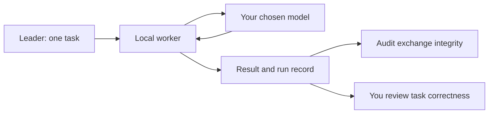

# toknish: trusted federation and compact model answers

> Walkthrough: collect auditable worker results, then test whether compact answers help your own tasks.

toknish provides a checkable receipt: result, evidence, what wasn't checked.
It helps you inspect an exchange; it does not prove that the task was done
correctly. Its compact-answer benchmark is a separate pilot.

| Feature | What it does for you | How it is enabled |
|---|---|---|
| **Repository transfer** | Send larger committed repositories and collect patches from compatible workers. | Automatic when both sides support it. |
| **Waiting for results** | Let the leader wait for a worker's result rather than repeatedly checking. | Automatic; `--longpoll-wait` adjusts the wait. |
| **Auditable exchange** | Keep a record whose integrity you can check later. Authentication can also be checked when you supply the run's shared token. | Opt in with `--wire toknish` or `--wire auto`. |
| **Compact answers** (toknish-M pilot) | Compare a structured answer with prose on the same questions. Savings must concern the answer, not hidden reasoning. | `tokn tkm bench` measures it; it does not enable a live answer mode. |

The federation below uses loopback addresses. Model requests go to the
provider you choose; the commands also write local run records and reports.
Local model inference does not by itself disable TOKN startup registration
or update checks. For an offline session, set `TOKN_NO_REGISTER=1` and
`TOKN_NO_UPDATE_CHECK=1`, stage the model beforehand, and review other
configured integrations.

Illustrative flow (the audit checks the exchange, not answer correctness):



```text
Result + recorded evidence -> audit the exchange
                          -> independently check the answer
```

## 0. What you need

| Requirement | Why | Check |
|---|---|---|
| TOKN (`tokn`) on your PATH, v0.3.90 or later | Ships `agent-worker`, `agent-leader`, `toknish` and `tkm` | `tokn version` |
| Git | Creates the committed synthetic repository sent to the worker | `git --version` |
| Ollama with a model pulled (recommended, offline) | Runs the bench and the worker's model locally | `ollama list` |
| *or* a cloud provider key in your trusted process environment (optional) | Use a hosted model instead of Ollama | see `.env.example` |
| A shared token, `TOKN_WORKER_TOKEN` | Authenticates leader and worker | set by the scripts for the session |

For the bash wrapper, also have `curl` available for the Ollama health check
(`curl --version`). It ships with macOS; on Debian/Ubuntu use
`sudo apt-get install curl`. Manual bash token generation below uses OpenSSL
(`openssl version`); PowerShell uses its built-in random generator.
Run the commands below from `examples/toknish`.

If Git is missing, install it before continuing: Windows
`winget install Git.Git`, macOS `brew install git`, or Debian/Ubuntu
`sudo apt-get install -y git`. For the Bash wrapper, install missing `curl`
with `brew install curl` on macOS or `sudo apt-get install -y curl` on
Debian/Ubuntu. The Linux Ollama install uses a versioned package from its
official download page; verify the checksum rather than piping an installer
script into a shell.

### Install Ollama and pull a model

Pick the command for your system, then pull the model:

- **Windows:** `winget install Ollama.Ollama`, or download the installer from https://ollama.com/download
- **macOS:** `brew install ollama`, or download the app from https://ollama.com/download
- **Linux:** Choose a specific Ollama release package from the [official download page](https://ollama.com/download), verify its published checksum, install it, then check `ollama --version`. Do not pipe a downloaded installer directly into a shell.

Then, on every system:

```bash
ollama pull qwen3:8b
ollama list
```

The model name is only an example. Choose a provider-supported model and
pass it with `--model`. Availability is not proof of tool-calling or
compact-answer reliability; the worker run and benchmark test those separately.

### Install TOKN

Use TOKN v0.3.90 or newer. Download a numbered release from the
[public releases page](https://github.com/bhakthan/tokn-dist/releases), verify
its published checksum, then add the binary to `PATH`. Do not pipe a mutable
remote installer into a shell. Open a new terminal and run `tokn version`.
If `tokn` is not found, the run scripts stop with an actionable hint.

## 1. Try it: a two-terminal loopback federation

This runs one worker and one leader on the same machine, talking over `127.0.0.1`. Both sides share one token.

### Step 1: set the shared token (both terminals)

The wrappers generate this token for one run if it is unset. If you set it
manually, use a unique secret in the process environment; `.env` is not read
for this value.

bash:

```bash
export TOKN_WORKER_TOKEN="$(openssl rand -base64 32)"
```

PowerShell:

```powershell
$b = New-Object byte[] 32
[System.Security.Cryptography.RandomNumberGenerator]::Create().GetBytes($b)
$env:TOKN_WORKER_TOKEN = [Convert]::ToBase64String($b)
```

Copy the generated value securely into the second terminal and set
`TOKN_WORKER_TOKEN` there. Do not generate a different value in each terminal.
Never write the token into a file you commit.

### Step 2: start the worker (terminal A)

The worker keeps run records in `--federation-dir`, which must be an absolute
path. Create a unique scratch folder under your system temp directory, outside
the example checkout. Create and commit a tiny repository so the leader can
explicitly send that content to the worker in step 3.

bash:

```bash
EXAMPLE_DIR="$PWD"
SCRATCH="${TMPDIR:-/tmp}/toknish-manual-$(date +%Y%m%d%H%M%S)-$$"
mkdir -m 700 "$SCRATCH"
mkdir -p "$SCRATCH/worker-state" "$SCRATCH/repo"
printf 'Synthetic TOKNish example.\n' > "$SCRATCH/repo/README.md"
git -C "$SCRATCH/repo" init -q
git -C "$SCRATCH/repo" add README.md
git -C "$SCRATCH/repo" -c user.name=demo -c user.email=demo@example.invalid commit -qm "sample"
printf 'In terminal B, set SCRATCH to: %s\n' "$SCRATCH"
cd "$SCRATCH"
tokn agent-worker --listen 127.0.0.1:8099 --worker-id w1 \
  --repo-root "$SCRATCH/repo" \
  --provider ollama --model qwen3:8b \
  --federation-dir "$SCRATCH/worker-state"
```

PowerShell:

```powershell
$EXAMPLE_DIR = (Get-Location).Path
$SCRATCH = Join-Path ([IO.Path]::GetTempPath()) "toknish-manual-$([guid]::NewGuid().ToString('N'))"
New-Item -ItemType Directory -Path (Join-Path $SCRATCH 'worker-state'), (Join-Path $SCRATCH 'repo') | Out-Null
Set-Content (Join-Path $SCRATCH 'repo\README.md') "Synthetic TOKNish example."
git -C (Join-Path $SCRATCH 'repo') init -q
git -C (Join-Path $SCRATCH 'repo') add README.md
git -C (Join-Path $SCRATCH 'repo') -c user.name=demo -c user.email=demo@example.invalid commit -qm "sample"
Write-Output "In terminal B, set SCRATCH to: $SCRATCH"
Set-Location $SCRATCH
tokn agent-worker --listen 127.0.0.1:8099 --worker-id w1 `
  --repo-root (Join-Path $SCRATCH 'repo') `
  --provider ollama --model qwen3:8b `
  --federation-dir (Join-Path $SCRATCH 'worker-state')
```

The worker offers the toknish profile by default. Add `--no-toknish` to turn it off and serve plain JSON only.

### Step 3: run the leader (terminal B)

Set `SCRATCH` to the exact unique path printed by terminal A.
Use `--wire auto`. The leader uses toknish with every worker that offers it, and plain JSON with the others.

bash:

```bash
SCRATCH='/paste/the/printed/path'
cd "$SCRATCH"
tokn agent-leader \
  --worker w1=http://127.0.0.1:8099 \
  --wire auto \
  --seed-repo "$SCRATCH/repo" \
  --federation-dir "$SCRATCH/leader-state" \
  --prompt "List the files in the repository root and say which one looks like a README." \
  --out "$SCRATCH/results.json"
```

PowerShell:

```powershell
$SCRATCH = 'PASTE_THE_PRINTED_PATH'
Set-Location $SCRATCH
tokn agent-leader `
  --worker w1=http://127.0.0.1:8099 `
  --wire auto `
  --seed-repo (Join-Path $SCRATCH 'repo') `
  --federation-dir (Join-Path $SCRATCH 'leader-state') `
  --prompt "List the files in the repository root and say which one looks like a README." `
  --out (Join-Path $SCRATCH 'results.json')
```

`--prompt` runs one ad-hoc task. For several dependent tasks, write a plan with `tokn workplan` and pass it with `--plan`. See the [federation walkthrough](../federation/README.md).

Expected, not a recorded run: the worker can identify `README.md`, and the
leader writes the result report. Inspect both the task status and answer;
a successful exchange alone does not establish a correct response.

### Step 4: confirm the wire that was negotiated

- **Session folder.** With `--wire auto`, a worker that does not offer the profile is served over plain JSON. A session subdirectory under the leader's `--federation-dir` appears only when toknish was used.
- **Strict check.** Run with `--wire toknish` instead. The leader refuses to use any worker that does not offer toknish, so a successful run confirms that every worker negotiated it.
- **Audit log.** The leader writes one subdirectory per session under `--federation-dir`. Its name is the session ID. Verify the chain offline:

```bash
tokn toknish audit "SESSION_ID" --dir "$SCRATCH/leader-state"
```

PowerShell:

```powershell
tokn toknish audit "SESSION_ID" --dir (Join-Path $SCRATCH 'leader-state')
```

Replace `SESSION_ID` with the session directory name.
The exit code tells you the result: `0` clean, `2` integrity failure,
`3` authentication failure, `4` incomplete. Keep the original
`TOKN_WORKER_TOKEN` set when auditing to check authentication too. Without a
token, authentication is **unverified**, even if integrity checks pass.
Add `--gloss` for a plain-English reading or `--json` for the report.
Neither a clean audit nor a gloss validates scientific claims, code behavior
or task completion.

### Step 5: clean up

Press Ctrl+C in terminal A to stop the worker. Review the printed temp path,
then remove only that run's folder when finished. No runtime output is written
into the example checkout.

## 2. Try it: benchmark compact model answers (toknish-M)

toknish-M asks the model for a compact structured answer. The bench runs
the same questions twice, once as prose and once in the compact format.
It checks answer quality, answer size and format compliance. It does not
compress or claim savings on the model's reasoning.

For a standalone bench, run TOKN from a fresh temp folder so run records and
reports stay out of this checkout. Keep `EXAMPLE_DIR` pointed at this folder;
reuse a unique `SCRATCH` path only for this run.

From the example folder, set these in the shell that will run the commands:

```bash
EXAMPLE_DIR="$PWD"
SCRATCH="${TMPDIR:-/tmp}/toknish-bench-$(date +%Y%m%d%H%M%S)-$$"
mkdir -m 700 "$SCRATCH"
cd "$SCRATCH"
```

```powershell
$EXAMPLE_DIR = (Get-Location).Path
$SCRATCH = Join-Path ([IO.Path]::GetTempPath()) "toknish-bench-$([guid]::NewGuid().ToString('N'))"
New-Item -ItemType Directory -Path $SCRATCH | Out-Null
Set-Location $SCRATCH
```

### (a) Smoke test with the built-in sample

```bash
tokn tkm bench --provider ollama --model qwen3:8b --sample
```

PowerShell:

```powershell
tokn tkm bench --provider ollama --model qwen3:8b --sample
```

The sample is a small embedded set. It is a smoke test that shows the pipeline works. It is far below the sample size needed for a decision, so it never passes the gate.

### (b) A dataset run

`dataset.json` in this folder has 12 synthetic cases. Four of them include `context` entries, which are tool output or file content the model may cite. Run it and save the full report:

```bash
tokn tkm bench --provider ollama --model qwen3:8b \
  --dataset "$EXAMPLE_DIR/dataset.json" --out "$SCRATCH/bench-report.json"
```

PowerShell:

```powershell
tokn tkm bench --provider ollama --model qwen3:8b `
  --dataset (Join-Path $EXAMPLE_DIR 'dataset.json') --out (Join-Path $SCRATCH 'bench-report.json')
```

Add `--n` to cap how many cases run, `--retries` to set re-asks, and `--seed` to make the bootstrap repeatable. Use `--json` to print the whole report instead of the summary.

To bench a cloud model, set `--provider` and `--model` to your provider's
values. The scripts import only `OPENAI_API_KEY` and `ANTHROPIC_API_KEY` from
an untracked `.env`; keep credentials in a trusted process environment and put
any other provider key directly in the trusted process environment.
The worker token is never loaded from `.env`.

### Reading the bench report

The summary prints one row per arm, `prose` and `tkm` (the frame), with these columns:

| Field | What to look at |
|---|---|
| `pass` | Share of cases whose answer contains the expected text. Compare `tkm` with `prose`. |
| `mean-out` | Provider-reported output usage. Do not read this alone as answer savings. |
| `mean-answer` | Answer-token accounting with reasoning excluded when the provider makes that measurable. |
| `p50` | Median latency. |
| `errors` | Requests that failed outright. |
| Answer ratio | Compact answer size relative to prose, excluding reasoning. Unmeasurable accounting cannot establish savings. |
| Violations | Frame answers that broke a rule, on the first attempt and after a re-ask, plus the counts of fallbacks, free-text answers and alias hits. A high number means the model is not following the frame. |
| Calibration (`n`, `ECE`, `Brier`) | How well the stated confidence matches reality. Lower `ECE` and `Brier` are better. |
| Gate | Whether there is enough paired evidence and whether quality, answer-size and format checks all pass. |

The gate requires sufficient paired cases **and** acceptable quality,
answer-size and format results. A small sample is insufficient evidence,
not a successful savings result. If the provider does not report reasoning
usage separately, answer savings are unmeasurable and cannot pass the gate.
Passing on your dataset is pilot evidence for that model and task set,
not a general performance guarantee or a switch that enables live use.

The JSON report written by `--out` contains every row. Use it for the exact definitions of each field.

## Preflight and run scripts

`run-local.ps1` (PowerShell) and `run-local.sh` (bash) do the whole loopback run and the bench in one go. Before doing anything, they check for:

1. `tokn` on your PATH.
2. The provider: Ollama installed and reachable, with the model pulled. For a cloud provider, they remind you to set its key in the trusted process environment or in an optional, allowlisted `.env`.
3. A shared token. If `TOKN_WORKER_TOKEN` is not set, they create one for the run only and do not write it to disk.

If something is missing, they stop with a message naming the problem and the command that fixes it.

```bash
./run-local.sh                       # uses qwen3:8b on Ollama
./run-local.sh llama3.2             # positional model argument
```

PowerShell:

```powershell
./run-local.ps1                      # uses qwen3:8b on Ollama
./run-local.ps1 -Model llama3.2
```

The bash wrapper takes `[MODEL] [PROVIDER]`; PowerShell uses `-Model` and
`-Provider`. These scripts start a worker, run model calls and write to a unique folder
under the system temp directory, outside the checkout. They are not read-only
preflight commands. Each stops
its worker on exit. Check individual command results: the wrapper's final
message alone does not establish an audit or benchmark pass.
Unlike the manual walkthrough, the wrappers do not pass `--seed-repo`.
Use the manual seeded run to test whether a worker received committed
repository content; the wrapper's file-listing answer does not establish that.

## Files

| File | What it is |
|---|---|
| `README.md` | This walkthrough |
| `dataset.json` | 12 synthetic cases for the bench, with `context` on four |
| `run-local.ps1`, `run-local.sh` | Preflight and the full local run |
| `.env.example` | Blank cloud-provider key fields. The wrappers load only the listed API keys. |
| `.gitignore` | Keeps `scratch/`, `.env` and bench reports out of git |

## Troubleshooting

- **`tokn` not found.** Open a new terminal after installing, then run `tokn version`.
- **Worker unreachable.** Check that the worker is still running in terminal A and that `--listen` and `--worker` use the same port.
- **`--wire toknish` fails.** The worker does not offer the profile. Remove `--no-toknish` from the worker, or use `--wire auto`.
- **`toknish audit` exits `3`.** The token in your audit command is not the token the run used. Check `TOKN_WORKER_TOKEN`.
- **Bench gate reports insufficient cases.** Expected with `--sample` or this small dataset. Use a larger representative dataset; more cases alone do not satisfy the other checks.
- **Answer ratio is unmeasurable.** The provider has not separated reasoning usage from answer usage. Do not substitute total tokens and claim savings.
- **Ollama model missing.** Run `ollama pull <model>` with the same name you pass to `--model`.

## Related

- [federation](../federation/README.md): the leader and worker basics, with two workers and a work plan
- [quality-flywheel](../quality-flywheel/README.md): grading a dataset against a baseline
- [evidence-earned-prompting](../evidence-earned-prompting/README.md): evidence-cited prompt patches
